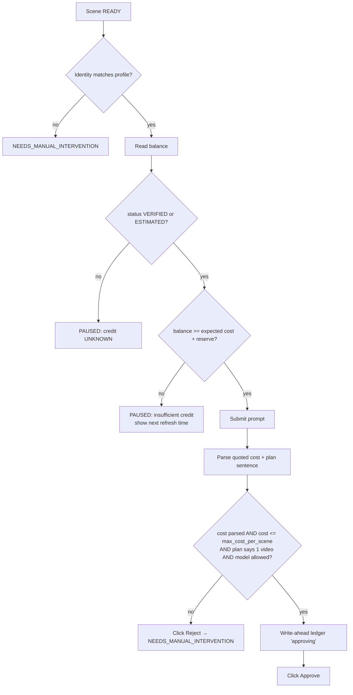

# WP-0.5 — Account and Credit Architecture

> **Ringkasan (ID):** Identitas akun dan saldo kredit **bisa dibaca langsung dari tampilan Flow** (terverifikasi): panel "Account details" menampilkan nama + email, "**40 Google Flow credits**", dan "**Credits refresh daily at 3:37 PM**". Biaya setiap generate juga tampil sebelum kredit dipakai ("costing 10 credits"). Jadi OCR **tidak diperlukan**. Fakta penting: dengan tier akun saat ini, 1 video = 10 kredit, sehingga 36 adegan butuh ±360 kredit, sementara saldo harian tampaknya ±50. Sistem **tidak akan** memutar banyak akun secara otomatis untuk "mengakali" batas kredit harian. Pilihan yang sah: produksi bertahap per hari, upgrade langganan, atau Anda sendiri yang memilih akun lain yang memang Anda miliki dan berhak dipakai.

## 1. What Flow exposes (evidence)

| Information | Where | Example | Status |
|---|---|---|---|
| Identity (name + email) | `button "Account details"` → child button name `"Google Account: <name> (<email>)"`; dialog text | redacted | VERIFIED (E-FLOW-02, -17) |
| Credit balance | `dialog "Account settings"` → `link` named `"<N> Google Flow credits"` | `40 Google Flow credits` | VERIFIED once (E-FLOW-17) |
| Refresh schedule | text in same dialog | `Credits refresh daily at 3:37 PM` | VERIFIED once |
| Cost of a pending video generation | agent message before approval | `…costing 10 credits?` | VERIFIED once (E-FLOW-12) |
| Cost of an image edit | image editor settings | `Generating will use` + `0 credits` | VERIFIED once (E-FLOW-07) |
| Tier restrictions | download menu, tools page | `1080p Upscaled [disabled]` + `Upgrade`; `Upgrade to create tools` | VERIFIED |
| Credit consumption | balance before − after | 10 credits for 1× Veo 3.1 Lite 8 s | PARTIALLY VERIFIED — balance before the test was not read; 50 is inferred |
| Insufficient-credit message | — | — | **UNVERIFIED** (not triggered) |
| Session-expired state | — | Landing page `/about` when logged out | PARTIALLY VERIFIED (E-FLOW-01) |
| Account-specific errors | — | — | UNVERIFIED |

Method: only visible DOM via accessibility snapshot. No private APIs, no network interception, no cookie or token access. The credit links point to `one.google.com` pages; the app never follows them automatically.

**OCR**: not needed — all values are in accessible text. Tesseract is not installed; OCR stays a documented fallback, not a dependency.

## 2. Credit data model

```python
class CreditStatus(str, Enum):
    VERIFIED = "VERIFIED"        # read from DOM within freshness window (default 10 min) and parsed
    ESTIMATED = "ESTIMATED"      # last verified balance minus confirmed costs since then
    UNKNOWN = "UNKNOWN"          # could not read/parse; production must not spend
    UNAVAILABLE = "UNAVAILABLE"  # account/tier exposes no balance, or dialog missing

class CreditSnapshot(BaseModel):
    account_id: str
    balance: int | None
    status: CreditStatus
    refresh_text: str | None     # raw, e.g. "Credits refresh daily at 3:37 PM"
    next_refresh_at: datetime | None   # parsed in local TZ when possible
    read_at: datetime
    source: Literal["account_dialog", "ledger_estimate"]
    evidence_path: str | None

class CreditLedgerEntry(BaseModel):          # append-only, SQLite
    account_id: str
    scene_attempt_id: str
    quoted_cost: int | None      # parsed from "costing N credits"
    approved_at: datetime | None
    outcome: Literal["approved", "rejected", "aborted_before_approve", "unknown_after_crash"]
```

## 3. Spending gate (per generation)



- `max_cost_per_scene` defaults to the observed 10 and is configurable per episode.
- **Never click "Always approve"**, and never set the project setting "Confirm before generating" to `Never`. At start-up the adapter verifies this setting is `Always`; otherwise it pauses (the confirmation step is the main protection against unintended spending).

## 4. Account manager responsibilities

| Responsibility | Mechanism |
|---|---|
| Identify active account | Read `"Google Account: … (<email>)"` accessible name |
| Validate identity | Compare with the profile's expected email (stored as label + SHA-256 hash; email is shown to the user only in the UI) |
| Isolated sessions | One Chrome user-data-dir per account (see browser architecture) |
| Record status | `ACTIVE`, `LOGIN_REQUIRED`, `IDENTITY_MISMATCH`, `CREDIT_EXHAUSTED_UNTIL(<time>)`, `RESTRICTED`, `DISABLED_BY_USER` |
| Check credit | Account dialog read before each scene + ledger estimate between reads |
| Pause | On insufficient/unknown credit, identity mismatch, login required |
| Resume | Only after the user picks the account (or confirms waiting for the same account's refresh) |

## 5. Usage policy — what account switching may and may not do

Discovery shows a **hard budget mismatch**: ~360 credits per 36-scene episode vs. a daily balance of roughly 50 on this account (inferred). This creates an obvious temptation to rotate many accounts automatically. The architecture deliberately does **not** do that:

Allowed:
- Several accounts that the user legitimately owns and is entitled to use (e.g. a personal and a business/Workspace account, or accounts with their own paid subscriptions).
- **User-initiated** switch: production pauses; the user chooses another account in the UI; the app validates identity and continues.
- Waiting for the same account's daily refresh (scheduler resumes after `next_refresh_at`, if the user enabled "resume after refresh").
- Upgrading the subscription.

Not allowed (not implemented, by design):
- Automatic rotation to the next account when one runs out of credit.
- Creating accounts, or encouraging multiple free accounts to multiply free quota.
- Hiding automation, randomising fingerprints, spoofing, or bypassing CAPTCHA/MFA/verification.
- Parallel generation on several accounts at once to exceed limits.

The user should check Google's Terms of Service and the Google AI / Flow usage policies for their plan; whether a given multi-account setup is permitted is the user's responsibility and is **not** something Phase 0 could verify.

## 6. Credit planning feature (PROPOSED)

Before starting an episode, show: scenes remaining × expected cost per scene vs. known balance and refresh time, e.g. *"Episode needs ~360 credits; account A has 40 (refresh 15:37 daily). Estimated 8 days on this account alone."* The user then decides (wait / upgrade / choose another of their accounts).

## 7. Open items

1. Read balance before and after a generation to confirm the exact per-clip cost (Phase 2).
2. Capture insufficient-credit UI text (Phase 2/5, when balance < cost).
3. Confirm refresh amount (daily allowance) by reading the balance right after refresh.
4. Check whether the cost differs by model (Veo 3.1 Lite vs others) and by output count (x1–x4).
5. User decision on subscription tier / production pace (see Final Audit, U-02).
