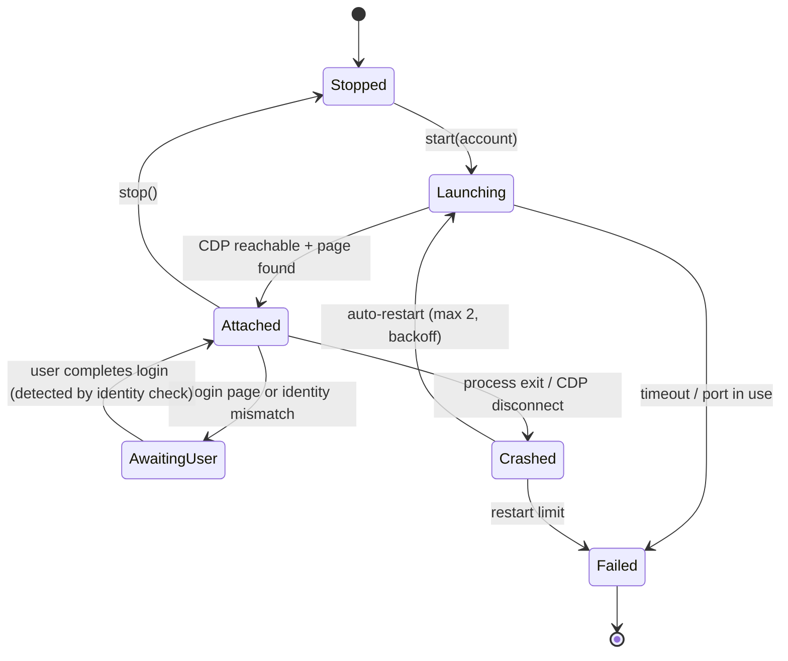

# WP-0.4 — Browser Automation Architecture

> **Ringkasan (ID):** Rekomendasi: jalankan **Google Chrome asli** (bukan Chromium bawaan Playwright) dengan **satu folder profil terpisah per akun Google**, dibuka sebagai browser biasa yang terlihat (*headed*). Playwright lalu "menempel" ke Chrome lewat port lokal (CDP). Cara ini **sudah terbukti** saat discovery: login Google berjalan normal, upload (file chooser) bisa ditangkap, dan download bisa disimpan. Mode *headless* (tanpa jendela) **tidak** direkomendasikan sampai benar-benar diuji. Browser Engine dipisah dari Production Engine supaya bisa diganti tanpa mengubah logika produksi.

## 1. Options compared

| Option | Description | Google login | Evidence | Recommendation |
|---|---|---|---|---|
| **A. Real Chrome launched normally + CDP attach** | App starts `Google Chrome --user-data-dir=<profile> --remote-debugging-port=<random> --remote-debugging-address=127.0.0.1`; Playwright `connect_over_cdp` | **Worked**: user logged in, no blocking reported | E-FLOW-19, all E-FLOW evidence | **Primary (VERIFIED)** |
| B. `launch_persistent_context(channel="chrome")` | Playwright launches Chrome with automation flags | Google may show "This browser or app may not be secure" for sign-in in automation-controlled browsers | Not tested | Phase 1 experiment only (UNVERIFIED) |
| C. Playwright bundled Chromium | Downloads ~150–300 MB browser | Same concern as B; also not the user's real Chrome | Not tested; not downloaded (disk) | Not recommended |
| D. Headless (new headless) | No window | Google Flow + Google sign-in compatibility unknown; higher detection/blocking risk; no manual takeover | Not tested | **Do not adopt** until tested in a later phase |
| E. Minimised headed | Option A with window minimised | Same as A | Rendering while minimised/occluded (timers throttled, video thumbnails) UNVERIFIED | Test in Phase 1; acceptable if downloads/progress still work |

Why A: Chrome started normally carries no `--enable-automation` flag, so sign-in, MFA and CAPTCHA are done by the user exactly as in daily use. Chrome (since v136) refuses remote debugging on the **default** data directory, which is a safety benefit: the app can only attach to its own dedicated profiles.

## 2. Profile layout and isolation

```
<workspace>/profiles/
  <account_id>/           # one Chrome user-data-dir per Google account (mode 700)
    chrome/               # Chrome data (cookies, cache) — never read by the app
    profile.json          # app metadata: expected_email_hash, label, created_at
```

- One Google account per profile directory. Do **not** use Google's in-profile multi-login (`Switch account` link) — it mixes sessions in one cookie jar and makes identity ambiguous.
- Only one profile active at a time on this machine (8 GiB RAM; each Chrome ~242 MB on disk after one session, E-ENV-05).
- Profiles must live on the encrypted disk (FileVault is On, E-ENV-04) and never in git, cloud-synced folders or backups that leave the machine.
- The user's personal Chrome profiles (`~/Library/Application Support/Google/Chrome`) are never touched.

## 3. Browser Engine interface (contract)

```python
class BrowserEngine(Protocol):
    def start(self, account_id: str) -> BrowserSession: ...       # launch Chrome for that profile, attach
    def stop(self, graceful: bool = True) -> None: ...
    def health(self) -> BrowserHealth: ...                         # process alive, CDP reachable, page responsive
    def page(self) -> Page: ...                                    # the single Flow tab
    def expect_download(self, action: Callable[[], None], dest: Path, timeout_s: float) -> DownloadResult: ...
    def set_upload_files(self, trigger: Callable[[], None], files: list[Path]) -> None: ...
    def capture(self, label: str) -> CaptureBundle: ...            # used by Inspector
    def bring_to_front_for_user(self, reason: str) -> None: ...    # manual takeover
```

The Production Engine only sees this interface and the `FlowAdapter` interface (see `SYSTEM_ARCHITECTURE.md`). Nothing outside the Browser Engine imports Playwright.

## 4. Lifecycle



- Port: choose a free random port per launch, bound to `127.0.0.1` only (VERIFIED flag usage, E-FLOW-19).
- Detect crash: Playwright `browser.on("disconnected")` + process poll. Any crash moves the current scene to recovery (`PRODUCTION_STATE_MACHINE.md`).
- After restart, the engine navigates to the scene's saved `flow_project_url`, never re-submits anything by itself.

## 5. Downloads

VERIFIED (E-FLOW-15): over CDP, `page.expect_download()` captured the 720p download (`blob:` URL, 0.5 s) and `save_as()` wrote it.

Rules:
1. Always download through `expect_download` into `<workspace>/tmp/downloads/<job>/<attempt>.part`, then validate, then atomically move to the final asset path (`os.replace`).
2. Never trust `suggested_filename` for the final name; it is stored as metadata only (`Cat_waving_to_camera_24b5daf0.mp4`).
3. Check free disk space before download (≥ 2 GB margin; disk is 98 % full).
4. Compute SHA-256; a second download with the same hash is a duplicate and is discarded.

## 6. Uploads

PARTIALLY VERIFIED (E-FLOW-10): `expect_file_chooser()` around `Upload media` intercepts the chooser (`multiple=True`, accepts png/jpg/webp/heic/mp4/mov…). `file_chooser.set_files()` and the post-upload state are not yet tested.

Rules: only upload files from the app's own asset directory; re-encode extracted frames to PNG with a safe generated name before upload; wait for the new asset to appear (`data-media-id` not present before) before attaching.

## 7. Session expiry and identity

- Before each scene: open the account dialog (or read `button "Google Account: …"` name) and compare the email against the profile's expected identity (stored as a salted hash plus the user-visible label). Mismatch ⇒ `NEEDS_MANUAL_INTERVENTION`.
- Logged-out detection: redirect to `flow.google.com/about` or `accounts.google.com` (landing page observed before login, E-FLOW-01). Exact logged-out DOM of a `/project/` URL is UNVERIFIED.
- The app never types credentials. On expiry it brings the window to the front and waits for the user.

## 8. Manual takeover

- A "Take over" button in the UI pauses the scheduler **after** the current atomic step and brings Chrome to the front.
- While paused, the engine does not send input events. On "Resume", the Flow Adapter re-inspects the page (health check + reconciliation) before doing anything.

## 9. Headless policy

Headless is out of scope until a dedicated compatibility test (Phase 6+) shows that login persistence, generation, progress and downloads behave identically. Even then, the first run of each session stays headed.

## 10. Risks

| Risk | Mitigation |
|---|---|
| Google blocks sign-in in automated browsers | Option A (no automation flags) — verified working |
| CDP port reachable by other local processes | Bind 127.0.0.1, random port, close Chrome when idle; profile dir 700 |
| Chrome auto-update changes behaviour | Record Chrome version in every run; Inspector pre-flight |
| Background-tab throttling when minimised | Test in Phase 1; keep window visible if needed |
| Multiple tabs confuse page selection | Engine owns exactly one Flow tab and closes others it opened |
