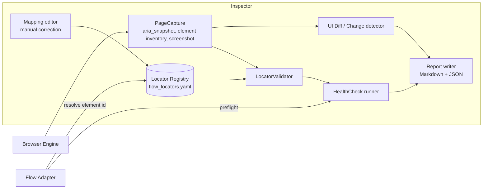

# WP-0.3 — Flow UI Inspector Architecture

> **Ringkasan (ID):** Flow UI Inspector adalah alat diagnostik yang membaca tampilan Flow (struktur aksesibilitas, elemen, screenshot), lalu mengecek apakah setiap "alamat tombol" (locator) yang dipakai otomasi masih valid. Semua locator disimpan di satu *registry* (file YAML) per workflow. Jika ada locator yang gagal divalidasi, produksi **berhenti dengan aman** dan pengguna diberi laporan, bukan menebak-nebak klik. Desain ini berdasarkan pengalaman nyata saat discovery: dua skrip kecil (`evidence/tools/flow_probe.py`, `flow_click.py`) sudah membuktikan pendekatannya bekerja.

Status: **PROPOSED** design. The read-only capture technique (ARIA snapshot + element inventory + screenshot over CDP) is **VERIFIED** — it produced all evidence in `evidence/aria/` (E-FLOW-01…20).

## 1. Purpose and boundaries

The Inspector:
- observes the page, validates locators and produces reports;
- **never** clicks credit-consuming or outward-facing controls (it refuses names on a deny-list such as `Start generation`, `Approve`, `Always approve`, `Generate`, `Publish to YouTube`, `Share`, `Move to trash`, `Delete all`). The tile-menu `Animate` item spends no credits (E-FLOW-23), but production uses it only through the Flow Adapter;
- never reads cookies, `localStorage`, network bodies or auth headers;
- is used by the Flow Adapter at runtime (pre-flight health check) and by the developer/user as a CLI/desktop tool.

## 2. Components



| Component | Responsibility |
|---|---|
| `PageCapture` | `locator("body").aria_snapshot()`, a JS element inventory (tag, role, name, safe attributes, bounding box — same as `flow_probe.py`), full-page screenshot. Redacts emails and the account name before writing. |
| `LocatorRegistry` | Loads/saves the YAML registry, schema-validated with Pydantic. Versioned in git. |
| `LocatorValidator` | Resolves one entry against the live page and applies its validation rules. |
| `HealthCheck` | Runs all entries for a workflow *state* (e.g. "composer idle") and returns `HEALTHY / DEGRADED / BROKEN`. |
| `UIDiff` | Compares a new ARIA snapshot with the last known-good one for the same state; reports added/removed/renamed roles+names. Ignores known-volatile nodes (suggestion chips, tile list, chat text). |
| `ReportWriter` | `inspections/<timestamp>/<state>.{aria.yaml,elements.json,png,report.md}`. |
| `MappingEditor` | UI/CLI to accept a proposed replacement locator, which writes the registry with `status: VERIFIED`, new timestamp and the evidence path. |

## 3. Locator strategy priority

As required, and confirmed by discovery (`FLOW_UI_DISCOVERY.md` §4):

1. `role` + accessible `name` (exact), **scoped to a container** — primary.
2. `label` / `placeholder` — Flow's prompt textboxes expose their placeholder as the accessible name, so (1) covers them.
3. Stable attributes / URL patterns: `data-media-id`, `/edit/<uuid>`, `/project/<uuid>`.
4. Validated CSS — only for elements without role/name; never Angular `_ngcontent-*`/`_nghost-*` attributes or Material class names.
5. Visual recognition (OpenCV template match) — **diagnostic fallback only**: used to *locate a region for the user's attention* or to confirm a screenshot state, never to click by coordinates in production. Not needed by any element found so far; OpenCV is therefore **not** a Phase 1 dependency.

## 4. Registry format

One YAML file, keyed by workflow and element ID. Example entries use only values that were **actually observed**:

```yaml
schema_version: 1
flow_ui_fingerprint: "2026-11-02/angular-material/agent-composer"
workflows:
  composer:
    container:
      strategy: role
      role: complementary          # UNVERIFIED: panel container role not captured; Phase 1 must choose a scope
      fallback_note: "scope via heading level=2 inside session panel"
    elements:
      prompt_input:
        strategy: role
        role: textbox
        name: "What do you want to create?"
        exact: true
        expected: {tag: div, editable: true}
        validate: [unique, visible, enabled]
        status: VERIFIED
        verified_at: "2026-11-02T13:33:00+07:00"
        evidence: evidence/aria/16-prompt-ready.aria.yaml
      add_ingredient:
        strategy: role
        role: button
        name: "Add ingredients to the prompt box"
        validate: [unique, visible, enabled]
        status: VERIFIED
        verified_at: "2026-11-02T13:20:00+07:00"
        evidence: evidence/aria/02-composer-plus.aria.yaml
      send:
        strategy: role
        role: button
        name: "Start generation"
        validate: [unique, visible]
        credit_sensitive: true          # inspector may resolve but never click
        status: VERIFIED
  cost_confirmation:
    elements:
      permission_group: {strategy: role, role: radiogroup, name: "Permission options", status: VERIFIED}
      approve:          {strategy: role, role: radio, name: "Approve", within: permission_group, credit_sensitive: true, status: VERIFIED}
      reject:           {strategy: role, role: radio, name: "Reject", within: permission_group, status: VERIFIED}
      cost_text:
        strategy: text_regex
        pattern: "costing (\\d+) credits?"
        status: PARTIALLY_VERIFIED      # observed once; LLM wording may vary
  tile_menu:
    container: {strategy: role, role: group, name: "{tile_title}"}   # flow-grid-tile-container; hover first
    elements:
      more_options: {strategy: role, role: button, name: "More options", within: container, requires: hover, status: VERIFIED}
      animate:      {strategy: role, role: menuitem, name: "Animate", within: {role: menu}, status: VERIFIED, notes: "image tiles only; attaches ingredient"}
      publish_youtube: {strategy: role, role: menuitem, name: "Publish to YouTube", deny: true, status: VERIFIED}
    preconditions: ["grid scrolled to top", "no open cdk-overlay-backdrop"]
  result_download:
    elements:
      download_button: {strategy: role, role: button, name: "Download media", status: VERIFIED}
      download_720p:   {strategy: role, role: menuitem, name: "720p Original size", status: VERIFIED}
  account:
    elements:
      account_button: {strategy: role, role: button, name: "Account details", status: VERIFIED}
      credit_link:
        strategy: role_regex
        role: link
        name_pattern: "^(\\d+) Google Flow credits$"
        within: {role: dialog, name: "Account settings"}
        status: VERIFIED
```

Required fields per entry: `workflow`, `element id`, `strategy`, locator value(s), `expected` element type, `validate` rules, `status` (`VERIFIED | PARTIALLY_VERIFIED | UNVERIFIED | BROKEN | DEPRECATED`), `verified_at`, `evidence`. Optional: `within`, `credit_sensitive`, `volatile`, `notes`.

## 5. Validation rules and fail-safe behaviour

| Rule | Meaning |
|---|---|
| `unique` | exactly one match inside the scope |
| `visible` / `enabled` / `disabled` | state assertion |
| `name_regex` | accessible name matches pattern |
| `attr` | attribute equals/matches |
| `count_min` | for lists (tiles) |
| `within` | must resolve inside a container entry |

Resolution algorithm:

1. Resolve the container, then the element, with a short timeout (default 5 s, per-entry override).
2. Apply rules. Any failure ⇒ `LocatorError(element_id, rule, evidence_capture_path)`.
3. The Flow Adapter **does not retry with a weaker locator automatically** for `credit_sensitive` elements. It stops the job in `NEEDS_MANUAL_INTERVENTION`, captures the page and opens the Inspector report.
4. For non-credit elements, a registry may define an ordered `fallbacks:` list; each fallback must itself be `VERIFIED`. A fallback hit marks the run `DEGRADED` and is logged.

`UNVERIFIED` entries can be used only in an explicit "discovery" run, never in production.

## 6. Health checks

Health checks are defined per UI **state**, because many elements exist only in one state:

| State | Required entries |
|---|---|
| `project_idle` | `Project navigation`, `prompt_input`, `add_ingredient`, `send [disabled]` |
| `ingredient_picker_open` | `Asset list` listbox, `Upload media`, `Add to prompt` |
| `awaiting_cost_confirmation` | `permission_group`, `approve`, `reject`, `cost_text` |
| `media_detail_video` | `Download media`, `Total duration` text, stored prompt text |
| `account_dialog` | `credit_link`, refresh text, identity text, `Close account panel` (Escape does not close it, E-FLOW-21) |
| `tile_menu_open` | `menu` with the expected items for the tile type (image: `Animate`; video: `Add to scene`) |

General preconditions learned in discovery: scroll the grid to the top before resolving top-bar elements, and make sure no `cdk-overlay-backdrop` is open before hovering tiles (E-FLOW-21). Read ingredient chips; never click them, because clicking removes them (E-FLOW-25).

Production runs `project_idle` before every scene and the matching state check before each credit-sensitive step.

## 7. UI change detection

- Store a normalised ARIA snapshot per state as `baselines/<state>.aria.yaml` (volatile subtrees removed: tile groups, chat messages, suggestion chips, timestamps).
- On each pre-flight, diff against the baseline. Classes of change: `ROLE_NAME_REMOVED` (blocking if referenced), `ROLE_NAME_ADDED` (info), `NAME_CHANGED` (blocking if referenced).
- A blocking diff pauses production with a report listing the referenced element IDs and screenshots.

## 8. Manual correction flow

1. Inspector shows the failing entry, the current snapshot around the old location, and candidates (same role, similar name — Levenshtein ≤ 3 — or same position in the tree).
2. User or developer picks a candidate; the editor runs the entry's validation rules live.
3. On success the registry entry is updated (`status: VERIFIED`, `verified_at`, `evidence`) and committed; the old value is kept under `history:`.

## 9. Reports

`report.md` + `report.json` contain: Flow URL pattern (UUIDs kept, query strings stripped), Chrome and Playwright versions, registry version, per-entry result, diff summary, screenshots, and redaction confirmation. No cookies, storage, or headers are ever included.

## 10. Proven building blocks

`evidence/tools/flow_probe.py` and `flow_click.py` are the discovery prototypes (not production code). They demonstrate: CDP attach, ARIA snapshot, element inventory, screenshot, role+name click with a credit deny-list. Phase 1 rewrites them properly inside the `inspector` package.
