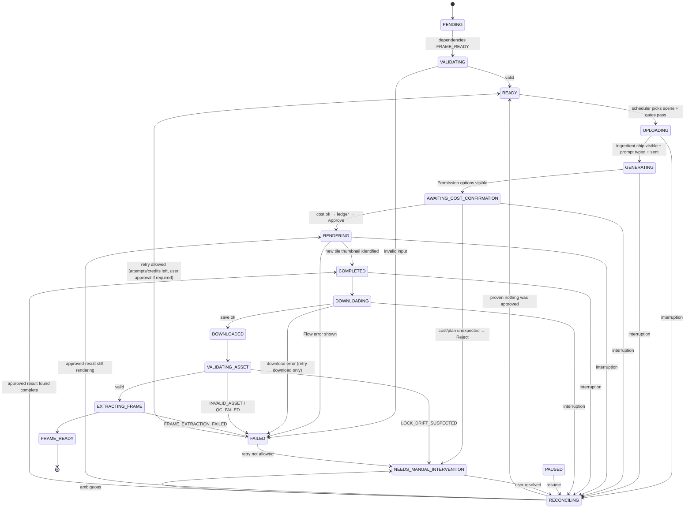

# WP-0.7 — Production State Machine and Recovery

> **Ringkasan (ID):** Setiap adegan punya "status" yang disimpan di database SQLite **sebelum** aksi penting dilakukan (prinsip *write-ahead*). Kalau browser crash, aplikasi ditutup, atau komputer restart, sistem tahu persis adegan mana yang sedang di tahap apa. Hal terpenting: **sebelum generate ulang, sistem selalu memeriksa dulu apakah video sudah ada di Flow**, supaya kredit tidak terbuang. Ada dua status tambahan (berdasarkan temuan discovery): `AWAITING_COST_CONFIRMATION` (Flow menanyakan biaya kredit) dan `RECONCILING` (mencocokkan kondisi Flow setelah gangguan).

Status: **PROPOSED**. The Flow signals the machine relies on (cost confirmation, tile progress %, thumbnail on completion, `/edit/<uuid>` media URL, blob download, ffprobe validation, last-frame extraction) are **VERIFIED once** (E-FLOW-12…16). Failure signals are UNVERIFIED.

## 1. States

| State | Meaning | Persisted data written on entry |
|---|---|---|
| `PENDING` | Scene known; dependencies not yet satisfied | — |
| `VALIDATING` | Validate scene inputs (locks, start-frame file, prompt assembly) | assembled prompt + hash |
| `READY` | Inputs valid, dependencies done, waiting for scheduler slot | — |
| `UPLOADING` | Attaching start image: upload local file or pick existing Flow asset | attempt row: `attempt_id`, `account_id`, `pre_submit_media_ids` (snapshot of tiles), upload file hash |
| `GENERATING` | Prompt typed and **sent** to the agent ("Start generation"); agent thinking | `submitted_at` |
| `AWAITING_COST_CONFIRMATION` *(added)* | Agent asked "…costing N credits?"; cost and plan are being checked | `quoted_cost`, plan sentence |
| `RENDERING` | Approve clicked (ledger written *before* click); tile shows % | `approved_at`, ledger entry |
| `COMPLETED` | Flow shows the generated thumbnail; result identified | `flow_media_id`, `flow_title`, stored prompt |
| `DOWNLOADING` | Download in progress to `.part` file | temp path |
| `DOWNLOADED` | File saved, size > 0 | path, size, SHA-256 |
| `VALIDATING_ASSET` | ffprobe + full decode + expectations (ratio, duration ± 1 s, has video stream) + lock-drift check on stored prompt | probe JSON, QC result |
| `EXTRACTING_FRAME` | FFmpeg last-frame extraction | — |
| `FRAME_READY` | **Terminal success**: all outputs for this scene version are ready (frame present if `extract_final_frame`) | frame path + hash, manifest commit |
| `RECONCILING` *(added)* | After any interruption: inspect Flow for an existing result of this attempt before doing anything that costs credits | reconciliation report |
| `PAUSED` | Stopped by user or by a gate (credit, disk); `resume_to` stored | reason, `resume_to` |
| `NEEDS_MANUAL_INTERVENTION` | Automation cannot decide safely (locator broken, identity mismatch, ambiguous result, lock drift) | reason, capture bundle path |
| `FAILED` | Attempt failed definitively; retry policy decides next | error code |
| `CANCELLED` | User cancelled the scene/episode | — |

Why the additions:
- **`AWAITING_COST_CONFIRMATION`** — discovery proved Flow inserts a mandatory approval step that quotes the cost (E-FLOW-12). Crashing *before* vs. *after* Approve has different credit consequences, so it must be a persisted state.
- **`RECONCILING`** — the brief requires inspecting existing Flow results before retrying. Making it a state guarantees that every resume path passes through it.

## 2. Transitions

Any non-terminal state may go to `PAUSED` (user/gate) or `CANCELLED` (user). `PAUSED` always resumes through `RECONCILING`, never directly into a credit-sensitive state.

Local-only steps (`DOWNLOADED` → `FRAME_READY`) can be re-run from the saved file without touching Flow.

## 3. Checkpointing rules

1. **Write-ahead**: the state row and attempt fields are committed to SQLite (WAL mode, `synchronous=FULL`) *before* the browser action that the state describes. The ledger entry `approving` is committed before clicking Approve.
2. One transaction per transition: `UPDATE scene_attempt …; INSERT INTO state_event …`. The event log is append-only.
3. Files: write to `*.part`, `fsync`, then `os.replace` to final name; record hash after the move.
4. The episode manifest (`manifest.json`) is regenerated from SQLite after each `FRAME_READY`; it is a mirror, not the source of truth.
5. Daily SQLite backup with `sqlite3 .backup` (online backup API), keeping 7 copies.

## 4. Result identification (core of reconciliation)

Because Flow titles are generated by the agent and the video tile showed no `data-media-id` (E-FLOW-18), the result of an attempt is identified by **set difference**:

1. In `UPLOADING`, store the set of existing tiles (names + any `data-media-id`) as `pre_submit_media_ids`.
2. After Approve, the *new* tile(s) not in that set, appearing after `submitted_at`, belong to this attempt. VERIFIED once: exactly one new tile appeared at the top of the grid (E-FLOW-13).
3. Opening the tile yields `/edit/<media-uuid>`; this UUID becomes `flow_media_id` (stable key).
4. The stored generation prompt and ingredient on that page are recorded and checked against the attempt.
5. If zero or more than one candidate exists ⇒ `NEEDS_MANUAL_INTERVENTION` (never guess).

Risk: the user generating manually in the same project during production breaks the set-difference assumption. Mitigation: dedicated Flow project per episode (PROPOSED) and "take over" pausing.

## 5. Failure scenarios

| # | Scenario | Detection | Recovery | Credit risk |
|---|---|---|---|---|
| 1 | Browser crash during rendering | CDP disconnect / process exit while `RENDERING` | Restart browser → `RECONCILING`: open project, find new tile via set difference; if % ⇒ `RENDERING`, if thumbnail ⇒ `COMPLETED`. **No re-submit.** | None (re-submit avoided) |
| 2 | Crash after rendering, before download | Crash in `COMPLETED`/`DOWNLOADING` | `RECONCILING` → open `flow_media_id` URL directly → download again | None |
| 3 | Download interruption | `download.failure()` non-null, timeout, or `.part` left | Delete `.part`; retry download up to 3× (no Flow generation) | None |
| 4 | Duplicate download | Same SHA-256 as an existing asset of this scene | Keep the first, discard the second, log `DUPLICATE_DOWNLOAD` | None |
| 5 | Invalid video file | ffprobe error, decode error, no video stream, duration ≠ expected ±1 s, wrong ratio | Re-download once; if still invalid ⇒ `FAILED(INVALID_ASSET)` → retry policy (costs credits, requires approval by default) | Possible, gated |
| 6 | Final-frame extraction fails | FFmpeg non-zero / empty PNG | Retry with alternate method (`-sseof -0.5`, then frame-count select; both VERIFIED on the test file, E-FLOW-16); else `FAILED(FRAME_EXTRACTION_FAILED)`; never regenerate automatically | None |
| 7 | Session expiry | Redirect to `/about` / Google sign-in, or identity button missing | `PAUSED(LOGIN_REQUIRED)`, bring window to front; after user logs in ⇒ `RECONCILING` | None |
| 8 | Insufficient credit | Pre-check balance < cost + reserve, or cost confirmation exceeds balance, or Flow error text (UNVERIFIED wording) | `PAUSED(INSUFFICIENT_CREDIT)` with next refresh time; on the confirmation step click **Reject** | None |
| 9 | Locator failure after UI update | Inspector validation fails | `NEEDS_MANUAL_INTERVENTION(LOCATOR_BROKEN)` + capture bundle; Inspector correction flow | None |
| 10 | Computer restart | On app start, any scene in a non-terminal, non-paused state | Mark all such scenes `RECONCILING`; start browser on the attempt's account | None |
| 11 | Application restart | Same as 10 (also clean shutdown leaves `PAUSED`) | Same | None |
| 12 | User interrupts | "Pause" ⇒ finish current atomic step, then `PAUSED`; "Stop now" ⇒ immediate `PAUSED`; "Cancel" ⇒ `CANCELLED` | Resume always via `RECONCILING` | None |

### Crash exactly around Approve

| Last committed state | Ledger | Reconciliation rule |
|---|---|---|
| `GENERATING` | none | Look for a pending `Permission options` in the session; if present and unanswered ⇒ re-evaluate cost; if absent and no new tile ⇒ `READY` (safe to resubmit). |
| `AWAITING_COST_CONFIRMATION` | none | Same as above. |
| `AWAITING_COST_CONFIRMATION` | `approving` | Credit may have been spent. Search for new tile. Found ⇒ continue. Not found after a grace period (e.g. 3 min) ⇒ `NEEDS_MANUAL_INTERVENTION` (do **not** resubmit automatically). |
| `RENDERING` | `approved` | Search for new tile ⇒ `RENDERING`/`COMPLETED`; not found ⇒ manual. |

## 6. Timeouts (initial values, to be tuned with Phase 2 measurements)

| Step | Timeout | Basis |
|---|---|---|
| Agent reply with cost | 60 s | observed ~10 s |
| Rendering | 15 min, polling every 10 s | observed ~60 s; queue under load unknown |
| Download event | 60 s | observed 0.5 s |
| ffprobe/decode | 60 s | local |

A timeout in `RENDERING` never triggers regeneration; it moves to `NEEDS_MANUAL_INTERVENTION`.

## 7. Scheduler

- Picks the lowest-`order` scene whose dependencies are `FRAME_READY`.
- One scene in a credit-sensitive state at a time (single browser, single account).
- Gates before `UPLOADING`: disk free ≥ 2 GB, identity verified, credit status VERIFIED/ESTIMATED and sufficient, Inspector `project_idle` HEALTHY, Flow setting "Confirm before generating = Always".
- Scene edits after production started create a new `version`; downstream scenes that used its frame are marked stale (`PENDING`) only with user confirmation.
