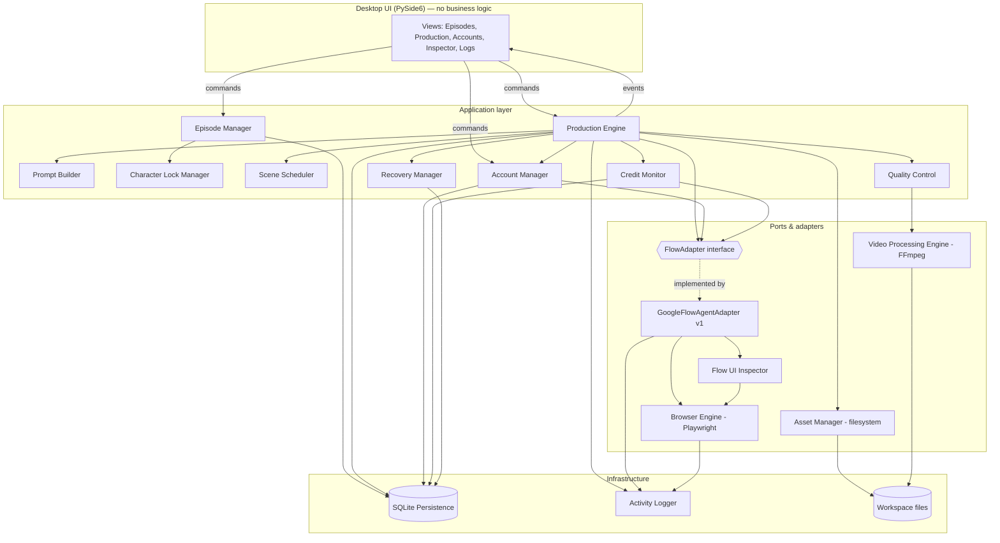
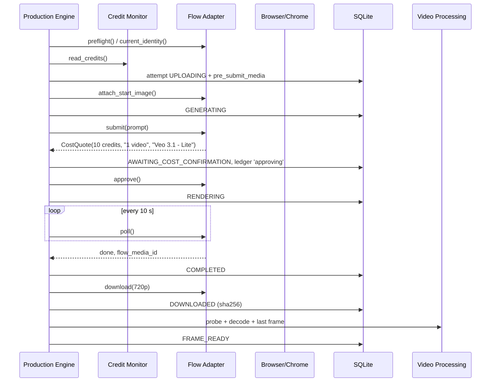

# WP-0.8 — System Architecture

> **Ringkasan (ID):** Aplikasi dibagi menjadi beberapa lapisan. Tampilan desktop (PySide6) hanya menampilkan data dan mengirim perintah, tanpa logika bisnis. **Production Engine** mengatur alur adegan demi adegan. **Flow Adapter** satu-satunya bagian yang "tahu" cara memakai Google Flow, sehingga bisa diganti kalau Flow berubah. **Browser Engine** satu-satunya bagian yang memakai Playwright. Data produksi disimpan di SQLite, file video di folder kerja. Tech stack yang diusulkan (Python, Playwright, PySide6, SQLite, FFmpeg, Pydantic, pytest) **cocok**. OpenCV **tidak perlu** untuk saat ini.

Status: **PROPOSED**, grounded in VERIFIED discovery facts where cited.

## 1. Technology evaluation

| Proposed | Verdict | Reason |
|---|---|---|
| Python 3.12 (via `uv`) | **Adopt** | Team language; uv present (E-ENV-01); 3.12 supported by all libs below |
| Playwright (Python) | **Adopt** | VERIFIED: CDP attach, ARIA snapshots, file chooser, downloads all work against Flow |
| PySide6 | **Adopt (Phase 6)** | Native desktop UI, LGPL, Qt signals fit an async engine. Until Phase 6, a CLI is enough |
| SQLite | **Adopt** | Built in; WAL + transactions give the durable checkpointing required |
| FFmpeg/FFprobe (CLI via `subprocess`) | **Adopt** | VERIFIED on test asset; no Python wrapper library needed |
| Pydantic v2 | **Adopt** | Data contracts + registry schema validation |
| pytest | **Adopt** | + `pytest-asyncio` if the engine is async |
| OpenCV | **Defer** | No element needed visual recognition; QC (e.g. frame similarity) can start with FFmpeg filters. Re-evaluate in Phase 7 |
| OCR (Tesseract) | **Reject for now** | Credits are in accessible text (E-FLOW-17) |

Concurrency model: Playwright **sync** API in a dedicated worker thread owned by the Browser Engine; the UI talks to the engine via a command queue + Qt signals. (Simpler than asyncio + qasync; one browser at a time anyway.)

## 2. Component diagram



Dependency rule: arrows point inward to interfaces. Only `BrowserEngine` imports Playwright; only `GoogleFlowAgentAdapter` knows Flow labels (via the locator registry); only `VideoProcessingEngine` calls FFmpeg.

## 3. Component responsibilities and contracts

| Component | Responsibility | Key inputs → outputs |
|---|---|---|
| Desktop UI | Display state, collect user decisions (approve retry, choose account, take over) | Commands / read models |
| Episode Manager | Load, validate (Pydantic), version episode JSON; compute dependency graph | `Episode` → `EpisodePlan` |
| Character Lock Manager | Store locks with hashes; approve/retire; detect tampering | `Lock` library |
| Prompt Builder | Assemble prompt; enforce verbatim lock inclusion | `Scene`, locks → `AssembledPrompt` |
| Production Engine | Drive the state machine per scene; apply gates; write-ahead persistence | `EpisodePlan` → scene states |
| Scene Scheduler | Choose the next ready scene | dependency graph + states → `scene_id` |
| Recovery Manager | Startup scan; `RECONCILING` logic | attempts + Flow observations → transition |
| Flow Adapter | Translate intents into Flow UI steps; read results | `GenerationRequest` → `GenerationHandle` / `FlowResult` |
| Flow UI Inspector | Registry, validation, health checks, diffs, reports | page → `HealthReport` |
| Browser Engine | Chrome process + CDP, page, downloads, uploads, captures | — |
| Account Manager | Profiles, identity validation, account status | `account_id` → `AccountStatus` |
| Credit Monitor | Read balance, ledger, estimates, spending gate | → `CreditSnapshot` |
| Asset Manager | Safe paths, atomic moves, hashing, retention | → asset records |
| Video Processing Engine | ffprobe, decode check, last-frame extraction, later concat | file → `ProbeResult`, frame |
| Quality Control | Asset expectations, lock-drift check, optional visual checks | → `QCResult` |
| Activity Logger | Structured JSON logs + user-readable activity feed; redaction | events |
| SQLite Persistence | Repositories; migrations; backup | — |

### FlowAdapter interface (replaceable)

```python
class FlowAdapter(Protocol):
    def preflight(self) -> HealthReport: ...
    def current_identity(self) -> AccountIdentity: ...
    def read_credits(self) -> CreditSnapshot: ...
    def snapshot_media(self, project: FlowProjectRef) -> MediaSet: ...
    def attach_start_image(self, req: StartImage) -> None: ...                 # upload or existing asset
    def submit(self, req: GenerationRequest) -> CostQuote: ...                 # stops at confirmation
    def approve(self, quote: CostQuote) -> None: ...                           # credit-sensitive
    def reject(self, quote: CostQuote) -> None: ...
    def poll(self, handle: GenerationHandle) -> GenerationProgress: ...        # % / done / error
    def find_result(self, attempt: AttemptRecord) -> list[FlowResult]: ...    # reconciliation
    def download(self, result: FlowResult, dest: Path, quality: str) -> DownloadResult: ...
```

`submit` and `approve` are split on purpose: the Production Engine (not the adapter) decides whether a quoted cost is acceptable. A future adapter (e.g. an official API, or a classic non-agent Flow UI) implements the same interface; Episode Manager and Production Engine stay unchanged.

## 4. Data storage

```
<workspace>/                       # default: ~/BlatifaStudio (must be on a disk with space)
  blatifa.db                       # SQLite (WAL)
  backups/blatifa-YYYYMMDD.db
  profiles/<account_id>/chrome/    # 700, never backed up off-machine
  episodes/<episode_id>/
     episode.json                  # canonical source (copy of imported file)
     inputs/…                      # custom start images
     S01/v1/a1/S01_v1.mp4, S01_v1_last.png, probe.json
     manifest.json
  inspections/<timestamp>/…        # Inspector reports (redacted)
  logs/
  tmp/downloads/
```

SQLite tables (initial): `episode`, `scene`, `scene_attempt`, `state_event`, `asset`, `account`, `credit_snapshot`, `credit_ledger`, `locator_check`, `app_setting`. Migrations via simple numbered SQL files (no ORM needed).

## 5. Main sequence (one scene, image-to-video)



## 6. Security model

| Concern | Design |
|---|---|
| Browser profile isolation | One Chrome user-data-dir per account; mode 700; never the user's personal profiles; Chrome refuses CDP on the default dir |
| Session & cookie protection | App never reads cookies/storage/headers; profiles on FileVault-encrypted disk (VERIFIED On, E-ENV-04); excluded from git and from any export |
| CDP exposure | `--remote-debugging-address=127.0.0.1`, random port, Chrome closed when idle |
| Secret management | No passwords stored at all (user logs in manually). Expected account email stored as hash + display label; if any secret is ever needed, macOS Keychain via `keyring` |
| Filesystem permissions | Workspace 700; files 600 for DB and logs |
| Account identity validation | Before every scene (see Account architecture) |
| Safe downloads | Download only via `expect_download` to temp; accept only MP4 with ffprobe-valid H.264/AAC; ignore `suggested_filename` for paths; size cap (e.g. 500 MB) |
| Safe file naming | Generated names `^[A-Za-z0-9_-]+$` from scene ID/version/attempt; reject `..`, absolute paths, symlinks in inputs |
| Database backups | Online `.backup`, 7 rotations, local only |
| User-controlled auth | App never types credentials; login/MFA/CAPTCHA always by the user in the visible window |
| No CAPTCHA/MFA bypass | Not implemented; detection ⇒ pause and hand over |
| No quota circumvention | No automatic account rotation; no parallel multi-account; no fingerprint spoofing (see Account architecture §5) |
| Credit safety | "Confirm before generating = Always" enforced; never "Always approve"; cost parsed and capped; write-ahead ledger |
| Logs & evidence redaction | Emails and account names redacted (pattern + known values) before writing reports |

## 7. Prompt fidelity and lock drift (top risk)

Discovery showed the Flow agent paraphrases prompts (E-FLOW-20). Layered mitigation:

1. **Agent instructions (per Flow project)**: add a standing instruction such as *"Use the user's prompt verbatim for generation. Do not rewrite, summarise or shorten it."* — effectiveness UNVERIFIED; test in Phase 2.
2. **Explicit wording in the message**: wrap the assembled prompt, e.g. *"Generate exactly one video using this exact prompt, unchanged: «…»"* — UNVERIFIED.
3. **Post-generation verification**: read the stored prompt on `/edit/<uuid>`; check that each lock's key phrases (configurable per lock, e.g. `protruding circular pout`, `Do NOT make the mouth wide`) are present. Missing ⇒ `LOCK_DRIFT_SUSPECTED` → user review (accept / regenerate).
4. **Visual references**: attach character reference images as ingredients (Flow has `Characters` / `Avatars` concepts — UNVERIFIED).
5. **Escalation**: if Phase 2 shows the agent cannot be made to preserve prompts, evaluate an alternative Flow surface (if Google exposes a non-agent generation mode) behind the same `FlowAdapter` interface.

## 8. Logging

- Structured JSON lines (`logs/app-YYYYMMDD.jsonl`) with `episode_id`, `scene_id`, `attempt_id`, `state`, `event`.
- Human activity feed in the UI (Indonesian messages), derived from events.
- Every credit-sensitive action logs: quoted cost, plan sentence, account label, timestamp.
