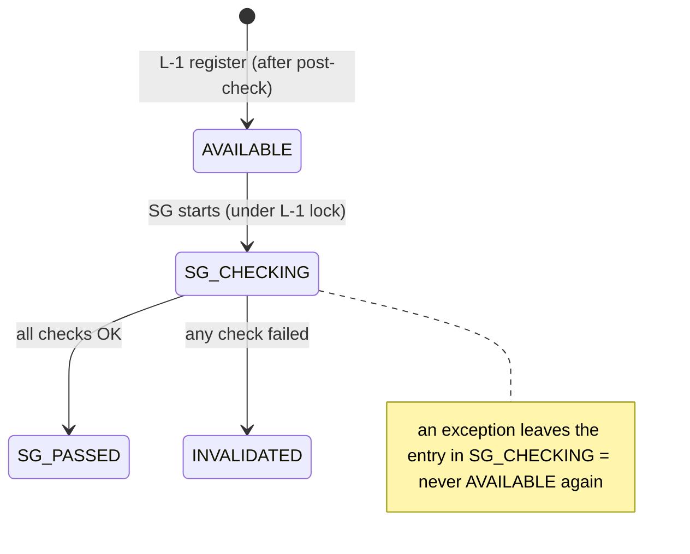
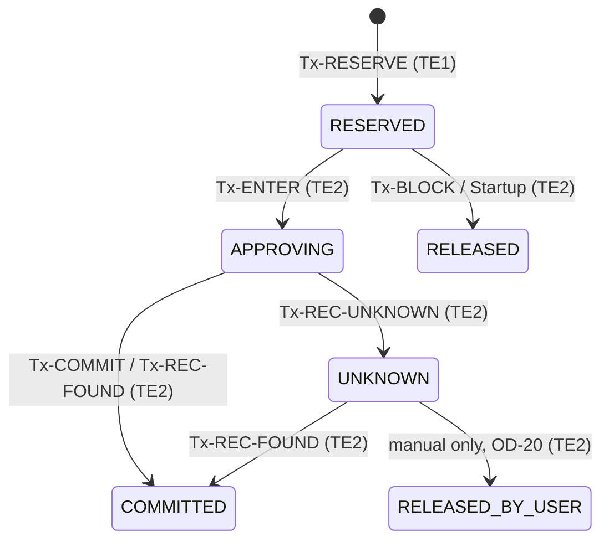

PHASE 5.3G — L-1/L-2 SPECIFICATION REVISION 5

*Hanya dokumen. Tidak ada file yang ditulis, tidak ada kode atau tes yang dijalankan, dan tidak ada aktivitas browser, Flow, maupun kredit. Revisi ini disusun dari Revision 4 dan dari fakta yang sudah dibaca read-only sebelumnya. Tidak ada perintah baru yang dijalankan.*

Label yang dipakai: **FACT** (dengan path:line), **INFERENCE**, **PROPOSAL**, **OPEN / DEFERRED / UNVERIFIED**, **NOT ESTABLISHED — REQUIRES DECISION OR EVIDENCE**.

---

## A. Ringkasan

**Empat perbaikan yang memblokir di review final Revision 4:**

1. **Source Gate dan TOCTOU.**
   - Bukti sumber sekarang mencakup adapter, page, main frame, URL, identitas dokumen, fingerprint, `acquisition_id` dan waktu.
   - SG-1 memeriksa ulang **semua** bukti itu tepat sebelum `authorize_approval`, jadi tidak lagi hanya URL.
   - Registry L-1 punya state sendiri: `AVAILABLE` → `SG_CHECKING` → `SG_PASSED`, atau → `INVALIDATED`. SG yang gagal, termasuk karena exception, membuat reading **tidak pernah lagi** lolos SG.
   - Interval TOCTOU dirinci per segmen. Atomisitas **tidak** diklaim.
   - SG-2 sesudah `authorize` direkomendasikan (OD-8). Interval dari SG-2 sampai klik tetap residual dan hanya bisa ditutup oleh kontrak pre-click di `approve()` (OD-37 baru).
2. **Tx-BLOCK dan READY.**
   - Kontradiksi di G.3 dihapus.
   - Dialog yang tertutup **bukan** bukti bahwa reject berhasil.
   - Attempt yang terputus di `AWAITING_COST_CONFIRMATION` tanpa catatan Tx-BLOCK yang durable **tidak pernah** menjadi READY otomatis; hasilnya MANUAL. Ini mengubah perilaku `decide()` yang ada (CC-20, OD-39).
   - READY hanya bisa dicapai lewat aturan R-READY (G.5).
3. **L-2 Acceptance Criteria lengkap.** L2-AC-1 sampai L2-AC-35, dengan kondisi awal, tindakan, hasil, kegagalan dan ekspektasi gagal tertutup. Semua referensi sudah dicek.
4. **`reservation_event`.** Mekanisme kanonik dipilih: **trigger database saja**. Penjelasannya di C.3. API aplikasi tidak pernah menulis event. Kolom `version` dan `UNIQUE (reservation_id, version)` mencegah event ganda. Persetujuan akhir tetap OD-35 (OPEN).

**Status dokumen:**

| Dimensi | Status |
|---|---|
| SPECIFICATION COMPLETE | **NO.** Draft lengkap untuk direview, tetapi masih ada 32 OD OPEN dan 3 DEFERRED |
| ACCEPTANCE CRITERIA DEFINED | **YES.** Semua AC yang dirujuk sudah didefinisikan (bagian E) |
| ACCEPTANCE CRITERIA EXECUTED | **NO.** Semuanya NOT RUN |
| IMPLEMENTATION READY | **NO.** Tidak diotorisasi |
| LIVE READY | **NO.** Tidak diotorisasi |

**Jumlah OD:**

| Total aktif | CLOSED | OPEN | DEFERRED | REJECTED |
|---|---|---|---|---|
| **38** | **3** | **32** | **3** | **0** |

Dari 35 OD di Revision 4, Revision 5 menambah OD-37, OD-38 dan OD-39 (ketiganya OPEN). OD-21 berstatus RETIRED dan tidak dihitung.

**Perubahan kontrak R-2 yang beku:** dua item, CC-7 dan CC-18. Angka dua ini **hanya** untuk kontrak R-2 yang beku. Perubahan lintas modul lain dirinci di bagian F.

**Audit trail (dipertahankan):** di Revision 2, satu perintah yang berisi `python3 -c` ditolak sistem sebelum dieksekusi. Python tidak berjalan dan perintah itu tidak diulang.

---

## B. Spesifikasi L-1: Source Authenticity

### L1.0 Cakupan

- A1–A5 tetap menjadi cakupan. A4 dan A5 adalah inti desain.
- Keaslian sumber **belum terbukti**. R-2 provenance bukan keaslian sumber.
- Keaslian main frame harus gagal tertutup.
- Arsitektur yang direkomendasikan adalah **L1-X**. Ini bukan keputusan implementasi; pilihannya OD-32.

### L1.1 Baseline (FACT)

| Fakta | Bukti |
|---|---|
| `acquire_balance(page)` hanya memanggil `page.locator("body").aria_snapshot()` | `src/blatifa/account/provenance.py:10`, `:150` |
| Pin R-2 yang beku: `FINDINGS` persis lima; pemetaan dan `Block` `BALANCE_READING_*` persis lima; nama publik provenance berupa himpunan tetap; signature `authorize` tetap; `_calls("acquire_balance") == []`; `authorize_approval` hanya dari runner | `tests/unit/test_phase5_3g4_4_r2_provenance.py:306-307`, `:310-314`, `:474-478`, `:485`, `:546-548` |
| Tab dipilih lewat substring | `src/blatifa/browser/engine.py:162-169` |
| `PROJECT_URL` memakai `[0-9a-f-]{36}`, yang **bukan** UUID kanonik | `src/blatifa/flow/adapter.py:40` |
| `_on_project` | `src/blatifa/flow/adapter.py:69-71` |
| `approve()` dan `reject()` live: `BlockedOperationError` | `src/blatifa/flow/adapter.py:156-160` |
| `ReadOnlyPage` tidak mengekspos `main_frame` | `src/blatifa/flow/live_probe.py:72-107` |
| `new_cdp_session` dan `Network.enable` dilarang oleh tes | `tests/unit/test_phase5_1_runner_compat.py:112-113` |
| `_manual(a, code: str, detail)` | `src/blatifa/production/runner.py:341-345` |

### L1.2 Batasan

1. Bukti dari DOM adalah satu sumber dan tidak independen bila browser sudah terkompromi.
2. Manipulasi di dalam proses yang sama berada di luar jaminan Option C.
3. Akses CDP lokal, ekstensi browser, atau kompromi browser berada di luar jaminan.
4. Pemakaian manual akun yang sama di luar aplikasi tidak bisa dideteksi maupun dikoordinasi.
5. Restart proses tidak membuktikan keaslian sumber maupun keamanan budget.
6. Tab yang aktif tidak dianggap project yang benar.
7. Saldo di UI tidak dianggap segar.
8. **Tidak ada atomisitas antara pemeriksaan sumber dan klik** (L1.9).
9. Spesifikasi ini tidak mengizinkan operasi live.

### L1.3 Pilihan arsitektur (OD-32 OPEN)

| Opsi | Inti | Kontrak R-2 beku yang tersentuh |
|---|---|---|
| **L1-X (direkomendasikan)** | Registry L-1 terpisah; `acquire_balance(view)` R-2 dipakai tanpa perubahan; SG di runner | CC-7 (§8 runner) dan CC-18 (pin `acquire_balance`). `provenance.py` dan `gates.py` tidak berubah |
| L1-Y | Evidence di dalam R-2 | CC-1 sampai CC-6: **CHANGE CONTROL REQUIRED** |

### L1.4 Bukti sumber (`SourceEvidence`) dan keterikatannya (perbaikan blocking #1, bagian 3.1)

Frozen dataclass, disimpan **hanya** di registry L-1:

| Field | Sumber | Bisa diperoleh di arsitektur saat ini? | Dipakai di SG |
|---|---|---|---|
| `version` | konstanta = 2 | Ya | — |
| `acquisition_id` | `uuid4().hex` per akuisisi | Ya | Audit, dan masuk `evidence_digest` |
| `adapter_session` | Token acak yang dibuat sekali saat `GoogleFlowAgentAdapter` dikonstruksi (CC-10/CC-17) | Ya, di dalam proses | Dicocokkan |
| `adapter_ref` | weakref tanpa callback | Ya | `adapter_ref() is adapter` |
| `page_ref` | weakref ke `adapter.page` | Ya | `adapter.page is page_ref()` |
| `frame_ref` | weakref privat ke `page.main_frame` saat pre-check. **Tidak pernah diekspos** | Ya, tetapi stabilitasnya UNVERIFIED (OD-31) | `page.main_frame is frame_ref()` |
| `url_digest` | L1.6 | Ya | Dicocokkan |
| `doc_identity_digest` | SHA-256 dari `{timeOrigin, url}` (`DOC_IDENTITY_JS`) | Ya. Kecukupannya DEFERRED (OD-3, U-2) | Dicocokkan |
| `account_fingerprint` | Pembacaan identitas tanpa interaksi | Ya, dari DOM yang sama | Dicocokkan (OD-5) |
| `t_mono_pre`, `t_mono_post` | `time.monotonic()` | Ya | **Hanya audit.** SG tidak menambah toleransi kesegaran; kesegaran tetap urusan R-2 (STALE 300 dtk dan jam dinding) |
| Identitas sesi browser atau target CDP | — | **Tidak.** Butuh API CDP yang dilarang (FACT di atas) | Tidak diklaim |

**Keterikatan ke BalanceReading:**
- Entri registry L-1 diikat ke objek reading lewat identitas objek: `id(reading)` ditambah `ref() is reading`. Ini mencerminkan aturan identitas R-2 §5.3.
- `evidence_digest` adalah SHA-256 dari field yang bisa diserialisasi, termasuk `acquisition_id`. Digest ini dicatat L-2 di reservasi.

**State entri L-1:**



`SG_PASSED`, `INVALIDATED` dan `SG_CHECKING` yang tertinggal sama-sama bersifat **terminal untuk SG**: SG berikutnya pada reading yang sama akan gagal.

**Registry L-1:**
- Punya lock non-reentrant sendiri, dan tidak pernah memegangnya sambil memanggil R-2. Tidak ada lock bertingkat.
- Tanpa reset, clear, maupun pemulihan.
- Kegagalan internal menjadi `SourceEvidenceError`.
- Tidak pernah menyentuh FAULTED milik R-2.

### L1.5 `TrustedFrameView` (OD-23 OPEN; OD-31 UNVERIFIED)

**Dibuat hanya di dua tempat:** di dalam `acquire_trusted_balance()` dan di dalam `source_gate()`. Masing-masing berumur satu pemanggilan, dan tidak pernah dikembalikan, disimpan, atau diberikan ke komponen lain.

**Enam operasi (lengkap):**

| # | Operasi | Batasan |
|---|---|---|
| 1 | `page_is_closed()` | `page.is_closed()`; hasil harus `type(x) is bool` |
| 2 | `is_main()` | `frame.parent_frame is None` |
| 3 | `is_detached()` | Hasil harus `bool` persis |
| 4 | `url()` | Hasil harus `str` persis |
| 5 | `locator("body")` | Hanya argumen literal `"body"`; argumen lain raise. Mengembalikan objek yang hanya punya `aria_snapshot()`, yang mengembalikan `str` |
| 6 | `document_identity()` | Konstanta `DOC_IDENTITY_JS` saja. Hasilnya harus dict persis `{timeOrigin: float, url: str}` |

- **Dilarang:** `evaluate` generik, `locator` generik, Frame atau Page mentah, dan `__getattr__` yang mengembalikan sesuatu.
- Kondisi yang gagal atau tidak bisa diverifikasi ditolak. Exception dari Playwright diteruskan.
- Wrapper ini **bukan** batas keamanan terhadap kode in-process.

### L1.6 Kontrak URL dan project (OD-1, OD-2, OD-30 OPEN)

Diterima hanya bila `url == "https://flow.google.com/project/" + project_id`, dibandingkan persis.
- Port, userinfo, query, fragment, garis miring di akhir, huruf kapital, `xn--` dan titik di akhir: ditolak.
- `project_id` berasal dari `adapter.project_url`. Validasi yang ditemukan hanya regex yang ada, yang bukan UUID kanonik. Format yang dibutuhkan: OD-30.
- `url_digest` = SHA-256 dari UTF-8 string kanonik, dalam heksadesimal huruf kecil.
- Himpunan yang diterima adalah subset ketat dari `_on_project`.
- Belum tervalidasi di runtime (LIVE-OBS-3).

### L1.7 Akuisisi tepercaya (L1-X)

```
GoogleFlowAgentAdapter.acquire_trusted_balance():          # exact type (OD-7)
  1. PRE: _on_project(); view; not page_is_closed; is_main; not detached; url() per L1.6;
          doc_pre = document_identity(); fp_pre == expected (OD-5); frame_pre = page.main_frame (private)
  2+3. reading = provenance.acquire_balance(view)            # R-2 unchanged (incl. R-2 registration)
  4. POST: same checks + page.main_frame is frame_pre (OD-31) + url == url_pre + doc == doc_pre + fp == fp_pre
           otherwise SourceEvidenceError (reading dropped, no L-1 entry)
  5. L-1 REGISTER: entry AVAILABLE with SourceEvidence (incl. acquisition_id, adapter_session, frame_ref)
```

Dinyatakan jujur: registrasi **R-2** terjadi sebelum post-check, dan itu tidak terhindarkan tanpa mengubah R-2. Yang membuat reading **tepercaya** adalah registrasi **L-1**, yang baru terjadi sesudah post-check.

### L1.8 Source Gate (bagian 3.2 dan 3.4)

**Urutan di `_decide_on_quote`** (lihat G.1):
- akuisisi;
- gate pendahuluan;
- `confirm`;
- **SG-1**;
- `authorize_approval`;
- **SG-2** (OD-8);
- L-2.

**SG-1 = `source_gate(reading, adapter, phase="pre_authorize")`:**

| # | Pemeriksaan | Kode internal SG bila gagal |
|---|---|---|
| 0 | Simulasi bawaan dengan reading int, atau adapter bukan live **dan** reading tanpa entri L-1: PASS (tidak berlaku) | — |
| 1 | Adapter live, tetapi reading tidak punya entri L-1 | `SG_NO_EVIDENCE` |
| 2 | Di bawah lock L-1: state entri harus `AVAILABLE`, lalu diubah ke `SG_CHECKING` | `SG_EVIDENCE_REUSED` (bila `SG_PASSED` atau `SG_CHECKING`) / `SG_EVIDENCE_INVALIDATED` |
| 3 | `adapter_ref() is adapter` dan `adapter._session == adapter_session` | `SG_ADAPTER_MISMATCH` |
| 4 | `adapter.page is page_ref()` dan tidak `page_is_closed()` | `SG_PAGE_MISMATCH` |
| 5 | `page.main_frame is frame_ref()` (OD-31), `is_main()`, tidak `is_detached()` | `SG_FRAME_MISMATCH` / `SG_FRAME_DETACHED` |
| 6 | `url()` memenuhi L1.6 dan digest-nya sama dengan `url_digest` | `SG_URL_MISMATCH` |
| 7 | Digest `document_identity()` sama dengan `doc_identity_digest` | `SG_DOCUMENT_MISMATCH` |
| 8 | Fingerprint sama dengan `account_fingerprint` | `SG_FINGERPRINT_MISMATCH` |
| 9 | Semua lolos: `SG_CHECKING` menjadi `SG_PASSED` | — |
| — | Adapter bukan live, tetapi reading punya entri L-1 | `SG_ADAPTER_MISMATCH` |

**Apa yang tidak bisa diperiksa SG:**
- **Apakah reading sudah CONSUMED di R-2.** SG tidak punya API untuk itu, dan pin `:474-478` melarang menambahkannya. Kondisi ini ditegakkan oleh `authorize` (finding CONSUMED).
- SG hanya menjamin bahwa **evidence L-1** dipakai satu kali (langkah 2).

**SG-2 = `source_gate(..., phase="post_authorize")` (OD-8; direkomendasikan):**
- Pemeriksaan 3–8 diulang pada entri yang sudah `SG_PASSED`, dengan transisi `SG_PASSED` → `SG2_PASSED` atau → `INVALIDATED`.
- Bila gagal: reading sudah CONSUMED di R-2 (§8 langkah 5), lalu Tx-BLOCK dengan `SOURCE_MISMATCH`, tanpa Tx-RESERVE.

**Perilaku saat gagal (bagian 3.4):**

| Syarat | Bagaimana dipenuhi |
|---|---|
| `authorize_approval()` tidak dipanggil | Kegagalan SG-1 mengarah langsung ke jalur blok |
| `adapter.approve()` tidak dipanggil | Sama. Kegagalan SG-2 juga terjadi sebelum Tx-RESERVE |
| Reading tidak dipakai ulang secara tidak aman | Entri L-1 menjadi `INVALIDATED` (atau tetap `SG_CHECKING` bila terjadi exception). Reading tidak bisa lolos SG lagi, baik untuk adapter live maupun bukan live. Runner juga membuang reading (variabel lokal, R-2 §8) |
| Konsumsi di R-2 | SG-1 yang gagal **tidak** mengonsumsi reading di R-2, karena satu-satunya jalur konsumsi adalah `authorize` yang mengizinkan, dan menambah jalur lain berarti mengubah R-2. Entri R-2 tetap AVAILABLE sampai STALE atau tersapu. Itu aman, karena invalidasi di L-1 menutup semua jalur pemakaian. Ini dicatat sebagai **limitation**, bukan PASS |
| Tidak masuk prioritas R-2 | Kode SG adalah kode internal L-1. Ke luar dilaporkan sebagai `block_code = "SOURCE_MISMATCH"` (string, lewat `_manual(code: str)`), **bukan** member `Block` dan bukan `FINDINGS`. Bentuk publiknya OD-9 |
| Exception di SG | Diteruskan tanpa ditangkap. Entri tetap `SG_CHECKING` (terminal). Tanpa `authorize`, tanpa approve, tanpa reject. Attempt lalu direkonsiliasi (G.5) |

### L1.9 Interval TOCTOU (bagian 3.3)

| Interval | Isi | Ada aksi asinkron? | Bagaimana perubahan ditangani | Jaminan |
|---|---|---|---|---|
| I1: post-check akuisisi sampai SG-1 | Gate pendahuluan dan `confirm` (menunggu pengguna, durasinya tidak terbatas) | Ya, menunggu pengguna. Browser bisa berubah kapan saja | SG-1 memeriksa ulang semua bukti | Perubahan yang mengubah bukti terdeteksi di SG-1 |
| I2: pembacaan browser terakhir di SG-1 sampai `authorize_approval` kembali | `credit_evidence`, `provenance.authorize`, `approval_gate` | INFERENCE: tidak ada panggilan Playwright dari kode kita (R-2 §10: provenance tanpa browser; gates murni). **Tetapi browser adalah proses lain dan bisa berubah kapan saja** | Tidak teramati di interval ini | **Tidak ada jaminan.** Hanya urutan sinkron di satu thread. Syarat tambahan: runner single-threaded untuk page itu. Apakah runner single-threaded: NOT ESTABLISHED, jadi dijadikan syarat implementasi |
| I3: `authorize` sampai SG-2 | Tidak ada kode yang menyentuh browser | Sama | SG-2 memeriksa ulang | Perubahan terdeteksi di SG-2 |
| I4: SG-2 sampai klik di `approve()` | Tx-RESERVE dan Tx-ENTER, masing-masing paling lama 5000 ms busy wait ditambah waktu eksekusi | Browser bisa berubah | **Tidak ditutup oleh L-1.** Hanya bisa ditutup oleh pemeriksaan pre-click di `approve()` sendiri (OD-37). Bila pemeriksaan itu gagal: tidak ada klik, record tetap APPROVING, lalu reconcile konservatif (UNKNOWN atau MANUAL) | Residual |
| I5: klik | Di dalam Playwright | — | — | Di luar L-1 |

**Kesimpulan:**
- Pemeriksaan sumber dan otorisasi **tidak** bisa dibuat atomik terhadap browser.
- Yang dijamin: bukti sumber valid pada saat SG-1 dan SG-2, ditambah gagal tertutup bila ada perbedaan yang terdeteksi.
- Perubahan sesudah pembacaan terakhir dan sebelum klik **tidak** dijamin terdeteksi. Ini dicatat sebagai limitation 8, OD-37, dan Risiko #2 di bagian I.

### L1.10 Tabel kombinasi dengan R-2

| Kombinasi kegagalan | Outcome | Kontrak R-2 tersentuh? | Status |
|---|---|---|---|
| SG-1 gagal (kode apa pun) | `SOURCE_MISMATCH` (detail = kode SG); R-2 tidak dipanggil; entri `INVALIDATED`; Tx-BLOCK | Tidak | PROPOSAL |
| SG-1 gagal dan R-2 FAULTED atau ada finding R-2 lain | `SOURCE_MISMATCH`, karena SG dievaluasi lebih dulu. Latch tetap berlaku | Tidak | PROPOSAL; diagnosisnya kalah spesifik |
| SG-1 lolos dan ada finding R-2 | Prioritas R-2 berlaku tanpa perubahan; entri tetap `SG_PASSED` sehingga tidak bisa dipakai lagi | Tidak | PROPOSAL |
| SG-1 lolos dan R-2 mengizinkan; SG-2 gagal | CONSUMED; `SOURCE_MISMATCH`; Tx-BLOCK | Tidak | OPEN (OD-8) |
| SG-1 dan SG-2 lolos | L-2 | Tidak | PROPOSAL |
| Exception di SG | Diteruskan; tanpa `authorize` | Tidak | PROPOSAL |
| L1-Y | Prioritas R-2 berubah | **CHANGE CONTROL REQUIRED** | Kondisional |

### L1.11 Mode kegagalan saat akuisisi

| Kegagalan | Hasil | FAULTED | Approval |
|---|---|---|---|
| Pre-check atau post-check | `SourceEvidenceError`, lalu `AdapterError("SOURCE_UNVERIFIED")`, lalu manual (`runner.py:39-44`, `:106`) | tidak | tidak |
| Playwright atau parse | Diteruskan | tidak | tidak |
| R-2 FAULTED | `ProvenanceRegistryError` | sudah | tidak |

Apakah `reject()` dipanggil di jalur `AdapterError`: **NOT ESTABLISHED.** Bila tidak dipanggil, dialog tetap terbuka dan hasilnya MANUAL.

### L1.12 SimulatedFlow dan FakeFlow

- Tidak berubah. Pin `tests/unit/test_phase5_3g4_1_adapter_trust.py:173-174` tetap berlaku.
- Binding TEST: OD-6 / CC-8.

---

## C. Spesifikasi L-2: Cross-Process Budget Coordination

### C.1 Cakupan dan baseline

- **Cakupan:** B1, B2, B3, B4, B5, B7.
- **Ditolak:** B6 dan B8.
- **Di luar cakupan:** koordinasi antar-mesin.
- **Diputuskan:** satu proses per workspace (`WorkspaceLockedError`).
- `PAUSE_BLOCKS` tidak berubah.

| FACT | Bukti |
|---|---|
| `COMMIT` di `_tx` berada di luar try | `src/blatifa/persistence/store.py:284-291` |
| `ledger_write` dan `transition` membuka transaksi terpisah | `store.py:323-343`, `:350-356` |
| Preseden trigger append-only | `store.py:197-200` |
| `connect` tanpa timeout; `foreign_keys=ON` per koneksi `Store` | `store.py:269`, `:274` |
| Tidak ada kerangka migrasi | `store.py:24`, `:275-278` |
| Jalur blok: `reject()`, lalu `REJECTED`, lalu `_manual` | `src/blatifa/production/runner.py:200-204` |
| `SimulatedFlow.reject()` idempotent **di simulasi saja** | `src/blatifa/simulation.py:46-47` |
| Reconcile tidak memanggil `reject` maupun `approve` | `runner.py:312-339` |
| `resume()` dari MANUAL atau PAUSED selalu ke RECONCILING | `runner.py:347-349` |
| `decide()` menghasilkan READY bila tidak `maybe_spent`, tidak ada tile baru, dan `pending_confirmation is False`. `interrupted_state` `AWAITING_COST_CONFIRMATION` tidak dibedakan | `src/blatifa/production/reconcile.py:66`, `:93-102` |
| Belum ada implementasi lock | Hasil grep kosong |
| Workspace default, dan path DB simulasi yang terpisah | `src/blatifa/config.py:23`; `src/blatifa/cli.py:333-335` |
| Python 3.12 | `pyproject.toml:5` |

**Dua besaran:**
1. Saldo aktual Flow: hanya bukti L-1 dan R-2 pada satu titik waktu, tidak dianggap segar.
2. Budget reservasi lokal: per grant per akun, dalam satu file DB.

### C.2 Skema konseptual v2 (PROPOSAL; CC-11)

```sql
CREATE TABLE budget_grant (
  id TEXT PRIMARY KEY, account_id TEXT NOT NULL,
  cap <TYPE: OD-27> NOT NULL,                 -- DECIDED: explicit, NOT NULL, no DEFAULT. OPEN: type/range (OD-27), value (OD-10)
  expected_fingerprint TEXT NOT NULL,         -- OD-5
  granted_by TEXT NOT NULL CHECK (granted_by = 'user'),
  opened_at TEXT NOT NULL, closed_at TEXT,
  UNIQUE (id, account_id));
CREATE UNIQUE INDEX budget_grant_one_open ON budget_grant(account_id) WHERE closed_at IS NULL;
CREATE UNIQUE INDEX scene_attempt_id_account ON scene_attempt(id, account_id);

CREATE TABLE budget_reservation (
  id TEXT PRIMARY KEY,
  idempotency_key TEXT NOT NULL UNIQUE, attempt_id TEXT NOT NULL UNIQUE,
  grant_id TEXT NOT NULL, account_id TEXT NOT NULL,
  quoted_cost INTEGER NOT NULL, observed_balance INTEGER NOT NULL,      -- range: OD-27
  evidence_digest TEXT NOT NULL, owner_token TEXT NOT NULL,
  state TEXT NOT NULL CHECK (state IN ('RESERVED','APPROVING','UNKNOWN','COMMITTED','RELEASED','RELEASED_BY_USER')),
  version INTEGER NOT NULL,                   -- 1 on INSERT, +1 on every transition
  transition_reason TEXT NOT NULL,            -- copied into the event by the trigger
  block_code TEXT,
  created_at TEXT NOT NULL, updated_at TEXT NOT NULL,
  UNIQUE (id, account_id),
  FOREIGN KEY (grant_id, account_id)   REFERENCES budget_grant(id, account_id),
  FOREIGN KEY (attempt_id, account_id) REFERENCES scene_attempt(id, account_id));
CREATE UNIQUE INDEX budget_one_active_per_account ON budget_reservation(account_id)
  WHERE state IN ('RESERVED','APPROVING','UNKNOWN');

CREATE TABLE reservation_event (
  id INTEGER PRIMARY KEY AUTOINCREMENT,
  reservation_id TEXT NOT NULL, account_id TEXT NOT NULL, version INTEGER NOT NULL,
  from_state TEXT, to_state TEXT NOT NULL, reason TEXT NOT NULL, at TEXT NOT NULL,
  UNIQUE (reservation_id, version),
  FOREIGN KEY (reservation_id, account_id) REFERENCES budget_reservation(id, account_id));
```

**Trigger (PROPOSAL; OD-35, OD-36):**

| ID | Trigger | Fungsi |
|---|---|---|
| TE1 | `AFTER INSERT ON budget_reservation` | INSERT event (version = `NEW.version`, from = NULL, to = `NEW.state`, reason = `NEW.transition_reason`) |
| TE2 | `AFTER UPDATE OF state ON budget_reservation` | INSERT event (version = `NEW.version`, from = `OLD.state`, to = `NEW.state`, reason = `NEW.transition_reason`) |
| TG1 | `BEFORE INSERT ON budget_reservation` | `NEW.version = 1` dan `NEW.state = 'RESERVED'`; selain itu ABORT |
| TG2 | `BEFORE UPDATE ON budget_reservation` | Setiap UPDATE wajib sebuah transisi sah (C.4): `NEW.state != OLD.state`, `(OLD, NEW)` ada di daftar, `NEW.version = OLD.version + 1`, kolom immutable tidak berubah, `transition_reason` diisi baru. Selain itu ABORT |
| TG3 | `BEFORE DELETE ON budget_reservation` | ABORT |
| TG4 | `BEFORE UPDATE` dan `BEFORE DELETE ON reservation_event` | ABORT |
| TG5 | `BEFORE INSERT ON reservation_event` | `NEW.version` dan `NEW.to_state` harus sama dengan `version` dan `state` reservasi saat ini; selain itu ABORT |
| TG6 | `budget_grant` | Tanpa DELETE; UPDATE hanya `closed_at` dari NULL (OD-36) |

### C.3 Mekanisme kanonik `reservation_event` (perbaikan blocking #4)

| Kriteria | A: hanya trigger | B: hanya API aplikasi |
|---|---|---|
| Transisi tidak mungkin berhasil tanpa event | **Ya.** TE1 dan TE2 berjalan di statement yang sama; bila INSERT event gagal, transisinya ikut ABORT | Tidak dijamin. SQLite tidak punya constraint tertunda untuk memastikan event ada; aplikasi bisa lupa |
| Mencegah event ganda | `UNIQUE (reservation_id, version)` ditambah TG5. INSERT manual untuk versi yang sama gagal | Hanya dengan disiplin kode |
| Konsistensi transaksi | Event otomatis berada di transaksi yang sama; rollback menghapus keduanya | Sama, bila tidak lupa |
| Bisa diuji | DBI langsung: setiap DML pada reservasi menghasilkan tepat satu event | Butuh tes per jalur kode |
| Kekurangan | Alasan transisi harus dibawa lewat kolom `transition_reason`; logika berada di DDL | Dua sumber kebenaran |

**Pilihan: A (trigger saja).**
- API aplikasi **tidak pernah** menulis `INSERT INTO reservation_event`. Ini ditegakkan secara statis (L2-AC-31) dan oleh TG5 serta UNIQUE.
- Transaksi di G.2 hanya meng-INSERT atau meng-UPDATE `budget_reservation`, dengan `version` dan `transition_reason`. Event muncul lewat TE1 dan TE2.
- **Batas jaminan:**
  - Hanya terhadap DML biasa. DDL (`DROP TRIGGER`), `writable_schema`, pengeditan file, atau penghapusan file DB berada di luar jaminan.
  - FK hanya ditegakkan pada koneksi yang mengaktifkan `foreign_keys=ON` (FACT: `Store` mengaktifkannya).
  - Perilaku trigger di runtime adalah INFERENCE dari dokumentasi SQLite, UNVERIFIED.
- Persetujuan akhirnya: **OD-35 tetap OPEN.**

**Integritas referensial:**
- Event wajib merujuk reservasi yang ada (FK komposit ke `(id, account_id)`, untuk isolasi akun).
- Parent tidak bisa dihapus (TG3). FK memakai NO ACTION, tanpa CASCADE.
- Rollback tidak meninggalkan event yatim.
- Akun dan grant lewat FK komposit di reservasi; attempt dan akun lewat `scene_attempt_id_account`.

**Migrasi v1 ke v2 (CC-11):**
- Satu transaksi aditif. Tidak ada backfill.
- DB yang ada (termasuk `~/BlatifaStudio/experiments/phase-5.3g/p53g.db`) tidak disentuh dalam fase ini.

### C.4 Mesin state reservasi



- **Aktif:** `RESERVED`, `APPROVING`, `UNKNOWN`.
- **Dihitung terpakai:** state aktif ditambah `COMMITTED`.
- Tidak ada expiry otomatis.

### C.5 Busy timeout dan klasifikasi error

- `timeout=5.0` ditambah `PRAGMA busy_timeout=5000` untuk setiap koneksi `Store`.
- **OD-25: CLOSED — FAIL-CLOSED REQUIREMENT.** Bila readback bukan 5000, koneksi tidak dipakai untuk jalur approval, operasi dihentikan, tanpa fallback, tanpa retry, dan dilaporkan (`BUSY_TIMEOUT_MISMATCH`). Belum diimplementasi.
- **Klasifikasi (OD-28):**
  - primary code 5 menjadi `DB_LOCK_TIMEOUT`;
  - primary code 6 menjadi `DB_LOCKED`;
  - selain itu diteruskan tanpa diubah;
  - pencocokan string tidak dipakai.
- Konflik aplikasi (`RESERVATION_ACTIVE`, `RESERVATION_CONFLICT`, `BUDGET_CAP`, `BUDGET_NO_GRANT`) dibedakan dari error SQLite.

### C.6 Process lock (OD-22 CLOSED; OD-14 OPEN)

| # | Ketentuan |
|---|---|
| 1 | `{WORKSPACE}/.blatifa.lock`, bukan root filesystem dan bukan CWD. `/.blatifa.lock` di Revision 3 hanya salah tampil |
| 2 | `{WORKSPACE}` = `expanduser` lalu harus absolut. Nilai relatif ditolak (OD-14). `realpath` hanya untuk audit |
| 3 | Symlink: OD-14. INFERENCE: lock tetap konflik dengan benar bila menunjuk file yang sama |
| 4 | Alias path: identitas yang diusulkan `(st_dev, st_ino)` direktori, dicocokkan dengan DB (CC-15) |
| 5 | Dua path ke direktori yang sama: lock bekerja. Salinan workspace atau `BLATIFA_WORKSPACE` lain: tidak terkoordinasi |
| 6 | Jaminan hanya untuk FS lokal |
| 7 | Network FS dan folder sinkron: NOT ESTABLISHED, usulan ditolak (U-5) |
| 8 | `flock` bersifat advisory, diwarisi saat fork, per open file description, dan tidak lintas mesin |
| 9 | Lock dilepas kernel saat proses mati (INFERENCE). Keberadaan file tidak pernah dibaca sebagai "terkunci". **File lock tidak pernah di-unlink** |
| 10 | Lock memberi eksklusivitas aplikasi (lapisan A). Reservasi memberi atomisitas DB (lapisan B). Keamanan reservasi tidak bergantung pada lock |

Lock tidak membuktikan identitas workspace kanonik. Path DB simulasi bisa berbeda (FACT).

### C.7 Semantik `reject()`

| Hal | Ketentuan |
|---|---|
| Fakta pemanggilan dan bukti keberhasilan | "`reject()` kembali normal" hanya berarti **dilaporkan** berhasil. Itu bukan bukti bahwa Flow menolak |
| Idempotent? | Hanya di SimulatedFlow (FACT). Live: diblokir. Flow: NOT ESTABLISHED. **Tidak dianggap idempotent** |
| Konfirmasi | Hanya tidak langsung, lewat `pending_confirmation()`, yang **tidak** membedakan reject dari approve. Dialog tertutup **bukan** bukti positif penolakan |
| Pengulangan | Tidak ada `reject()` otomatis di jalur pemulihan mana pun (FACT: reconcile tidak memanggilnya). Pengulangan hanya lewat tindakan pengguna |
| Urutan | Dipertahankan: `reject()` lalu Tx-BLOCK. Alternatif intent-dulu ada di OD-33 / CC-19 |
| Kontrak di masa depan | OD-34 |

### C.8 Jaminan konkurensi

| Lapisan | Jaminan | Batas | AC |
|---|---|---|---|
| A. Aplikasi | Satu proses per workspace; proses kedua menerima `WorkspaceLockedError` | C.6 | L2-AC-9a, L2-AC-9b, L2-AC-26, L2-AC-27 |
| B. DB | `BEGIN IMMEDIATE`, CAS, indeks parsial, idempotency, trigger | Satu file DB | L2-AC-1, -2, -3, -7. Lapisan reservasi dipanggil langsung oleh subprocess yang **melewati lock khusus untuk tes ini** (OD-24) |

Spesifikasi ini tidak mengklaim dukungan banyak instance maupun keamanan multi-mesin. Melepas `RESERVED` saat startup tetap aman walaupun lapisan A gagal, karena CAS Tx-ENTER mensyaratkan `RESERVED`.

### C.9 Intervensi manual

Intervensi manual wajib untuk:
- `UNKNOWN` (OD-20);
- kegagalan Tx-COMMIT;
- konflik idempotency;
- cap tercapai atau belum ada grant;
- OD-11;
- `BUSY_TIMEOUT_MISMATCH`;
- workspace tidak kanonik;
- dialog terbuka atau statusnya tidak diketahui;
- attempt yang terputus di `AWAITING_COST_CONFIRMATION` tanpa catatan Tx-BLOCK yang durable (G.5).

---

## D. Register keputusan terbuka (38 aktif: 3 CLOSED, 32 OPEN, 3 DEFERRED, 0 REJECTED; OD-21 RETIRED)

Kolom terakhir menunjukkan otoritas penutup: U = keputusan pengguna, DR = document review, CR = code review, T = tes, L = observasi live.

| OD | Topik | Status | Keputusan yang ada | Pertanyaan terbuka | Dependensi | Risiko bila terbuka | Bukti | AC / CC | Otoritas |
|---|---|---|---|---|---|---|---|---|---|
| OD-1 | Normalisasi host | OPEN | — | Literal persis? | L1.6 | Salah tolak atau salah terima | LIVE-OBS-3 | L1-AC-10 | U, L |
| OD-2 | Query, fragment, garis miring | OPEN | — | Tolak semua? | L1.6 | Salah tolak | LIVE-OBS-3 | L1-AC-10 | U, L |
| OD-3 | Identitas dokumen | DEFERRED | — | `timeOrigin` + URL cukup? | U-2 | Navigasi SPA tidak terdeteksi | LIVE-OBS-2 | L1-AC-2, L1-AC-21 | L, U |
| OD-4 | Snapshot hanya main frame | DEFERRED | — | Iframe ikut masuk? | U-1 | Teks iframe terbaca | LIVE-OBS-1 | — | L, U |
| OD-5 | Fingerprint yang diharapkan; pemeriksaan ulang di SG | OPEN | — | Sumbernya; wajib di SG? | Grant, L1.8 | Akun salah | — | L1-AC-3, L1-AC-21 | U |
| OD-6 | Binding TEST | OPEN | — | Daftarkan evidence TEST? | CC-8 | Tes lemah | — | — / CC-8 | U, T |
| OD-7 | Kelas adapter live | OPEN | — | Tipe persis? | SG | Adapter baru lolos | Static | L1-AC-8 | U, CR |
| OD-8 | SG-2 sesudah `authorize` | OPEN | — | Wajib? Posisinya? | L1.8, L1.9 | I3 tidak tertutup | — | L1-AC-25 | U |
| OD-9 | Bentuk publik `SOURCE_MISMATCH` | OPEN | Bukan `BALANCE_READING_*` (pin `:314`) | String, `Block` baru, atau pakai ulang | OD-32 | Diagnosis kabur | CR | L1-AC-27 | U, CR |
| **OD-10** | **Nilai cap** | **OPEN** | Eksplisit, tanpa default | Nilainya | Grant | Tidak bisa dipakai (aman) | — | L2-AC-2, L2-AC-13 | U |
| OD-11 | Saldo belum diperbarui | OPEN | — | Aturan kesegaran | U-3 | Saldo basi | Tidak bisa tanpa kredit | — | U |
| **OD-12** | **Busy timeout** | **CLOSED** | **5000 ms** | — | — | — | — | L2-AC-7, L2-AC-14 | — |
| OD-13 | Tab di `engine.py` | OPEN | — | Masuk cakupan? | — | Tab salah (SG tetap menolak) | — | — | U |
| **OD-14** | **Workspace kanonik dan FS** | **OPEN** | — | `(dev, ino)`, symlink, relatif, FS | C.6, CC-15 | Lock tidak efektif | CR, T | L2-AC-26, L2-AC-27 | U, CR, T |
| OD-15 | Pemakaian manual | OPEN | Di luar jaminan | Kebijakan | — | Tertukar | — | — | U |
| OD-16 | Satu reservasi per attempt | OPEN | — | Konfirmasi | Skema | — | — | L2-AC-3 | U |
| OD-17 | `reject()` di jalur blok | OPEN | Semantik yang ada (FACT) | Konfirmasi | C.7 | — | — | L2-AC-35 | U |
| **OD-18** | **Observasi live** | **DEFERRED** | Tidak diizinkan | Izin dan cakupan | OD-3, 4, 31, 34 | U-1 dan U-2 terbuka | — | LIVE-OBS-* | U |
| **OD-19** | **Penanda durable approval** | **OPEN** | — | Alt-A, B atau C | CC-13 | Atomisitas Tx-ENTER terbatas | CR | L2-AC-4 | U, CR |
| **OD-20** | **Pelepasan manual `UNKNOWN`** | **OPEN** | Tidak otomatis | Siapa, bukti apa, audit apa | C.4 | Budget terkunci | — | L2-AC-5 | U |
| OD-21 | — | RETIRED (tidak dihitung) | — | — | — | — | — | — | — |
| **OD-22** | **Process lock** | **CLOSED** | Satu proses per workspace; `WorkspaceLockedError` | Cakupan (OD-14) | — | — | — | L2-AC-9a, L2-AC-9b | — |
| OD-23 | `TrustedFrameView` | OPEN | Enam operasi (PROPOSAL) | Persetujuan; `DOC_IDENTITY_JS` | CC-10, OD-31 | Permukaan API | CR, T | L1-AC-11–14, L1-AC-19 | U, CR, T |
| OD-24 | Bypass lock di harness | OPEN | Hanya di `tests/` | Mekanismenya | C.8 | Bocor ke produksi | CR | L2-AC-1–3 | U, CR |
| **OD-25** | **Readback timeout** | **CLOSED: FAIL-CLOSED REQUIREMENT** | Tidak dipakai, dihentikan, tanpa fallback, tanpa retry | — (belum diimplementasi) | — | — | — | L2-AC-14 | — |
| OD-26 | Outcome ledger untuk blok dan bukti bertentangan | OPEN | `REJECTED` tetap | Outcome terpisah? | G | Audit kabur | — | L2-AC-17, L2-AC-18 | U |
| **OD-27** | **Tipe dan rentang cap, cost, saldo** | **OPEN** | NOT NULL tanpa DEFAULT | CHECK, tipe | OD-10 | Minimum yang dikarang | — | L2-AC-13 | U |
| OD-28 | `sqlite_errorcode` di runtime | OPEN | Berbasis kode | Ketersediaan dan nilai | C.5 | Salah klasifikasi (gagal tertutup) | CR, T | L2-AC-15 | CR, T |
| OD-29 | `COMMIT` di `_tx` | OPEN | FACT: tidak di-rollback | INDETERMINATE | CC-14 | Transaksi tertinggal | CR, T | L2-AC-19, L2-AC-25 | U, CR, T |
| OD-30 | Format project id | OPEN | Regex bukan UUID | Format; perlu CC? | L1.6 | Id aneh diterima | LIVE-OBS-3 | L1-AC-16 | U, L |
| OD-31 | Identitas `page.main_frame` | OPEN (UNVERIFIED) | Bila gagal, ditolak | Stabil? Tetap sama melewati navigasi? | L1.5, L1.8 | Tidak bisa dipakai, atau navigasi tidak terdeteksi | CR, T, L | L1-AC-15, LIVE-OBS-5 | CR, T, L |
| OD-32 | L1-X atau L1-Y | OPEN | L1-X direkomendasikan | Pilihannya | CC-1–6, CC-17, CC-18 | L1-Y mengubah R-2 | DR | L1-AC-20 | U, DR |
| **OD-33** | **Intent sebelum `reject()`** | **OPEN** | Urutan yang ada dipertahankan | Intent dulu? | CC-19 | Penolakan atau blok tidak tercatat | DR | L2-AC-23 | U |
| OD-34 | Kontrak idempotency dan konfirmasi reject | OPEN | Tidak idempotent | Bukti dari Flow | OD-18 | Reject ganda bila kelak otomatis | L | L2-AC-24, L2-AC-35 | U, L |
| OD-35 | Mekanisme event | OPEN | Spesifikasi memilih trigger saja (C.3) | Persetujuan | CC-11 | Event tidak lengkap | CR, T | L2-AC-29–31 | U, CR |
| OD-36 | Update grant dan kolom immutable | OPEN | — | Cap immutable? | CC-11 | Cap diubah diam-diam | — | L2-AC-28 | U |
| OD-37 (baru) | Kontrak pemeriksaan pre-click di `approve()` (I4) | OPEN | — | Pemeriksaan apa (mis. SG-3)? Kegagalannya bagaimana? | L1.9, `adapter.py:156-157` | Interval I4 tidak tertutup | DR, CR | L1-AC-28 | U, DR |
| OD-38 (baru) | Grace "tidak ada tile baru" untuk READY sesudah resume | OPEN | — | Berapa lama? Jangan mengarang angka | G.5 | READY prematur | — | L2-AC-33 | U |
| OD-39 (baru) | Ubah `decide()`: attempt terputus di AWAITING tanpa Tx-BLOCK durable tidak pernah READY | OPEN | Wajib secara spesifikasi demi gagal tertutup | Setuju dengan CC-20? | CC-20 | Tanpa perubahan ini, kontradiksi G.3 tetap ada | DR, CR | L2-AC-32 | U, DR |

**Rekonsiliasi hitungan:**
- Revision 4: 35 OD (3 CLOSED, 29 OPEN, 3 DEFERRED).
- Revision 5 menambah 3 OD OPEN.
- Hasil: **38 = 3 + 32 + 3 + 0**.
- Tidak ada ID yang dinomori ulang. OD-10, OD-14, OD-18, OD-19, OD-20, OD-27 dan OD-33 tidak ditutup.

---

## E. Acceptance criteria

**Semua AC berstatus NOT RUN.** Tidak ada AC yang lulus. AC R-2 tidak diubah.

Kode tipe tes: SPEC (review dokumen), STATIC (review kode atau AST), UNIT, DBI (integrasi DB), SUB (subprocess atau konkurensi), LIVE (observasi live).

### E.1 L-1

| ID | Requirement | Kondisi awal | Tindakan | Hasil yang diharapkan | Saat gagal | Ekspektasi gagal tertutup | Tipe | Status |
|---|---|---|---|---|---|---|---|---|
| L1-AC-1 | URL kanonik diterima | Double page dan frame kanonik | Akuisisi | Entri L-1 `AVAILABLE` | — | — | UNIT | NOT RUN |
| L1-AC-2 | Perubahan URL atau dokumen antara pre dan post | Double berubah di dalam snapshot | Akuisisi | Tanpa entri L-1 | `SourceEvidenceError` | Tidak FAULTED, tidak ada reading tepercaya | UNIT | NOT RUN |
| L1-AC-3 | Bukan main frame, detached, page tertutup, atau fingerprint beda | Double | Akuisisi | Tanpa entri | Sama | Sama | UNIT | NOT RUN |
| L1-AC-4 | Adapter live tanpa evidence | Reading jalur TEST | SG-1 | `SG_NO_EVIDENCE`; `authorize` tidak dipanggil | Tx-BLOCK | Tidak ada approve | UNIT | NOT RUN |
| L1-AC-5 | Adapter, sesi atau page berbeda | Entri milik adapter A | SG-1 dengan adapter B | `SG_ADAPTER_MISMATCH` / `SG_PAGE_MISMATCH` | Sama | Sama | UNIT | NOT RUN |
| L1-AC-6 | URL berubah sesudah akuisisi | Entri `AVAILABLE` | Ubah URL, lalu SG-1 | `SG_URL_MISMATCH` | Sama | Sama | UNIT | NOT RUN |
| L1-AC-7 | Evidence tidak bisa diubah lewat reading | Entri | Mutasi reading | Evidence tetap; R-2 MUTATED tetap berlaku | — | — | UNIT | NOT RUN |
| L1-AC-8 | Akuisisi tepercaya hanya dari tipe persis | Kode sumber | AST | Hanya satu pemanggil | Tes gagal | — | STATIC | NOT RUN |
| L1-AC-9 | Registrasi L-1 sesudah post-check | Spy | Akuisisi | Urutan sesuai L1.7 | — | — | UNIT | NOT RUN |
| L1-AC-10 | Matriks URL non-kanonik | Tabel kasus | Akuisisi dan SG | Semua ditolak | Error | Tanpa entri atau pass | UNIT | NOT RUN |
| L1-AC-11 | Tipe hasil view salah | Double | Akuisisi dan SG | Ditolak | Error | Sama | UNIT | NOT RUN |
| L1-AC-12 | View hanya punya **enam** operasi | Kode sumber | AST dan introspeksi | Persis enam | Tes gagal | — | STATIC | NOT RUN |
| L1-AC-13 | `DOC_IDENTITY_JS` konstan dan read-only | Kode sumber | Review dan pin | Konstan | Tes gagal | — | STATIC, CR | NOT RUN |
| L1-AC-14 | View hanya dibuat di akuisisi dan SG, dan tidak keluar dari sana | Kode sumber | AST | Sesuai | Tes gagal | — | STATIC | NOT RUN |
| L1-AC-15 | Objek frame berbeda | Double | Post-check atau SG | Ditolak (`SG_FRAME_MISMATCH`) | Error | Sama | UNIT | NOT RUN |
| L1-AC-16 | Regex `adapter.py:40` tidak berubah tanpa CC | Pin | Integrity | Tidak berubah | Tes gagal | — | STATIC | NOT RUN |
| L1-AC-17 | Tabel kombinasi L1.10 | Matriks | SG dan R-2 | Persis seperti tabel | — | — | UNIT | NOT RUN |
| L1-AC-18 | Registry L-1 tidak menyentuh FAULTED R-2; tidak ada lock bertingkat | Kode sumber dan subprocess | AST, SUB | Sesuai | Tes gagal | — | STATIC, SUB | NOT RUN |
| L1-AC-19 | `view.locator` hanya menerima `"body"` | Double | Argumen lain | Raise | — | — | UNIT | NOT RUN |
| L1-AC-20 | `provenance.py`, `gates.py` dan pin `:306-314`, `:474-485` tidak berubah (L1-X) | Pin | Integrity | Tidak berubah | Tes gagal | — | STATIC | NOT RUN |
| L1-AC-21 (baru) | SG-1 memeriksa ulang semua bukti: adapter, sesi, page, closed, frame, detached, main, URL, dokumen, fingerprint | Entri `AVAILABLE`; satu atribut diubah per kasus | SG-1 | Kode SG yang sesuai per kasus | Tx-BLOCK | Tanpa `authorize` maupun approve | UNIT | NOT RUN |
| L1-AC-22 (baru) | SG-1 yang gagal meng-invalidasi entri | Entri `AVAILABLE` | SG-1 gagal, lalu SG-1 lagi | Kedua kalinya `SG_EVIDENCE_INVALIDATED`, untuk adapter live maupun bukan live | — | Reading tidak pernah bisa dipakai | UNIT | NOT RUN |
| L1-AC-23 (baru) | Satu SG pass per reading | Entri `SG_PASSED` (`authorize` menolak) | SG-1 lagi | `SG_EVIDENCE_REUSED` | — | Sama | UNIT | NOT RUN |
| L1-AC-24 (baru) | Exception di SG | Double melempar error di langkah 7 | SG-1 | Exception diteruskan; entri `SG_CHECKING`; `authorize`, approve dan reject tidak dipanggil | — | Entri tidak pernah `AVAILABLE` lagi | UNIT | NOT RUN |
| L1-AC-25 (baru) | SG-2 gagal sesudah `authorize` (OD-8) | R-2 mengizinkan (CONSUMED) | Ubah dokumen, lalu SG-2 | `SOURCE_MISMATCH`; Tx-BLOCK; tanpa Tx-RESERVE | — | Tanpa approve | UNIT | NOT RUN |
| L1-AC-26 (baru) | Tidak ada panggilan Playwright antara SG-1 dan `authorize_approval` | Kode sumber | Call graph | Tidak ada | Tes gagal | — | STATIC | NOT RUN |
| L1-AC-27 (baru) | Kode SG dan `SOURCE_MISMATCH` tidak ada di `Block` maupun `FINDINGS` | Kode sumber | Static | Tidak ada | Tes gagal | — | STATIC | NOT RUN |
| L1-AC-28 (baru) | Kontrak pre-click `approve()` (OD-37) | Bergantung OD-37 | — | — | — | Bila pemeriksaan gagal: tidak ada klik | SPEC lalu UNIT | NOT RUN (dependen OD) |
| LIVE-OBS-1 | U-1 (iframe) | — | Observasi | — | — | — | LIVE | NOT RUN (DEFERRED) |
| LIVE-OBS-2 | U-2 (navigasi SPA) | — | Observasi | — | — | — | LIVE | NOT RUN (DEFERRED) |
| LIVE-OBS-3 | Bentuk URL dan id | — | Observasi | — | — | — | LIVE | NOT RUN (DEFERRED) |
| LIVE-OBS-4 | U-3 dan U-4 | — | Tidak bisa tanpa kredit; ditangani konservatif | — | — | — | — | Tidak berlaku |
| LIVE-OBS-5 | OD-31 di Flow | — | Observasi | — | — | — | LIVE | NOT RUN (DEFERRED) |
| SPEC-AC-L1 | Konsistensi dokumen L-1 | Revision 5 | Review | — | — | — | SPEC | NOT RUN (menunggu review Anda) |

### E.2 L-2 (lengkap)

| ID | Requirement | Kondisi awal | Tindakan atau urutan | Hasil yang diharapkan | Saat gagal | Ekspektasi gagal tertutup | Tipe | Status |
|---|---|---|---|---|---|---|---|---|
| L2-AC-1 | Atomisitas lapisan B | Grant terbuka; N subprocess; lock dilewati (khusus tes, OD-24) | Tx-RESERVE serentak, akun sama | Tepat 1 berhasil | N−1 menerima `RESERVATION_ACTIVE` | Tidak ada reservasi ganda | SUB, DBI | NOT RUN |
| L2-AC-2 | Cap tidak terlampaui | Cap X (nilai milik tes, bukan kebijakan) | Tx-RESERVE berurutan dan serentak | Σ ≤ cap | `BUDGET_CAP` | Tanpa baris | SUB, DBI | NOT RUN |
| L2-AC-3 | Idempotency | Satu key | Dua subprocess dengan key sama | Satu baris, satu CAS, approve = 1 | Konflik | Tanpa klik kedua | SUB, DBI | NOT RUN |
| L2-AC-4 | Jendela crash G.4 | FakeFlow | `os._exit` di titik #1–#11 | State sesuai G.4 | — | Tanpa approve kedua | SUB | NOT RUN |
| L2-AC-5 | Tidak ada pelepasan otomatis | `APPROVING` dan `UNKNOWN` | Clock palsu diajukan jauh | State tetap | — | Budget tetap dihitung terpakai | UNIT, DBI | NOT RUN |
| L2-AC-6 | Startup melepas `RESERVED` yatim | `RESERVED` dengan token lain | Startup, lalu pemilik lama mencoba Tx-ENTER | `RELEASED`; CAS gagal | Konflik | Tanpa approve | SUB | NOT RUN |
| L2-AC-7 | Busy di atas 5000 ms sebelum approval | Penahan `BEGIN IMMEDIATE` | Tx-RESERVE atau Tx-ENTER | `DB_LOCK_TIMEOUT`; tanpa baris | Tx-BLOCK (bisa ikut gagal, lalu G.3) | Tanpa approve | SUB, DBI | NOT RUN |
| L2-AC-8 | Trigger penjaga TG1–TG4 | Tabel | INSERT tidak sah, transisi ilegal, kolom immutable, DELETE, UPDATE event | ABORT | — | — | DBI | NOT RUN |
| L2-AC-9a | Proses aplikasi kedua | Proses 1 memegang lock | Jalankan proses 2 | `WorkspaceLockedError` | — | Proses 2 tidak menyentuh DB atau Flow | SUB | NOT RUN |
| L2-AC-9b | Lock lepas setelah proses dibunuh | Proses 1 di-SIGKILL | Proses 2 | Berhasil mendapat lock | — | — | SUB | NOT RUN |
| L2-AC-10 | FK komposit grant, akun dan attempt | Grant akun A | Reservasi untuk akun B | `IntegrityError` | — | Tanpa baris | DBI | NOT RUN |
| L2-AC-11 | Crash di antara pernyataan dalam Tx | Injeksi | Setiap Tx | Rollback penuh | — | Kombinasi record tetap sah | DBI, SUB | NOT RUN |
| L2-AC-12 | Ulang setelah timeout | Timeout di Tx-RESERVE | Panggil lagi dengan key sama | Tidak ada baris kedua | — | — | DBI | NOT RUN |
| L2-AC-13 | Cap eksplisit | — | Buat grant tanpa cap | Ditolak oleh API dan NOT NULL | Error | Tanpa grant | UNIT, DBI | NOT RUN |
| L2-AC-14 | Readback timeout | Double mengembalikan nilai bukan 5000 | Buka `Store` | `BUSY_TIMEOUT_MISMATCH`; koneksi tidak dipakai | — | Tanpa jalur approval | UNIT | NOT RUN |
| L2-AC-15 | Klasifikasi kode | Exception buatan dan DB nyata | Klasifikasi | 5 menjadi `DB_LOCK_TIMEOUT`, 6 menjadi `DB_LOCKED`, lainnya diteruskan | — | Tidak salah dipetakan | UNIT, DBI | NOT RUN |
| L2-AC-16 | Tx-COMMIT timeout setelah approve | FakeFlow; penahan saat Tx-COMMIT | Alur penuh | approve = 1; record (AWAITING, APPROVING, APPROVING); error diteruskan | — | Tanpa retry approve maupun commit | SUB | NOT RUN |
| L2-AC-17 | Tx-REC-FOUND hanya dengan bukti lengkap | Tabel kasus G.2 | Reconcile | Sesuai tabel; kasus ambigu menjadi MANUAL | — | Tanpa status sukses yang diduga | UNIT | NOT RUN |
| L2-AC-18 | `block_code` per penyebab | Matriks penyebab | Tx-BLOCK | Kode benar; `REJECTED` tidak berarti pengguna menolak | — | — | UNIT, DBI | NOT RUN |
| L2-AC-19 | `COMMIT` INDETERMINATE | Double `COMMIT` raise | Tx apa pun | Koneksi tidak dipakai; langkah berikutnya tidak dijalankan | — | Tanpa approve | UNIT | NOT RUN |
| L2-AC-20 | Tidak ada `except Exception` | Kode sumber | AST | Tidak ada | Tes gagal | — | STATIC | NOT RUN |
| L2-AC-21 | FK komposit event | Reservasi akun A | INSERT event untuk akun B | `IntegrityError` | — | — | DBI | NOT RUN |
| L2-AC-22 | Rollback tanpa event yatim | Injeksi sesudah TE | Rollback | Tidak ada event | — | — | DBI | NOT RUN |
| L2-AC-23 | Matriks G.3 | FakeFlow; DB gagal sesudah `reject()` | Tiap baris G.3 | State sesuai G.3; **tidak pernah READY otomatis** | — | Tanpa reject maupun approve ulang | SUB | NOT RUN |
| L2-AC-24 | `reject()` melempar error | FakeFlow raise | Jalur blok | Tx-BLOCK tidak dijalankan; reconcile MANUAL | — | Tanpa reject ulang | UNIT | NOT RUN |
| L2-AC-25 | Tx-ENTER INDETERMINATE | Double `COMMIT` raise | Tx-ENTER | Tanpa approve dan tanpa reject; error diteruskan | — | Reconcile UNKNOWN atau MANUAL | UNIT | NOT RUN |
| L2-AC-26 | Lock path | tmp dir | Buka lock | `{WORKSPACE}/.blatifa.lock`; tidak pernah di-unlink; workspace relatif ditolak | Tes gagal | — | STATIC, UNIT | NOT RUN |
| L2-AC-27 | Identitas workspace dan DB | DB dari workspace lain | Buka | Ditolak | Error | Tanpa operasi | UNIT | NOT RUN |
| L2-AC-28 | Kebijakan grant | Grant | DELETE atau UPDATE `cap` | ABORT (OD-36) | — | — | DBI | NOT RUN |
| L2-AC-29 (baru) | Tepat satu event per INSERT atau transisi | Reservasi | Seluruh lifecycle | Jumlah event = 1 + jumlah transisi; `version` berurutan | — | — | DBI | NOT RUN |
| L2-AC-30 (baru) | INSERT event manual ditolak | Reservasi versi n | INSERT event versi n, versi lain, atau state lain | ABORT (UNIQUE atau TG5) | — | Tanpa event ganda | DBI | NOT RUN |
| L2-AC-31 (baru) | Aplikasi tidak pernah menulis event | Kode sumber | AST atau grep | Tidak ada `INSERT INTO reservation_event` di `src` | Tes gagal | — | STATIC | NOT RUN |
| L2-AC-32 (baru) | Aturan READY: terputus di AWAITING tanpa Tx-BLOCK durable | Skenario B, C, D, E (G.5) | Startup lalu reconcile | MANUAL atau UNKNOWN, **tidak pernah READY** | — | Tanpa resubmit | UNIT, SUB | NOT RUN |
| L2-AC-33 (baru) | READY hanya lewat R-READY | Skenario A ditambah resume oleh pengguna | Reconcile | READY hanya bila semua syarat R-READY terpenuhi (grace: OD-38) | MANUAL | — | UNIT | NOT RUN |
| L2-AC-34 (baru) | Tidak ada approval saat `UNKNOWN` | Reservasi `UNKNOWN` untuk akun A | Attempt yang sama atau baru di akun A | Tx-RESERVE ditolak (`RESERVATION_ACTIVE` atau `SPENT_OR_MAYBE`) | — | Tanpa approve | UNIT, DBI | NOT RUN |
| L2-AC-35 (baru) | Tidak ada `reject()` otomatis | Kode sumber | AST | `reject()` hanya dipanggil di jalur blok `_decide_on_quote` | Tes gagal | — | STATIC | NOT RUN |
| INT-AC-1 | Tidak ada approval bila langkah 1, 4, 5, 6, 7 atau 8 gagal | Matriks injeksi | Alur penuh | approve = 0 | — | — | UNIT, SUB | NOT RUN |
| INT-AC-2 | Urutan langkah | Spy | Alur penuh | SG-1, CONSUMED, SG-2, Tx-RESERVE, Tx-ENTER, approve, Tx-COMMIT | — | — | UNIT | NOT RUN |
| INT-AC-3 | L-1 dan L-2 tidak pernah memasang FAULTED | Subprocess | Semua jalur gagal | FAULTED tetap False | — | — | SUB | NOT RUN |
| REG-AC | Regresi R-2 | Semua tes R-2 | Regresi penuh | Hijau, atau hanya diubah lewat CC-7 dan CC-18 | — | — | UNIT | NOT RUN |
| SPEC-AC-L2 | Konsistensi dokumen L-2 | Revision 5 | Review | — | — | — | SPEC | NOT RUN (menunggu review Anda) |

**Cek referensi:** semua `L1-AC-*`, `L2-AC-*`, `INT-AC-*` dan `LIVE-OBS-*` yang dirujuk di B, C, D, F, G, H dan I sudah didefinisikan di atas.

---

## F. Matriks change control

### F.1 Item yang menyentuh kontrak R-2 beku (khusus untuk L1-X: dua item)

| CC | Komponen | Kontrak R-2 beku berubah? | Alasan | Change control yang dibutuhkan | Status |
|---|---|---|---|---|---|
| CC-7 | `production/runner.py` (`_decide_on_quote`); pin call graph dan sumber runner di tes R-2 dan root test | **Ya:** alur R-2 §8 dan pin runner | SG-1, SG-2, Tx-* menggantikan alur §8 | Persetujuan terpisah; baris manifest; pin root | PROPOSED |
| CC-18 | `tests/unit/test_phase5_3g4_4_r2_provenance.py:546-547` | **Ya:** pin `_calls("acquire_balance") == []` | Penyambungan live butuh satu pemanggil produksi | Persetujuan terpisah; pengganti berupa pin yang **lebih ketat** (pemanggil tunggal = `acquire_trusted_balance`) | PROPOSED |

**Tidak berubah:** daftar finding, prioritas, signature, API provenance, `provenance.py`, `gates.py`, `credit_evidence`, `PAUSE_BLOCKS`, dan dokumen R-2 yang beku.

### F.2 Item kondisional L1-Y (semuanya menyentuh kontrak R-2 beku)

| CC | Komponen | Kontrak R-2 beku berubah? | Status |
|---|---|---|---|
| CC-1 | `provenance.py` (evidence di entri) | Ya (§4; pin `:474-478`) | KONDISIONAL (OD-32) |
| CC-2 | `provenance.py`, `adapter.py` | Ya (§4) | KONDISIONAL |
| CC-3 | Import provenance | Ya (§10) | KONDISIONAL |
| CC-4 | `authorize(…, adapter)` | Ya (§6.6; pin `:485`) | KONDISIONAL |
| CC-5 | Finding dan kode baru | Ya (AC-5; pin `:306-314`) | KONDISIONAL |
| CC-6 | Revalidasi di gates | Ya (§6.3) | KONDISIONAL |

### F.3 Perubahan lintas modul lain (bukan kontrak R-2 beku)

| CC | Komponen | Lapisan | Alasan | Change control | Status |
|---|---|---|---|---|---|
| CC-8 | `tests/unit/simflow.py`, root test | Integrasi | Binding TEST (OD-6). Bila menyentuh tes R-2, menjadi CC REQUIRED | Manifest | KONDISIONAL |
| CC-9 | — | — | Penegasan: FAULTED hanya dari `ProvenanceRegistryError` | — | TIDAK ADA PERUBAHAN |
| CC-10 | `TrustedFrameView` (modul baru atau `live_probe.py`, dilindungi); `adapter.py` (`_session`, dilindungi) | L-1 | Enam operasi; token sesi | Manifest | PROPOSED |
| CC-11 | `persistence/store.py` | L-2 | Skema v2, trigger TE/TG, timeout dan readback, klasifikasi, migrasi | Persetujuan | PROPOSED |
| CC-12 | `runner.py:312-345` | L-2 dan integrasi | Tx-REC-* atomik | Manifest (runner dilindungi) | PROPOSED |
| CC-13 | `states.py`, `reconcile.py:66` | L-2 | Alt-B (OD-19) | Persetujuan | KONDISIONAL |
| CC-14 | `store.py` (`_tx`) | L-2 | `COMMIT` INDETERMINATE | Persetujuan | PROPOSED |
| CC-15 | `config.py`, `cli.py` (dilindungi), `store.py`, modul lock | L-2 | Lock, path, identitas | Manifest | PROPOSED |
| CC-16 | `runner.py:200-204` | Integrasi | Tx-BLOCK atomik dan `block_code` (bagian dari CC-7) | Lewat CC-7 | PROPOSED |
| CC-17 | `account/source_evidence.py` (baru); runner; adapter | L-1 (Source Gate) | Registry L-1 dan state SG | Persetujuan; manifest untuk runner dan adapter | PROPOSED |
| CC-19 | `runner.py`, `store.py` | Integrasi | Intent sebelum reject (OD-33) | Persetujuan | KONDISIONAL |
| CC-20 (baru) | `production/reconcile.py` (`decide`), `runner._reconcile` | L-2 dan reconcile | Aturan READY (G.5, OD-39) | Persetujuan. `reconcile.py` tidak termasuk baseline yang dilindungi (FACT), tetapi tes reconcile yang ada bisa terdampak: NOT ESTABLISHED | PROPOSED |
| CC-21 (baru, kondisional) | `flow/adapter.py` (`approve`) | Integrasi dan L-1 | Pemeriksaan pre-click (OD-37) | Persetujuan; manifest | KONDISIONAL |

Manifest dan dokumen change control yang sebenarnya tidak diubah.

---

## G. Matriks transaksi

### G.1 Urutan

| # | Langkah | Bila gagal |
|---|---|---|
| 1 | Akuisisi tepercaya | `AdapterError`, lalu manual |
| 2 | Gate pendahuluan | `reject()` lalu Tx-BLOCK |
| 3 | `confirm` | `reject()` lalu Tx-BLOCK (`NOT_CONFIRMED_BY_USER`) |
| 4 | **SG-1** | `reject()` lalu Tx-BLOCK (`SOURCE_MISMATCH`). Bila exception: diteruskan |
| 5 | `authorize_approval` | `reject()` lalu Tx-BLOCK (kode R-2) |
| 6 | **SG-2** (OD-8) | `reject()` lalu Tx-BLOCK (`SOURCE_MISMATCH`) |
| 7 | Tx-RESERVE | `reject()` lalu Tx-BLOCK. Bila INDETERMINATE: diteruskan |
| 8 | Tx-ENTER | `reject()` lalu Tx-BLOCK. **Bila INDETERMINATE: tanpa approve dan tanpa reject** |
| 9 | `approve()` | Error diteruskan; record tetap APPROVING |
| 10 | Tx-COMMIT | Error diteruskan; tanpa retry |

Tidak ada approval bila langkah 1, 4, 5, 6, 7 atau 8 gagal. Tidak ada retry approval maupun reject otomatis. Atomisitas hanya berlaku untuk record yang benar-benar dimutasi. Event dibuat oleh trigger (C.3).

### G.2 Spesifikasi per transaksi

| Tx | Tujuan | Precondition | State sebelum | Operasi DB (event dari trigger) | State sesudah | Ledger | Attempt | Aksi eksternal | Bila gagal | Idempotency | Reconcile |
|---|---|---|---|---|---|---|---|---|---|---|---|
| **Tx-RESERVE** | Memesan budget | Lock dan owner aktif; CONSUMED; SG-2 lolos (bila diadopsi); attempt AWAITING; akun cocok; grant terbuka; tidak ada reservasi aktif; ledger ∉ `SPENT_OR_MAYBE`; Σ + cost ≤ cap; cost ≤ observed − reserve; OD-11 | Tidak ada | INSERT reservasi (`version` 1, `RESERVED`, `transition_reason`) → TE1 | `RESERVED` | — | Precondition saja | **Belum ada approval** | `Budget*Error` atau busy: rollback, Tx-BLOCK. INDETERMINATE: berhenti | Key, parameter dan owner sama, state `RESERVED`: baris lama dikembalikan. Selain itu konflik | Startup melepas yang yatim |
| **Tx-ENTER** | Write-ahead | `RESERVED`, owner aktif; attempt AWAITING; ledger ∉ `SPENT_OR_MAYBE` | `RESERVED` | UPDATE ke `APPROVING` (CAS state dan owner, `version` + 1) → TE2; INSERT ledger APPROVING | `APPROVING` | APPROVING | Alt-A: precondition saja (OD-19) | **Belum ada approval** | Rowcount ≠ 1 atau busy: rollback, Tx-BLOCK. INDETERMINATE: **tanpa approve dan tanpa reject** | CAS sekali | `maybe_spent` |
| **Tx-COMMIT** | Mencatat approval | `approve()` kembali normal; `APPROVING` dengan owner; ledger APPROVING; attempt AWAITING | `APPROVING` | UPDATE ke `COMMITTED` → TE2; ledger APPROVED; attempt ke `RENDERING` dengan `state_event` | `COMMITTED`, `RENDERING` | APPROVED | Dimutasi | **Approval mungkin sudah terjadi** | Tidak dianggap berhasil; tanpa retry; record tetap APPROVING; diteruskan | CAS | Wajib bila gagal |
| **Tx-BLOCK** | Mencatat blok sesudah `reject()` kembali normal | Tidak ada `APPROVING`; ledger ∉ `SPENT_OR_MAYBE`; reservasi tidak ada atau `RESERVED` dengan owner | Tidak ada atau `RESERVED` | Ledger `REJECTED`; bila ada reservasi, UPDATE ke `RELEASED` (`block_code`) → TE2; attempt ke `NEEDS_MANUAL_INTERVENTION` (`error_code = block_code`) | **BLOCKED** (G.5) | `REJECTED` = "`reject()` dipanggil dan dilaporkan kembali normal", bukan "pengguna menolak" (OD-26) | Dimutasi | `reject()` sudah dipanggil; hasil sebenarnya tidak terbukti | G.3 | Precondition mencegah pencatatan ganda | G.5 |
| **Tx-REC-UNKNOWN** | Hasil tidak pasti | Attempt `RECONCILING`; `decide` menghasilkan MANUAL; ledger APPROVING | `APPROVING` atau tidak ada | Ledger `UNKNOWN_AFTER_CRASH`; UPDATE ke `UNKNOWN` → TE2; attempt ke MANUAL | **UNKNOWN** | `UNKNOWN_AFTER_CRASH` | Dimutasi | Mungkin | Rollback; diulang | Bila ledger sudah UNKNOWN, hanya attempt | — |
| **Tx-REC-FOUND** | Hasil terbukti ada | `RECONCILING`; ledger ∈ {APPROVING, UNKNOWN}; reservasi ∈ {`APPROVING`, `UNKNOWN`} atau tidak ada; `inspected_ok`; tepat satu tile baru; `maybe_spent`; tidak `failed`; `state_known`; `RENDERING` atau `COMPLETED` dengan `media_id` (`reconcile.py:61-91`) | Seperti precondition | Ledger APPROVED; UPDATE ke `COMMITTED` → TE2; attempt ke `RENDERING` atau `COMPLETED` | `COMMITTED` | APPROVED | Dimutasi | Dianggap mendarat (atribusi tile: INFERENCE) | Ambigu: MANUAL atau Tx-REC-UNKNOWN. Bertentangan: MANUAL tanpa mutasi (OD-26). Bukti saldo tidak dipakai | CAS | — |
| **Startup** | Pemulihan | — | — | (1) lock, kalau gagal `WorkspaceLockedError`; (2) readback 5000; (3) per reservasi, `RESERVED` dengan token lain ke `RELEASED` → TE2; (4) `startup_scan` | — | — | FLOW_SIDE ke `RECONCILING` | Tidak ada | Diteruskan; tanpa operasi Flow sebelum selesai | — | `APPROVING` dan `UNKNOWN` tidak disentuh |

**Sebelum dan sesudah approval:**
- **Sebelum** (timeout atau kegagalan di Tx-RESERVE dan Tx-ENTER): gagal tertutup, tanpa approval, tanpa retry, tanpa reservasi kedua.
- **Sesudah approval mungkin terjadi** (timeout Tx-COMMIT, kegagalan DB sesudah approval, atau `approve()` dengan respons ambigu): approval tidak dianggap tidak terjadi, tidak ada pengulangan, dan record tetap APPROVING.
- **Approval kedua mustahil secara struktural:**
  - Tx-RESERVE menolak (`SPENT_OR_MAYBE`, `attempt_id UNIQUE`);
  - Tx-ENTER mensyaratkan `RESERVED`;
  - B3;
  - `decide` tidak pernah READY bila `maybe_spent`.

### G.3 Kegagalan di jalur blok

| Titik kegagalan | Aksi eksternal mungkin terjadi? | State DB diketahui? | State aman | Pemulihan | Retry? |
|---|---|---|---|---|---|
| Safety block; `reject()` kembali normal; Tx-BLOCK busy atau timeout | Reject: dilaporkan. Approval oleh app: tidak | Ya setelah dibuka ulang: tanpa catatan keputusan | (AWAITING, –, – atau `RESERVED`) | Error diteruskan. Startup: `RESERVED` ke `RELEASED`; RECONCILING. **MANUAL (G.5 skenario B), tidak pernah READY otomatis** | Reject: tidak. Approval: tidak |
| Cap terlampaui, lalu sama seperti di atas | Sama | Sama | Sama | Sama | Tidak |
| DB busy di Tx-RESERVE, lalu `reject()`, lalu Tx-BLOCK juga busy | Sama | Sama | Sama | Sama | Tidak |
| Busy timeout di Tx-BLOCK sendiri | Sama | Sama | Sama | Sama | Tidak |
| Konflik reservasi (CAS Tx-ENTER), lalu `reject()`, lalu Tx-BLOCK | Sama | Ya | Bila ledger ∈ `SPENT_OR_MAYBE`: Tx-BLOCK menolak dan state dibiarkan | `BudgetConflictError` diteruskan; reconcile berakhir UNKNOWN atau MANUAL | Tidak |
| SG atau provenance gagal, lalu `reject()`, lalu Tx-BLOCK gagal | Sama | Ya | (AWAITING, –, –) | MANUAL (skenario B) | Tidak |
| Penolakan pengguna, lalu `reject()`, lalu Tx-BLOCK gagal | Sama | Ya | Sama | MANUAL (skenario B). Penolakan pengguna tidak tercatat, tetapi **tidak** berubah menjadi READY. Tidak pernah dicatat sebagai safety block, dan sebaliknya | Tidak |
| `reject()` melempar error | Hasil tidak diketahui | Ya: Tx-BLOCK tidak dijalankan | (AWAITING, –, `RESERVED` atau –) | MANUAL (skenario C atau D) | Reject otomatis: tidak |
| `reject()` kembali normal; Tx-BLOCK INDETERMINATE | Dilaporkan | Tidak, sampai dibuka ulang | Committed berarti BLOCKED (A); tidak berarti skenario B | Baca ulang; MANUAL | Tidak |
| Tx-ENTER INDETERMINATE | Tidak ada approve maupun reject | Tidak | Committed berarti UNKNOWN atau MANUAL; tidak berarti MANUAL | Reconcile (skenario E) | Tidak |
| Exception SG (tanpa reject) | Tidak ada | Ya | (AWAITING, –, –) | MANUAL (skenario E) | Tidak |

### G.4 Jendela crash

| # | Titik | State durable | Pemulihan | Approval kedua? |
|---|---|---|---|---|
| 1 | Sebelum SG-1, atau antara SG-1 dan `authorize` | (AWAITING, –, –); evidence L-1 hilang bersama proses | RECONCILING lalu **MANUAL** (G.5 skenario E) | Tidak |
| 2 | Sesudah `authorize` (CONSUMED), sebelum Tx-RESERVE | Sama | Sama | Tidak |
| 3 | Sesudah Tx-RESERVE | (AWAITING, –, `RESERVED`) | `RELEASED`, lalu MANUAL | Tidak |
| 4 | Sesudah Tx-ENTER | (AWAITING, APPROVING, `APPROVING`) | RECONCILING, lalu Tx-REC-* | Tidak |
| 5 | Tepat sebelum `approve()` | Sama dengan #4 | Sama | Tidak |
| 6 | Selama `approve()` | Sama dengan #4 | Sama | Tidak |
| 7 | Sesudah `approve()`, sebelum Tx-COMMIT | Sama dengan #4 | Sama | Tidak |
| 8 | Tx-COMMIT timeout atau INDETERMINATE | Sama dengan #4, atau sudah committed | Diteruskan; startup; reconcile | Tidak |
| 9 | Selama reconcile | `RECONCILING` | Diulang; Tx-REC-* atomik | Tidak |
| 10 | Antara `reject()` dan Tx-BLOCK | Seperti baris 1 di G.3 | MANUAL | Tidak |
| 11 | Sesudah Tx-BLOCK | BLOCKED | Tetap MANUAL sampai pengguna me-resume | Tidak |

### G.5 Aturan rekonsiliasi dan READY (perbaikan blocking #2)

**Definisi state hasil:**

| State | Definisi |
|---|---|
| **READY** | Attempt boleh dikirim ulang. **Hanya** bila aturan R-READY terpenuhi |
| **MANUAL** | `NEEDS_MANUAL_INTERVENTION` tanpa reservasi aktif yang mungkin terpakai |
| **UNKNOWN** | Reservasi `UNKNOWN` ditambah ledger `UNKNOWN_AFTER_CRASH` ditambah attempt MANUAL. Budget dihitung terpakai; pelepasan lewat OD-20 |
| **BLOCKED** | Label untuk Tx-BLOCK yang tercatat: MANUAL dengan `block_code`, reservasi `RELEASED` atau tidak ada, ledger `REJECTED`. **Bukan `SceneState` baru** |

**R-READY:** READY diizinkan hanya bila **semua** syarat berikut terpenuhi.
1. Ledger attempt ∉ `SPENT_OR_MAYBE`, dan tidak ada reservasi `APPROVING` atau `UNKNOWN` untuk attempt ini.
2. Salah satu dari:
   - (a) state yang terputus **bukan** `AWAITING_COST_CONFIRMATION` (perilaku yang ada untuk state lain dipertahankan); atau
   - (b) ada catatan Tx-BLOCK yang durable (BLOCKED) **dan** pengguna secara eksplisit me-resume (`runner.py:347-349`).
3. `pending_confirmation()` bernilai `False` persis.
4. Tidak ada tile baru sesudah grace yang ditetapkan (OD-38; tidak ada angka dikarang di sini).
5. `inspected_ok`.

Bila salah satu syarat tidak terpenuhi, hasilnya MANUAL, atau UNKNOWN bila ledger pernah APPROVING.

**Perubahan yang dibutuhkan:** FACT, `decide()` saat ini akan menghasilkan READY untuk attempt yang terputus di AWAITING tanpa catatan keputusan bila dialog tertutup (`reconcile.py:93-102`). Spesifikasi ini menuntut hasil MANUAL untuk kondisi itu, sehingga butuh **CC-20** dan **OD-39**. Tanpa perubahan itu, kontradiksi G.3 tetap ada.

**Matriks rekonsiliasi:**

| Skenario | Hasil pemanggilan reject | Hasil DB | Observasi UI | Expected state |
|---|---|---|---|---|
| A | Kembali normal (dilaporkan berhasil) | Tx-BLOCK committed | Tersedia: dialog tertutup, tidak ada tile baru | **BLOCKED (MANUAL)**. READY hanya sesudah resume oleh pengguna dan R-READY. Dialog tertutup tidak dianggap bukti penolakan; yang membuatnya bisa di-resume adalah catatan durable ditambah keputusan pengguna |
| A2 | Kembali normal | Tx-BLOCK committed | Dialog masih terbuka, atau tile baru muncul | **MANUAL.** Bila ada tile baru: `decide` menghasilkan MANUAL "tile exists although nothing was approved" (`reconcile.py:79-80`) |
| B | Kembali normal | Tx-BLOCK gagal (rollback) | Dialog tertutup | **MANUAL** (skenario B). Tidak boleh READY. `RESERVED` dilepas |
| C | Tidak diketahui (raise) | Tx-BLOCK tidak dijalankan; Tx-RESERVE mungkin sudah ada | Dialog tertutup | **MANUAL** (gagal tertutup) |
| D | Gagal (raise) | Sama | Dialog masih terbuka | **MANUAL** ("pengguna harus Reject", `reconcile.py:99-100`) |
| E | Belum dipanggil (exception SG, Tx-ENTER INDETERMINATE, crash) | Gagal atau tidak diketahui | Tidak diketahui | Ledger APPROVING committed: **UNKNOWN** (Tx-REC-UNKNOWN). Selain itu: **MANUAL** |
| F | Kembali normal | Tx-BLOCK INDETERMINATE | — | Setelah dibuka ulang: committed menjadi A atau A2; tidak committed menjadi B |
| G | — (jalur approve) | Tx-ENTER committed; `approve()` raise atau Tx-COMMIT gagal | Tile tepat satu dengan bukti lengkap | **COMMITTED** (Tx-REC-FOUND). Selain itu UNKNOWN |

Tidak ada bukti observasi yang dikarang: kolom "Observasi UI" hanya memakai `pending_confirmation()` dan `observe()` yang sudah ada (FACT).

---

## H. Audit kompatibilitas R-2

| Item | L1-X | L1-Y |
|---|---|---|
| Prioritas publik R-2 | **Tidak berubah**; SG di luar R-2; `SOURCE_MISMATCH` bukan `Block` maupun finding | CC REQUIRED |
| FAULTED latch | Tidak berubah (L1-AC-18, INT-AC-3) | Tidak berubah |
| BalanceReading sekali pakai | Tidak berubah. SG tidak mengonsumsi, dan invalidasi L-1 hanya **menambah** pembatasan | Tidak berubah |
| Semantik provenance | Tidak berubah; `provenance.py` tidak disentuh | CC REQUIRED |
| Digest fungsi beku | `provenance.py` dan `gates.py` tidak berubah | CC REQUIRED |
| Call graph | `authorize_approval` hanya dari runner; `provenance.authorize(` hanya di gates. `acquire_balance`: CC-18, diganti pin yang lebih ketat. Tidak ada panggilan Playwright antara SG-1 dan `authorize` (L1-AC-26) | Ditambah CC-4 |
| `credit_evidence()` | Tidak berubah | Tidak berubah |
| `PAUSE_BLOCKS` | Tidak berubah | Tidak berubah |
| 18 `deny: true` | Tetap | Tetap |
| `LIVE_ACTIONS_ACTIVE=False` | Tetap | Tetap |
| R-2 §8 | CC-7 | CC-7 |
| AC R-2 | Tidak berubah | AC-5: CC REQUIRED |
| Dokumen R-2 yang beku | Tidak diubah | Tidak diubah |

**Kesimpulan:** di L1-X hanya ada **dua** item yang menyentuh kontrak R-2 yang beku, yaitu CC-7 dan CC-18. Di luar itu ada banyak perubahan lintas modul yang tidak menyentuh kontrak R-2 (F.3). Konflik tidak diselesaikan secara implisit.

---

## I. Risiko dan batasan

Diurutkan berdasarkan dampak lalu kemungkinan, secara kualitatif.

| # | Risiko | Dampak | Kemungkinan | Mitigasi | Sisa |
|---|---|---|---|---|---|
| 1 | Browser atau CDP terkompromi | Tinggi | Bergantung lingkungan | Di luar jaminan | Penuh |
| 2 | TOCTOU I2 dan I4: sumber berubah sesudah pemeriksaan terakhir, sebelum klik | Tinggi | Rendah–sedang | SG-1, SG-2, OD-37; gagal tertutup bila terdeteksi | Tidak ada atomisitas |
| 3 | Approval terjadi tetapi Tx-COMMIT gagal | Tinggi | Rendah–sedang | Tanpa retry; APPROVING; reconcile; B3 | Bergantung reconcile |
| 4 | Pemakaian manual akun yang sama (termasuk approve manual yang menutup dialog) | Tinggi | Sedang | Di luar jaminan; R-READY; MANUAL | Atribusi INFERENCE |
| 5 | Workspace atau DB ganda | Tinggi | Sedang | OD-14, CC-15 | Belum ditutup |
| 6 | Pin R-2 dilemahkan saat CC-18 | Tinggi | Rendah | Pin pengganti yang lebih ketat | Bergantung review |
| 7 | Saldo di UI basi | Sedang–tinggi | Sedang | Cap; OD-11 | U-3 |
| 8 | CC-20 tidak disetujui sehingga kontradiksi READY tetap ada | Tinggi | Bergantung keputusan | OD-39 | — |
| 9 | Identitas frame atau dokumen tidak sesuai asumsi | Sedang | Tidak diketahui | Gagal tertutup | Bisa tidak bisa dipakai |
| 10 | Aturan READY yang lebih ketat menambah intervensi manual | Rendah (aman) – sedang (operasional) | Pasti | Diterima demi gagal tertutup | Beban operasional |
| 11 | Penolakan pengguna tidak tercatat sesudah DB gagal | Sedang | Rendah | MANUAL, bukan READY; OD-33 | Audit kurang lengkap |
| 12 | Salah klasifikasi SQLite | Sedang | Rendah | Berbasis kode | OD-28 |
| 13 | `COMMIT` INDETERMINATE | Sedang | Rendah | CC-14 | OD-29 |
| 14 | Trigger atau FK di-bypass lewat DDL atau koneksi tanpa FK | Sedang | Rendah | Di luar jaminan | Penuh terhadap manipulasi |
| 15 | `UNKNOWN` tidak pernah dilepas | Rendah – sedang | Sedang | OD-20 | Prosedur |
| 16 | Bypass lock di harness bocor | Sedang | Rendah | OD-24, AST | — |
| 17 | Cap belum diputuskan | Rendah (aman) | Pasti sampai OD-10 diputuskan | Gagal tertutup | — |
| 18 | Diagnosis `SOURCE_MISMATCH` menutupi REGISTRY_ERROR | Rendah | Rendah | Latch tetap berlaku | Hanya diagnosis |

Batasan L1.2 nomor 1–9 dan C.6 tetap berlaku. Risiko ini terkait dengan 32 OD OPEN dan 3 DEFERRED (dari 38).

---

## J. Changelog Revision 4 ke Revision 5

| # | Sebelum (Revision 4) | Sesudah (Revision 5) |
|---|---|---|
| Blocking #1 | SG hanya mencocokkan `page.url` dengan `url_digest` | Bukti diperluas (`acquisition_id`, `adapter_session`, `frame_ref`, doc digest, fingerprint). SG-1 memeriksa ulang semuanya. Entri L-1 punya state (`AVAILABLE` / `SG_CHECKING` / `SG_PASSED` / `INVALIDATED`). Kode SG internal. SG-2. Interval TOCTOU I1–I5 tanpa klaim atomisitas. OD-37 dan CC-21 baru |
| Blocking #1 (lanjutan) | View lima operasi, hanya di akuisisi | Enam operasi (`page_is_closed`), dipakai di akuisisi dan di SG |
| Blocking #1 (lanjutan) | Konsumsi saat SG gagal tidak dijelaskan | Dijelaskan: tidak dikonsumsi di R-2 (dicatat sebagai limitation); di-invalidasi di L-1 sehingga tidak bisa dipakai ulang |
| Blocking #2 | G.3: `pending_confirmation` False berarti READY | Dihapus. G.5: definisi state, R-READY, matriks A–G. Attempt yang terputus di AWAITING tanpa Tx-BLOCK durable tidak pernah READY. CC-20, OD-38 dan OD-39 baru |
| Blocking #3 | Tabel L-2 AC dianggap tidak lengkap | E.2 lengkap: L2-AC-1 sampai L2-AC-35 dengan semua kolom. Referensi dicek, termasuk perbaikan referensi lapisan A di C.8 (Revision 4 salah merujuk L2-AC-27; sekarang L2-AC-9a, -9b, -26, -27) |
| Blocking #4 | Event lewat API **dan** trigger opsional (T5) | Trigger saja (TE1, TE2) ditambah penjaga TG1–TG6, `version`, `UNIQUE (reservation_id, version)` dan `transition_reason`. Semua Tx diseragamkan. L2-AC-29–31 baru. OD-35 tetap OPEN |
| CC R-2 | "Dua perubahan R-2" tanpa pembedaan | F.1, F.2 dan F.3 dipisah. Angka dua hanya berlaku untuk kontrak R-2 beku |
| OD | 35 | 38 (+OD-37, OD-38, OD-39); hitungan 3 / 32 / 3 / 0; OD-21 tetap RETIRED |
| Status | — | Tabel status dokumen di bagian A |
| Sengaja tetap OPEN | — | OD-10, OD-14, OD-18 (DEFERRED), OD-19, OD-20, OD-27, OD-31, OD-32, OD-33, OD-35, OD-37, OD-38, OD-39, dan OD OPEN lainnya |

**Audit konsistensi (dengan penalaran, tanpa eksekusi):**

| Pemeriksaan | Hasil |
|---|---|
| Semua referensi AC, OD dan CC valid | Ya (diperiksa per bagian) |
| Transaksi dan skema konsisten | Ya. Tidak ada `INSERT` event di Tx; `version` dan `transition_reason` ada di skema |
| Matriks kegagalan dan state hasil konsisten | Ya. Tidak ada READY tanpa R-READY |
| Tidak ada approval saat UNKNOWN | Ya (L2-AC-34) |
| Tidak ada retry otomatis untuk reject maupun approve | Ya |
| SG di luar R-2 | Ya |
| Keterbatasan TOCTOU dinyatakan jujur | Ya |
| Semua AC berstatus NOT RUN | Ya |
| Tidak ada klaim implementation-ready atau live-ready | Ya |

---

## K. Verdict

**READY FOR FINAL SPECIFICATION RE-REVIEW** (untuk Revision 5).

- **NOT IMPLEMENTATION READY**, karena ada 32 OD OPEN dan 3 DEFERRED.
- **NOT LIVE READY.**
- Semua AC: **NOT RUN.**

---

### Ringkasan akhir

1. **Temuan Revision 4 yang diperbaiki:**
   - TOCTOU dan Source Gate;
   - kontradiksi READY di G.3;
   - tabel L-2 AC yang belum lengkap;
   - mekanisme `reservation_event` yang ganda;
   - kejelasan change control R-2;
   - referensi AC lapisan A yang salah.
2. **Yang belum bisa diselesaikan:**
   - **Interval I2 dan I4 (residual).** Antara pemeriksaan terakhir dan klik, tidak ada atomisitas. I4 hanya bisa dipersempit lewat OD-37.
   - **Stabilitas identitas frame (OD-31).** Belum terbukti.
   - **Kecukupan identitas dokumen untuk navigasi SPA (OD-3).** Butuh observasi live.
   - **Perilaku library di runtime.** SQLite, trigger, `flock` dan Playwright masih UNVERIFIED.
   - **Konsumsi R-2 saat SG gagal.** Tidak bisa dilakukan tanpa mengubah R-2. Ditangani lewat invalidasi L-1 dan dicatat sebagai limitation.
3. **OD yang menunggu keputusan Anda:**
   - OD-10, OD-14, OD-19, OD-20, OD-27, OD-32, OD-33, OD-35, OD-37, OD-38, OD-39;
   - OD-18 (izin observasi live);
   - OD-1, 2, 5, 6, 7, 8, 9, 11, 13, 15, 16, 17, 26, 30 dan 36.
4. **Perubahan kontrak R-2 yang beku:** di L1-X ada dua, **CC-7** (§8 runner beserta pinnya) dan **CC-18** (pin `acquire_balance`). Keduanya masih PROPOSED dan tidak diimplementasikan. L1-Y akan menambah CC-1 sampai CC-6.
5. **AC yang tetap NOT RUN:** semuanya, yaitu L1-AC-1 sampai L1-AC-28, L2-AC-1 sampai L2-AC-35 (termasuk 9a dan 9b), INT-AC-1 sampai 3, REG-AC, SPEC-AC-L1, SPEC-AC-L2 dan LIVE-OBS-1 sampai 5.
6. **Status otorisasi:** implementasi tidak diotorisasi, live tidak diotorisasi. `LIVE_ACTIONS_ACTIVE=False`, 18 `deny: true` tetap, `BLATIFA_LIVE` tidak diset.

**Laporan eksekusi:**

| Item | Hasil |
|---|---|
| File dibuat, diubah, dihapus | 0 |
| Python, tes, `py_compile` | Tidak dijalankan |
| Browser, Chrome, Playwright, Flow, observasi live | Tidak disentuh |
| Kredit | 0 |
| Git, environment, konfigurasi | Tidak diubah |
| Dokumen R-2 yang beku | Tidak diubah |
| Perintah yang dijalankan untuk revisi ini | Tidak ada |