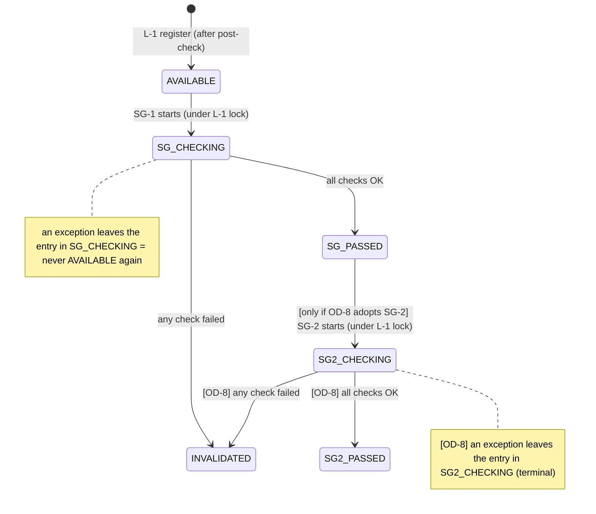
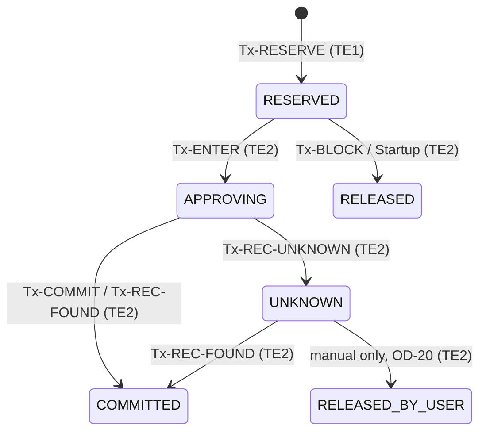

# PHASE 5.3G — L-1/L-2 SPECIFICATION REVISION 5.2.1

| Metadata | Nilai |
|---|---|
| **[5.2.1] Revisi** | **5.2.1**: penyelarasan terminologi Acceptance Criteria (L2-AC-32, L2-AC-36) atas Revision 5.2 |
| **[5.2.1] Tanggal revisi 5.2.1** | 2026-11-23 |
| **[5.2.1] Dokumen sumber 5.2.1** | `docs/phase-5.3g4.5/L1_L2_SPEC_REV5_2.md` (SHA-256 `bafdfd6d3316805b9945a9c18e967d73b05fe2b83bf8308bd0ffb9a8e8cd4639`; tidak diubah) |
| **[5.2.1] Cakupan koreksi 5.2.1** | Hanya dua baris AC di E.2: L2-AC-32 dan L2-AC-36. Ditambah metadata, ringkasan, changelog (J.00) dan verdict (K.00). Definisi, transaksi, R-READY, OD dan CC tidak diubah |
| Riwayat: Revisi 5.2 | **5.2** (koreksi konsistensi terarah atas Revision 5.1) |
| Tanggal revisi 5.2 | 2026-11-23 |
| Dokumen sumber 5.2 | `docs/phase-5.3g4.5/L1_L2_SPEC_REV5_1.md` (SHA-256 `a5eb1bfc02b0b2be0b0e1aee9150f5489fad3c8249a117bb3173d9b9606a22a1`; tidak diubah) |
| Cakupan koreksi 5.2 | B1 (klasifikasi hasil Tx-REC-HOLD: MANUAL vs UNKNOWN), B2 (R-READY syarat 6 vs OD-39 OPEN), B3 (applicability L-2 untuk kelas S). Di luar itu tidak ada perubahan |
| Otorisasi | DOCUMENT ONLY. Bukan izin implementasi, bukan izin tes, bukan izin live |
| Riwayat: Revisi 5.1 | Koreksi terarah atas Revision 5, tanggal 2026-11-19. Sumbernya `docs/phase-5.3g4.5/L1_L2_SPEC_REV5.md` (SHA-256 `8d8ae99cdbab426f520ca349263fd0851479cc9a43bcc27a6c29850d8f4e8f40`; tidak diubah). Cakupannya B-1 sampai B-4 ditambah temuan tambahan A–D |

*[5.2.1] Revision 5.2.1 disusun dengan membaca Revision 5.2 dan mengedit salinannya. Tidak ada sumber kode yang dibaca, dan tidak ada kode, tes, Python, skrip, browser, Flow, maupun kredit yang dipakai. Satu-satunya file yang ditulis untuk revisi ini adalah dokumen ini. Teks yang baru atau dikoreksi di Revision 5.2.1 diberi tanda **[5.2.1]**.*

*[5.2] Revision 5.2 disusun dengan membaca Revision 5.1 dan mengedit salinannya. Tidak ada sumber kode yang dibaca ulang, dan tidak ada kode, tes, Python, skrip, browser, Flow, maupun kredit yang dipakai. Satu-satunya file yang ditulis untuk revisi ini adalah dokumen ini. Teks yang baru atau dikoreksi di Revision 5.2 diberi tanda **[5.2]**.*

*Revision 5.1 adalah dokumen hasil koreksi yang disimpan sebagai file baru. Riwayatnya: Revision 5 awalnya disusun hanya sebagai teks di percakapan, tanpa file yang ditulis. Kemudian, atas instruksi terpisah, teks itu disalin byte-per-byte ke `L1_L2_SPEC_REV5.md`. Revision 5.1 disusun dengan membaca Revision 5 dan membaca sumber secara read-only (`grep`, `sed -n`) untuk fakta baru yang dikutip dengan path:line. Tidak ada kode, tes, Python, browser, Flow, maupun kredit yang dipakai. Satu-satunya file yang ditulis untuk revisi ini adalah dokumen ini.*

Penanda perubahan: teks yang baru atau dikoreksi di Revision 5.1 diberi tanda **[5.1]**. Teks tanpa tanda itu berasal dari Revision 5.

Label yang dipakai: **FACT** (dengan path:line), **INFERENCE**, **PROPOSAL**, **OPEN / DEFERRED / UNVERIFIED**, **NOT ESTABLISHED — REQUIRES DECISION OR EVIDENCE**.

---

## A. Ringkasan

**[5.2.1] Koreksi di Revision 5.2.1 (dua temuan independent review Revision 5.2):**

| Temuan | Koreksi | Status keputusan |
|---|---|---|
| L2-AC-32 belum mencakup MANUAL-UNRESOLVED | Hasil yang diharapkan diselaraskan dengan aturan klasifikasi G.5 (UNKNOWN / MANUAL-UNRESOLVED / MANUAL / BLOCKED). Label hasil rekonsiliasi dipisahkan secara eksplisit dari state attempt `NEEDS_MANUAL_INTERVENTION` | OD-39 tidak berubah (OPEN) |
| L2-AC-36 menggabungkan dua skenario | Dipisah menjadi Kasus A (tile dengan bukti lengkap, tanpa reservasi) dan Kasus B (tanpa tile atau bukti tidak lengkap). Keduanya berjalan lewat Tx-REC-HOLD dengan label MANUAL-UNRESOLVED; tile dengan bukti lengkap tidak menghasilkan COMMITTED | OD-42 tidak berubah (OPEN) |

Tidak ada perubahan pada definisi, transaksi, R-READY, OD, CC, maupun status. Semua AC tetap NOT RUN.

**[5.2] Koreksi di Revision 5.2 (tiga blocker dari review Revision 5.1; riwayat):**

| Blocker | Koreksi | Status keputusan |
|---|---|---|
| B1 Tx-REC-HOLD: MANUAL vs UNKNOWN | Hasil Tx-REC-HOLD diberi label sendiri, **MANUAL-UNRESOLVED**. Label ini **bukan** state DB dan **bukan** `SceneState` baru. Komposisinya: attempt `NEEDS_MANUAL_INTERVENTION` (`RESERVATION_MISSING` / `RESERVATION_CONFLICT`), reservasi tidak ada atau tidak berubah, ledger `UNKNOWN_AFTER_CRASH`, dan akun `ACCOUNT_UNRESOLVED`. Label **UNKNOWN** sekarang hanya dipakai bila reservasi attempt itu benar-benar ada di state `UNKNOWN`. Aturan umum G.5 ("UNKNOWN bila ledger pernah APPROVING") diganti dengan aturan klasifikasi tiga cabang yang memeriksa reservasi lebih dulu. C.4b, G.2, G.5, AC dan matriks diseragamkan | Label ini hanya klasifikasi atas aturan sementara R-ABSENT. Statusnya PROPOSAL; **OD-42 tetap OPEN** |
| B2 Syarat 6 vs OD-39 | R-READY dipisah. **R-READY dasar** memuat syarat 1–5, posisi spesifikasi yang sama dengan Revision 5. **R-READY+6** adalah syarat 6 (`ACCOUNT_UNRESOLVED`), yang **hanya berlaku bila OD-39 secara eksplisit mengadopsinya**. Guard struktural `ACCOUNT_UNRESOLVED` di Tx-RESERVE dan Tx-ENTER **tetap wajib** dan tidak bergantung pada OD-39 | **OD-39 tetap OPEN** |
| B3 Kelas S dan L-2 | Frasa "(atau kelas S)" dicabut dari precondition Tx-RESERVE. Precondition Tx-RESERVE dan Tx-ENTER berlaku normatif untuk jalur kelas L. Untuk kelas S, applicability L-2 dinyatakan **UNRESOLVED** (C.4c). Dokumen tidak menyatakan bahwa kelas S wajib melalui L-2, dan juga tidak menyatakan bahwa kelas S dikecualikan. Kedua alternatif dan konsekuensinya dicatat di OD-42 | **OD-42 tetap OPEN** |

Tidak ada OD baru, tidak ada CC baru, dan tidak ada status OD yang berubah. Hitungan tetap **42 = 3 CLOSED + 36 OPEN + 3 DEFERRED + 0 REJECTED**. AC baru: L2-AC-42 (dependen OD-42). Semua AC NOT RUN.

**[5.1] Koreksi di Revision 5.1 (temuan review Revision 5; riwayat):**

| Temuan | Koreksi | Status keputusan |
|---|---|---|
| B-1 SG-2 tidak konsisten | Dipilih **satu representasi**: SG-2 adalah **rancangan kondisional yang belum diadopsi**. Konfigurasi dasar (yang berlaku untuk spesifikasi ini) **tanpa** SG-2. Semua bagian (L1.4, L1.8–L1.10, E, G.1, G.2, G.4, H, I) diseragamkan. Bila OD-8 mengadopsi SG-2, ketentuan bertanda "[bila OD-8 mengadopsi SG-2]" ikut berlaku | OD-8 tetap OPEN |
| B-2 Tx-REC-* tanpa reservasi | UPDATE tidak lagi diasumsikan. Percabangan dilakukan lewat SELECT eksplisit di transaksi yang sama, dan CAS wajib rowcount = 1. Untuk reservasi yang tidak ada berlaku aturan sementara gagal tertutup **R-ABSENT** (Tx-REC-HOLD): tanpa INSERT/UPDATE reservasi, tanpa APPROVED, attempt MANUAL, dan akun terblokir. **[5.2]** Label hasilnya: MANUAL-UNRESOLVED (G.5) | Pilihan akhir (tidak valid vs didukung untuk data lama): **OD-42 OPEN** |
| B-3 `reserve` tidak terdefinisi | Dibedakan empat besaran: budget reservation L-2, `policy_reserve` (= `SpendingPolicy.reserve`, FACT `gates.py:79`), `quoted_cost`, dan `observed_balance`. Precondition `cost ≤ observed − reserve` **dicabut dari Tx-RESERVE**: NOT ESTABLISHED sampai OD-40. Pemeriksaan saldo yang mengikat tetap `approval_gate` di dalam `authorize` (FACT `gates.py:242`) | **OD-40 OPEN**; OD-10 dan OD-27 tetap OPEN |
| B-4 Bypass SG untuk "bukan live" | Bypass **hanya** untuk tipe persis `SimulatedFlow` dengan reading `int ≥ 0`, yaitu kondisi yang sama dengan langkah 0 R-2 (FACT `gates.py:185-194`, `:277`). Semua adapter lain (FakeFlow, subclass, tipe tidak dikenal) wajib punya evidence L-1; tanpa evidence: `SG_NO_EVIDENCE`, tanpa `authorize`, tanpa approve | Tipe live persis: OD-7 OPEN. `SimulatedFlow` dengan reading bukan int: **OD-41 OPEN** |
| A. Exception SG-2 | State `SG2_CHECKING` terminal; tanpa Tx-RESERVE, approve, maupun reject; reading sudah CONSUMED di R-2 (semantik R-2 tidak berubah) | Kondisional OD-8 |
| B. `evidence_digest` | Serialisasi kanonik ditulis sebagai **PROPOSAL** (field, urutan, encoding, representasi) | **OD-43 OPEN** |
| C. READY dan UNKNOWN lintas attempt | Predikat tingkat akun `ACCOUNT_UNRESOLVED` (tanpa mengubah `SPENT_OR_MAYBE`) ditambahkan ke precondition Tx-RESERVE dan Tx-ENTER (struktural), serta ke R-READY sebagai syarat 6 (defense in depth, dalam cakupan OD-39). **[5.2]** Syarat 6 sekarang opsional: hanya berlaku bila OD-39 mengadopsinya (G.5) | OD-39 tetap OPEN |
| D. Metadata | Tanggal revisi, kalimat pembuka, dan audit trail diperbaiki | — |

**Empat perbaikan yang memblokir di review final Revision 4 (riwayat Revision 5):**

1. **Source Gate dan TOCTOU.**
   - Bukti sumber sekarang mencakup adapter, page, main frame, URL, identitas dokumen, fingerprint, `acquisition_id` dan waktu.
   - SG-1 memeriksa ulang **semua** bukti itu tepat sebelum `authorize_approval`, jadi tidak lagi hanya URL.
   - Registry L-1 punya state sendiri: `AVAILABLE` → `SG_CHECKING` → `SG_PASSED`, atau → `INVALIDATED`. SG yang gagal, termasuk karena exception, membuat reading **tidak pernah lagi** lolos SG.
   - Interval TOCTOU dirinci per segmen. Atomisitas **tidak** diklaim.
   - SG-2 sesudah `authorize` direkomendasikan (OD-8). Interval dari SG-2 sampai klik tetap residual dan hanya bisa ditutup oleh kontrak pre-click di `approve()` (OD-37 baru).
   - **[5.1]** SG-2 adalah rancangan **kondisional yang belum diadopsi** (OD-8 OPEN). Tanpa SG-2, interval dari SG-1 sampai klik seluruhnya residual (L1.9).
2. **Tx-BLOCK dan READY.**
   - Kontradiksi di G.3 dihapus.
   - Dialog yang tertutup **bukan** bukti bahwa reject berhasil.
   - Attempt yang terputus di `AWAITING_COST_CONFIRMATION` tanpa catatan Tx-BLOCK yang durable **tidak pernah** menjadi READY otomatis; hasilnya MANUAL. Ini mengubah perilaku `decide()` yang ada (CC-20, OD-39).
   - READY hanya bisa dicapai lewat aturan R-READY (G.5).
3. **L-2 Acceptance Criteria lengkap.** L2-AC-1 sampai L2-AC-35, dengan kondisi awal, tindakan, hasil, kegagalan dan ekspektasi gagal tertutup. Semua referensi sudah dicek.
4. **`reservation_event`.** Mekanisme kanonik dipilih: **trigger database saja**. Penjelasannya di C.3. API aplikasi tidak pernah menulis event. Kolom `version` dan `UNIQUE (reservation_id, version)` mencegah event ganda. Persetujuan akhir tetap OD-35 (OPEN).

**Status dokumen:**

| Dimensi | Status |
|---|---|
| SPECIFICATION COMPLETE | **NO.** Draft lengkap untuk direview, tetapi masih ada **[5.1]** 36 OD OPEN dan 3 DEFERRED |
| ACCEPTANCE CRITERIA DEFINED | **YES.** Semua AC yang dirujuk sudah didefinisikan (bagian E). **[5.1]** Sebagian AC baru bergantung pada OD dan ditandai "dependen OD" |
| ACCEPTANCE CRITERIA EXECUTED | **NO.** Semuanya NOT RUN |
| IMPLEMENTATION READY | **NO.** Tidak diotorisasi |
| LIVE READY | **NO.** Tidak diotorisasi |

**Jumlah OD:**

| Total aktif | CLOSED | OPEN | DEFERRED | REJECTED |
|---|---|---|---|---|
| **[5.1] 42** | **3** | **36** | **3** | **0** |

Dari 35 OD di Revision 4, Revision 5 menambah OD-37, OD-38 dan OD-39 (ketiganya OPEN). OD-21 berstatus RETIRED dan tidak dihitung.

**[5.1]** Revision 5.1 menambah OD-40, OD-41, OD-42 dan OD-43, keempatnya OPEN. **Tidak ada OD lama yang berubah status.** Isi OD-6, OD-7, OD-8 dan OD-39 diperjelas (pertanyaan, dependensi dan AC), tetapi statusnya tetap.

**Perubahan kontrak R-2 yang beku:** dua item, CC-7 dan CC-18. Angka dua ini **hanya** untuk kontrak R-2 yang beku. Perubahan lintas modul lain dirinci di bagian F.

**Audit trail (dipertahankan):** di Revision 2, satu perintah yang berisi `python3 -c` ditolak sistem sebelum dieksekusi. Python tidak berjalan dan perintah itu tidak diulang.

**[5.1] Audit trail lanjutan:**
- Revision 3, 4 dan 5 hanya berupa teks di percakapan; tidak ada file yang ditulis.
- Revision 5 kemudian disimpan ke `L1_L2_SPEC_REV5.md` sebagai salinan byte-per-byte. Salinan itu diambil dari transkrip sesi dengan `jq` lalu `cp`, dan diverifikasi dengan `cmp`.
- Revision 5.1 membaca sumber secara read-only dengan `grep` dan `sed -n`, lalu menulis satu file baru.

---

## B. Spesifikasi L-1: Source Authenticity

### L1.0 Cakupan

- A1–A5 tetap menjadi cakupan. A4 dan A5 adalah inti desain.
- Keaslian sumber **belum terbukti**. R-2 provenance bukan keaslian sumber.
- Keaslian main frame harus gagal tertutup.
- Arsitektur yang direkomendasikan adalah **L1-X**. Ini bukan keputusan implementasi; pilihannya OD-32.

### L1.1 Baseline (FACT)

| Fakta | Bukti |
|---|---|
| `acquire_balance(page)` hanya memanggil `page.locator("body").aria_snapshot()` | `src/blatifa/account/provenance.py:10`, `:150` |
| Pin R-2 yang beku: `FINDINGS` persis lima; pemetaan dan `Block` `BALANCE_READING_*` persis lima; nama publik provenance berupa himpunan tetap; signature `authorize` tetap; `_calls("acquire_balance") == []`; `authorize_approval` hanya dari runner | `tests/unit/test_phase5_3g4_4_r2_provenance.py:306-307`, `:310-314`, `:474-478`, `:485`, `:546-548` |
| Tab dipilih lewat substring | `src/blatifa/browser/engine.py:162-169` |
| `PROJECT_URL` memakai `[0-9a-f-]{36}`, yang **bukan** UUID kanonik | `src/blatifa/flow/adapter.py:40` |
| `_on_project` | `src/blatifa/flow/adapter.py:69-71` |
| `approve()` dan `reject()` live: `BlockedOperationError` | `src/blatifa/flow/adapter.py:156-160` |
| `ReadOnlyPage` tidak mengekspos `main_frame` | `src/blatifa/flow/live_probe.py:72-107` |
| `new_cdp_session` dan `Network.enable` dilarang oleh tes | `tests/unit/test_phase5_1_runner_compat.py:112-113` |
| `_manual(a, code: str, detail)` | `src/blatifa/production/runner.py:341-345` |
| **[5.1]** `is_simulated_adapter(adapter)` = `type(adapter) is SimulatedFlow`. Subclass, `__class__` palsu, atribut `is_simulated`, dan tipe lain dianggap produksi atau tidak tepercaya | `src/blatifa/production/gates.py:185-194` |
| **[5.1]** Jalur int R-2 (langkah 0) hanya bila `is_simulated_adapter(adapter)` **dan** `type(reading) is int and reading >= 0` | `src/blatifa/production/gates.py:206`, `:277` |
| **[5.1]** `FakeFlow` (tes) bukan `SimulatedFlow`; runner memperlakukannya sebagai adapter produksi yang tidak tepercaya; `fresh_balance()` memberi `BalanceReading` lewat `acquire_balance` pada fake Page | `tests/unit/simflow.py:39`, `:202-212` |
| **[5.1]** Reading berasal dari callable `balance` yang disuntikkan ke runner (komentar: "int: SimulatedFlow only") | `src/blatifa/production/runner.py:86`, `:194` |

### L1.2 Batasan

1. Bukti dari DOM adalah satu sumber dan tidak independen bila browser sudah terkompromi.
2. Manipulasi di dalam proses yang sama berada di luar jaminan Option C.
3. Akses CDP lokal, ekstensi browser, atau kompromi browser berada di luar jaminan.
4. Pemakaian manual akun yang sama di luar aplikasi tidak bisa dideteksi maupun dikoordinasi.
5. Restart proses tidak membuktikan keaslian sumber maupun keamanan budget.
6. Tab yang aktif tidak dianggap project yang benar.
7. Saldo di UI tidak dianggap segar.
8. **Tidak ada atomisitas antara pemeriksaan sumber dan klik** (L1.9).
9. Spesifikasi ini tidak mengizinkan operasi live.

### L1.3 Pilihan arsitektur (OD-32 OPEN)

| Opsi | Inti | Kontrak R-2 beku yang tersentuh |
|---|---|---|
| **L1-X (direkomendasikan)** | Registry L-1 terpisah; `acquire_balance(view)` R-2 dipakai tanpa perubahan; SG di runner | CC-7 (§8 runner) dan CC-18 (pin `acquire_balance`). `provenance.py` dan `gates.py` tidak berubah |
| L1-Y | Evidence di dalam R-2 | CC-1 sampai CC-6: **CHANGE CONTROL REQUIRED** |

### L1.4 Bukti sumber (`SourceEvidence`) dan keterikatannya (perbaikan blocking #1, bagian 3.1)

Frozen dataclass, disimpan **hanya** di registry L-1:

| Field | Sumber | Bisa diperoleh di arsitektur saat ini? | Dipakai di SG |
|---|---|---|---|
| `version` | konstanta = 2 | Ya | — |
| `acquisition_id` | `uuid4().hex` per akuisisi | Ya | Audit, dan masuk `evidence_digest` |
| `adapter_session` | Token acak yang dibuat sekali saat `GoogleFlowAgentAdapter` dikonstruksi (CC-10/CC-17) | Ya, di dalam proses | Dicocokkan |
| `adapter_ref` | weakref tanpa callback | Ya | `adapter_ref() is adapter` |
| `page_ref` | weakref ke `adapter.page` | Ya | `adapter.page is page_ref()` |
| `frame_ref` | weakref privat ke `page.main_frame` saat pre-check. **Tidak pernah diekspos** | Ya, tetapi stabilitasnya UNVERIFIED (OD-31) | `page.main_frame is frame_ref()` |
| `url_digest` | L1.6 | Ya | Dicocokkan |
| `doc_identity_digest` | SHA-256 dari `{timeOrigin, url}` (`DOC_IDENTITY_JS`) | Ya. Kecukupannya DEFERRED (OD-3, U-2) | Dicocokkan |
| `account_fingerprint` | Pembacaan identitas tanpa interaksi | Ya, dari DOM yang sama | Dicocokkan (OD-5) |
| `t_mono_pre`, `t_mono_post` | `time.monotonic()` | Ya | **Hanya audit.** SG tidak menambah toleransi kesegaran; kesegaran tetap urusan R-2 (STALE 300 dtk dan jam dinding) |
| Identitas sesi browser atau target CDP | — | **Tidak.** Butuh API CDP yang dilarang (FACT di atas) | Tidak diklaim |

**Keterikatan ke BalanceReading:**
- Entri registry L-1 diikat ke objek reading lewat identitas objek: `id(reading)` ditambah `ref() is reading`. Ini mencerminkan aturan identitas R-2 §5.3.
- `evidence_digest` adalah SHA-256 dari field yang bisa diserialisasi, termasuk `acquisition_id`. Digest ini dicatat L-2 di reservasi.
- **[5.1]** Serialisasi kanoniknya ada di L1.4a (PROPOSAL, OD-43 OPEN).

**State entri L-1:**



`SG_PASSED`, `INVALIDATED` dan `SG_CHECKING` yang tertinggal sama-sama bersifat **terminal untuk SG**: SG berikutnya pada reading yang sama akan gagal.

**[5.1] Konfigurasi dasar dan SG-2:**
- Dalam konfigurasi dasar (SG-2 tidak diadopsi), `SG_PASSED` adalah state akhir entri yang lolos.
- State `SG2_CHECKING` dan `SG2_PASSED` **hanya ada bila OD-8 mengadopsi SG-2**. Dalam varian itu:
  - `SG_PASSED` terminal untuk SG-1, tetapi menjadi titik awal **satu** SG-2;
  - `SG2_CHECKING` dan `SG2_PASSED` terminal untuk SG-1 maupun SG-2: pemeriksaan berikutnya pada reading yang sama gagal dengan `SG_EVIDENCE_REUSED`.

**Registry L-1:**
- Punya lock non-reentrant sendiri, dan tidak pernah memegangnya sambil memanggil R-2. Tidak ada lock bertingkat.
- Tanpa reset, clear, maupun pemulihan.
- Kegagalan internal menjadi `SourceEvidenceError`.
- Tidak pernah menyentuh FAULTED milik R-2.

### L1.4a [5.1] Serialisasi kanonik `evidence_digest` (PROPOSAL; OD-43 OPEN)

Semua isi subbagian ini adalah **PROPOSAL**, bukan FACT. Sumber yang ada tidak menetapkan format apa pun, jadi rincian berikut menunggu persetujuan lewat OD-43.

| Aspek | Usulan |
|---|---|
| Field yang masuk | `version`, `acquisition_id`, `adapter_session`, `url_digest`, `doc_identity_digest`, `account_fingerprint`. Masing-masing wajib ada; field yang hilang membuat digest gagal dibuat (`SourceEvidenceError`), tanpa nilai pengganti |
| Field yang **tidak** masuk | `adapter_ref`, `page_ref`, `frame_ref` (weakref; tidak bisa diserialisasi dan tidak bermakna di luar proses). `t_mono_pre` dan `t_mono_post` (float monotonic yang hanya bermakna di dalam proses; float juga membawa risiko perbedaan representasi). Field reading R-2 (`verified_balance`, `read_at`): apakah masuk adalah pertanyaan OD-43 |
| Urutan | Key diurutkan leksikografis menurut code point Unicode, sehingga urutan tidak bergantung pada urutan deklarasi |
| Bentuk | Objek JSON tunggal: tanpa spasi; pemisah `,` dan `:`; tanpa newline di akhir |
| Representasi nilai | `version`: integer JSON tanpa tanda `+`, tanpa nol di depan, tanpa eksponen. Field lain: string JSON. Digest heksadesimal dan `acquisition_id` harus huruf kecil (`[0-9a-f]`); huruf besar ditolak, bukan dinormalisasi. Float, `null`, boolean, NaN dan Infinity tidak dipakai |
| Encoding string | Karakter non-ASCII di-escape sebagai `\uXXXX` (setara `ensure_ascii=True`), sehingga byte yang dihasilkan hanya ASCII. Tidak ada normalisasi Unicode; nilai di-hash apa adanya |
| Pemisahan domain | Awalan byte ASCII `blatifa.l1.evidence.v2\n` sebelum JSON, agar digest ini tidak tertukar dengan digest lain (`url_digest`, `doc_identity_digest`) |
| Digest | `SHA-256(awalan ‖ JSON)`, dalam heksadesimal huruf kecil, 64 karakter |
| Format `adapter_session` | Belum ditetapkan (CC-10/CC-17). Usulan: 32 karakter heksadesimal huruf kecil dari sumber acak kriptografis. OD-43 |
| Verifikasi | Golden vector tetap (L1-AC-32) |

**Yang tetap OPEN di OD-43:**
- persetujuan format di atas;
- apakah field reading R-2 ikut masuk;
- apakah `account_fingerprint` boleh disimpan di DB dalam bentuk ini (OD-5).

### L1.5 `TrustedFrameView` (OD-23 OPEN; OD-31 UNVERIFIED)

**Dibuat hanya di dua tempat:** di dalam `acquire_trusted_balance()` dan di dalam `source_gate()`. Masing-masing berumur satu pemanggilan, dan tidak pernah dikembalikan, disimpan, atau diberikan ke komponen lain.

**Enam operasi (lengkap):**

| # | Operasi | Batasan |
|---|---|---|
| 1 | `page_is_closed()` | `page.is_closed()`; hasil harus `type(x) is bool` |
| 2 | `is_main()` | `frame.parent_frame is None` |
| 3 | `is_detached()` | Hasil harus `bool` persis |
| 4 | `url()` | Hasil harus `str` persis |
| 5 | `locator("body")` | Hanya argumen literal `"body"`; argumen lain raise. Mengembalikan objek yang hanya punya `aria_snapshot()`, yang mengembalikan `str` |
| 6 | `document_identity()` | Konstanta `DOC_IDENTITY_JS` saja. Hasilnya harus dict persis `{timeOrigin: float, url: str}` |

- **Dilarang:** `evaluate` generik, `locator` generik, Frame atau Page mentah, dan `__getattr__` yang mengembalikan sesuatu.
- Kondisi yang gagal atau tidak bisa diverifikasi ditolak. Exception dari Playwright diteruskan.
- Wrapper ini **bukan** batas keamanan terhadap kode in-process.

### L1.6 Kontrak URL dan project (OD-1, OD-2, OD-30 OPEN)

Diterima hanya bila `url == "https://flow.google.com/project/" + project_id`, dibandingkan persis.
- Port, userinfo, query, fragment, garis miring di akhir, huruf kapital, `xn--` dan titik di akhir: ditolak.
- `project_id` berasal dari `adapter.project_url`. Validasi yang ditemukan hanya regex yang ada, yang bukan UUID kanonik. Format yang dibutuhkan: OD-30.
- `url_digest` = SHA-256 dari UTF-8 string kanonik, dalam heksadesimal huruf kecil.
- Himpunan yang diterima adalah subset ketat dari `_on_project`.
- Belum tervalidasi di runtime (LIVE-OBS-3).

### L1.7 Akuisisi tepercaya (L1-X)

```
GoogleFlowAgentAdapter.acquire_trusted_balance():          # exact type (OD-7)
  1. PRE: _on_project(); view; not page_is_closed; is_main; not detached; url() per L1.6;
          doc_pre = document_identity(); fp_pre == expected (OD-5); frame_pre = page.main_frame (private)
  2+3. reading = provenance.acquire_balance(view)            # R-2 unchanged (incl. R-2 registration)
  4. POST: same checks + page.main_frame is frame_pre (OD-31) + url == url_pre + doc == doc_pre + fp == fp_pre
           otherwise SourceEvidenceError (reading dropped, no L-1 entry)
  5. L-1 REGISTER: entry AVAILABLE with SourceEvidence (incl. acquisition_id, adapter_session, frame_ref)
```

Dinyatakan jujur: registrasi **R-2** terjadi sebelum post-check, dan itu tidak terhindarkan tanpa mengubah R-2. Yang membuat reading **tepercaya** adalah registrasi **L-1**, yang baru terjadi sesudah post-check.

### L1.8 Source Gate (bagian 3.2 dan 3.4)

**Urutan di `_decide_on_quote`** (lihat G.1):
- akuisisi;
- gate pendahuluan;
- `confirm`;
- **SG-1**;
- `authorize_approval`;
- **[5.1]** SG-2, **hanya bila OD-8 mengadopsinya** (konfigurasi dasar: tidak ada);
- L-2.

**[5.1] Klasifikasi adapter untuk Source Gate (koreksi B-4):**

Status "bukan live" **tidak** dipakai sebagai dasar bypass. Klasifikasinya:

| Kelas | Definisi | Dasar | Perlakuan SG |
|---|---|---|---|
| **S** (simulasi tepercaya) | `is_simulated_adapter(adapter)` (tipe persis `SimulatedFlow`) **dan** `type(reading) is int and reading >= 0` | FACT `gates.py:185-194`, `:277`. Ini kondisi yang sama dengan langkah 0 R-2 | **Tidak berlaku (bypass).** Perilaku simulasi tidak berubah |
| **L** (live) | `type(adapter) is GoogleFlowAgentAdapter`, dengan tipe persis dan tanpa subclass | **PROPOSAL** (OD-7 OPEN) | Wajib ada entri L-1 |
| **U** (lainnya) | Semua yang bukan S atau L: `FakeFlow`, subclass `SimulatedFlow`, objek dengan `__class__` palsu, adapter tidak dikenal, dan `SimulatedFlow` dengan reading bukan int | Tidak ada bukti bahwa tipe-tipe ini aman. FACT: `FakeFlow` diperlakukan sebagai produksi yang tidak tepercaya (`simflow.py:202-212`) | **Gagal tertutup.** Tanpa entri L-1: `SG_NO_EVIDENCE`. Dengan entri L-1: `SG_ADAPTER_MISMATCH`, karena entri L-1 hanya dibuat oleh `acquire_trusted_balance` pada kelas L |

Konsekuensi yang dicatat (bukan perubahan yang dilakukan):
- **FakeFlow.** Tes berbasis FakeFlow dengan `fresh_balance()` (reading R-2 tanpa entri L-1) akan berhenti di SG-1 dengan `SG_NO_EVIDENCE`, kecuali ada binding TEST (OD-6, CC-8). Tidak ada perlindungan yang diklaim untuk kode yang belum ada.
- **`SimulatedFlow` dengan `BalanceReading`.** Saat ini kombinasi ini lewat R-2 (`credit_evidence` dan `authorize`). Di bawah SG, kombinasi ini masuk kelas U dan diblokir. Apakah jalur ini dipakai oleh simulasi yang ada: **NOT ESTABLISHED** (tidak diperiksa). Bila dipakai, aturan ini mengubah perilaku simulasi, dan itu butuh keputusan: **OD-41 OPEN**. Sampai OD-41 diputuskan, spesifikasi memakai varian gagal tertutup (kelas U).
- **Tanpa registrasi.** Kelas S tidak bisa ditambah lewat registrasi, flag, atau atribut. Tidak ada API whitelist.

**SG-1 = `source_gate(reading, adapter, phase="pre_authorize")`:**

| # | Pemeriksaan | Kode internal SG bila gagal |
|---|---|---|
| 0 | **[5.1]** Kelas S (lihat tabel klasifikasi): PASS (tidak berlaku). Kelas lain lanjut ke langkah 1 | — |
| 1 | **[5.1]** Kelas L atau U, tetapi reading tidak punya entri L-1 | `SG_NO_EVIDENCE` |
| 2 | Di bawah lock L-1: state entri harus `AVAILABLE`, lalu diubah ke `SG_CHECKING` | `SG_EVIDENCE_REUSED` (bila `SG_PASSED` atau `SG_CHECKING`) / `SG_EVIDENCE_INVALIDATED` |
| 3 | `adapter_ref() is adapter` dan `adapter._session == adapter_session` | `SG_ADAPTER_MISMATCH` |
| 4 | `adapter.page is page_ref()` dan tidak `page_is_closed()` | `SG_PAGE_MISMATCH` |
| 5 | `page.main_frame is frame_ref()` (OD-31), `is_main()`, tidak `is_detached()` | `SG_FRAME_MISMATCH` / `SG_FRAME_DETACHED` |
| 6 | `url()` memenuhi L1.6 dan digest-nya sama dengan `url_digest` | `SG_URL_MISMATCH` |
| 7 | Digest `document_identity()` sama dengan `doc_identity_digest` | `SG_DOCUMENT_MISMATCH` |
| 8 | Fingerprint sama dengan `account_fingerprint` | `SG_FINGERPRINT_MISMATCH` |
| 9 | Semua lolos: `SG_CHECKING` menjadi `SG_PASSED` | — |
| — | **[5.1]** Adapter kelas U, tetapi reading punya entri L-1 (diperiksa sebelum langkah 2, jadi entri tidak berpindah ke `SG_CHECKING`) | `SG_ADAPTER_MISMATCH` |

**Apa yang tidak bisa diperiksa SG:**
- **Apakah reading sudah CONSUMED di R-2.** SG tidak punya API untuk itu, dan pin `:474-478` melarang menambahkannya. Kondisi ini ditegakkan oleh `authorize` (finding CONSUMED).
- SG hanya menjamin bahwa **evidence L-1** dipakai satu kali (langkah 2).

**SG-2 = `source_gate(..., phase="post_authorize")` — [5.1] RANCANGAN KONDISIONAL, BELUM DIADOPSI (OD-8 OPEN):**

> **[5.1] Status normatif.** Semua ketentuan SG-2 di dokumen ini adalah rancangan kondisional. Ketentuan itu **tidak berlaku** dan **tidak boleh** dijadikan syarat, langkah wajib, atau AC yang mengikat sampai OD-8 memutuskan untuk mengadopsinya. Konfigurasi dasar adalah: SG-1 → `authorize_approval` → Tx-RESERVE. Rekomendasi dokumen ini tetap mengadopsi SG-2, tetapi rekomendasi bukan keputusan.

Bila OD-8 mengadopsi SG-2:
- **[5.1]** Pemeriksaan 3–8 diulang. Di bawah lock L-1, entri harus `SG_PASSED` lalu diubah ke `SG2_CHECKING`. Hasilnya `SG2_PASSED` bila semua lolos, atau `INVALIDATED` bila ada yang gagal. Entri yang tidak `SG_PASSED` menghasilkan `SG_EVIDENCE_REUSED` atau `SG_EVIDENCE_INVALIDATED`.
- Bila gagal: reading sudah CONSUMED di R-2 (§8 langkah 5), lalu Tx-BLOCK dengan `SOURCE_MISMATCH`, tanpa Tx-RESERVE.
- **[5.1] Bila SG-2 melempar exception (temuan tambahan A):**
  - Exception diteruskan tanpa ditangkap. Entri tetap `SG2_CHECKING`, yang terminal.
  - Tidak ada Tx-RESERVE, `approve()`, maupun `reject()`.
  - Reading sudah CONSUMED di R-2 karena `authorize` sudah mengizinkan, sehingga R-2 sendiri menolak pemakaian ulang dengan finding CONSUMED. Semantik R-2 tidak berubah, dan L-1 tidak menambah jalur konsumsi.
  - Durable state: (AWAITING, –, –), sebab Tx-RESERVE belum terjadi. Rekonsiliasi: skenario E di G.5, yaitu MANUAL, karena ledger tidak APPROVING. Dialog yang mungkin masih terbuka juga menghasilkan MANUAL (`reconcile.py:99-100`).
- Posisi SG-2 di antara `authorize_approval` dan Tx-RESERVE adalah bagian dari keputusan OD-8.

**Perilaku saat gagal (bagian 3.4):**

| Syarat | Bagaimana dipenuhi |
|---|---|
| `authorize_approval()` tidak dipanggil | Kegagalan SG-1 mengarah langsung ke jalur blok |
| `adapter.approve()` tidak dipanggil | Sama. **[5.1]** Bila OD-8 mengadopsi SG-2, kegagalan SG-2 juga terjadi sebelum Tx-RESERVE |
| Reading tidak dipakai ulang secara tidak aman | Entri L-1 menjadi `INVALIDATED` (atau tetap `SG_CHECKING` bila terjadi exception; **[5.1]** atau `SG2_CHECKING` pada varian SG-2). Reading tidak bisa lolos SG lagi, **[5.1]** untuk adapter kelas mana pun selain S. Kelas S tidak punya entri L-1; jalur int-nya tetap ditangani R-2. Runner juga membuang reading (variabel lokal, R-2 §8) |
| Konsumsi di R-2 | SG-1 yang gagal **tidak** mengonsumsi reading di R-2, karena satu-satunya jalur konsumsi adalah `authorize` yang mengizinkan, dan menambah jalur lain berarti mengubah R-2. Entri R-2 tetap AVAILABLE sampai STALE atau tersapu. Itu aman, karena invalidasi di L-1 menutup semua jalur pemakaian. Ini dicatat sebagai **limitation**, bukan PASS |
| Tidak masuk prioritas R-2 | Kode SG adalah kode internal L-1. Ke luar dilaporkan sebagai `block_code = "SOURCE_MISMATCH"` (string, lewat `_manual(code: str)`), **bukan** member `Block` dan bukan `FINDINGS`. Bentuk publiknya OD-9 |
| Exception di SG | Diteruskan tanpa ditangkap. Entri tetap `SG_CHECKING` (terminal). Tanpa `authorize`, tanpa approve, tanpa reject. Attempt lalu direkonsiliasi (G.5). **[5.1]** Exception di SG-2 (bila diadopsi): lihat di atas; `authorize` sudah terjadi, jadi reading sudah CONSUMED |

### L1.9 Interval TOCTOU (bagian 3.3)

| Interval | Isi | Ada aksi asinkron? | Bagaimana perubahan ditangani | Jaminan |
|---|---|---|---|---|
| I1: post-check akuisisi sampai SG-1 | Gate pendahuluan dan `confirm` (menunggu pengguna, durasinya tidak terbatas) | Ya, menunggu pengguna. Browser bisa berubah kapan saja | SG-1 memeriksa ulang semua bukti | Perubahan yang mengubah bukti terdeteksi di SG-1 |
| I2: pembacaan browser terakhir di SG-1 sampai `authorize_approval` kembali | `credit_evidence`, `provenance.authorize`, `approval_gate` | INFERENCE: tidak ada panggilan Playwright dari kode kita (R-2 §10: provenance tanpa browser; gates murni). **Tetapi browser adalah proses lain dan bisa berubah kapan saja** | Tidak teramati di interval ini | **Tidak ada jaminan.** Hanya urutan sinkron di satu thread. Syarat tambahan: runner single-threaded untuk page itu. Apakah runner single-threaded: NOT ESTABLISHED, jadi dijadikan syarat implementasi |
| I3: `authorize` sampai SG-2 **[5.1] (hanya bila OD-8 mengadopsi SG-2)** | Tidak ada kode yang menyentuh browser | Sama | SG-2 memeriksa ulang | Perubahan terdeteksi di SG-2 |
| **[5.1] I3+I4 dasar:** `authorize` sampai klik, tanpa SG-2 | Tx-RESERVE, Tx-ENTER | Browser bisa berubah | **Tidak teramati.** Pemeriksaan terakhir adalah SG-1 | **Residual**, sama dengan I4. Ditutup sebagian hanya oleh OD-8 dan/atau OD-37 |
| I4: SG-2 sampai klik di `approve()` **[5.1] (varian SG-2)** | Tx-RESERVE dan Tx-ENTER, masing-masing paling lama 5000 ms busy wait ditambah waktu eksekusi | Browser bisa berubah | **Tidak ditutup oleh L-1.** Hanya bisa ditutup oleh pemeriksaan pre-click di `approve()` sendiri (OD-37). Bila pemeriksaan itu gagal: tidak ada klik, record tetap APPROVING, lalu reconcile konservatif (UNKNOWN atau MANUAL) | Residual |
| I5: klik | Di dalam Playwright | — | — | Di luar L-1 |

**Kesimpulan:**
- Pemeriksaan sumber dan otorisasi **tidak** bisa dibuat atomik terhadap browser.
- Yang dijamin: bukti sumber valid pada saat SG-1 (**[5.1]** dan pada saat SG-2, bila OD-8 mengadopsinya), ditambah gagal tertutup bila ada perbedaan yang terdeteksi.
- **[5.1]** Dalam konfigurasi dasar, jendela residual membentang dari pembacaan browser terakhir di SG-1 sampai klik (I2 ditambah I3+I4 dasar). Jendela ini lebih panjang daripada pada varian SG-2.
- Perubahan sesudah pembacaan terakhir dan sebelum klik **tidak** dijamin terdeteksi. Ini dicatat sebagai limitation 8, OD-37, dan Risiko #2 di bagian I.

### L1.10 Tabel kombinasi dengan R-2

| Kombinasi kegagalan | Outcome | Kontrak R-2 tersentuh? | Status |
|---|---|---|---|
| SG-1 gagal (kode apa pun) | `SOURCE_MISMATCH` (detail = kode SG); R-2 tidak dipanggil; entri `INVALIDATED`; Tx-BLOCK | Tidak | PROPOSAL |
| SG-1 gagal dan R-2 FAULTED atau ada finding R-2 lain | `SOURCE_MISMATCH`, karena SG dievaluasi lebih dulu. Latch tetap berlaku | Tidak | PROPOSAL; diagnosisnya kalah spesifik |
| SG-1 lolos dan ada finding R-2 | Prioritas R-2 berlaku tanpa perubahan; entri tetap `SG_PASSED` sehingga tidak bisa dipakai lagi | Tidak | PROPOSAL |
| **[5.1]** SG-1 lolos dan R-2 mengizinkan (konfigurasi dasar) | L-2 (Tx-RESERVE) | Tidak | PROPOSAL |
| SG-1 lolos dan R-2 mengizinkan; SG-2 gagal **[5.1] (varian SG-2)** | CONSUMED; `SOURCE_MISMATCH`; Tx-BLOCK | Tidak | OPEN (OD-8) |
| SG-1 dan SG-2 lolos **[5.1] (varian SG-2)** | L-2 | Tidak | OPEN (OD-8) |
| Exception di SG-1 | Diteruskan; tanpa `authorize` | Tidak | PROPOSAL |
| **[5.1]** Exception di SG-2 (varian SG-2) | Diteruskan; sudah CONSUMED; tanpa Tx-RESERVE, approve, reject | Tidak | OPEN (OD-8) |
| **[5.1]** Adapter kelas U tanpa entri L-1 | `SG_NO_EVIDENCE`, lalu `SOURCE_MISMATCH`; R-2 tidak dipanggil | Tidak | PROPOSAL |
| **[5.1]** Adapter kelas S | SG tidak berlaku; langkah 0 R-2 berlaku tanpa perubahan. **[5.2]** L-2: UNRESOLVED (C.4c) | Tidak | FACT (R-2); **[5.2]** L-2: OPEN (OD-42) |
| L1-Y | Prioritas R-2 berubah | **CHANGE CONTROL REQUIRED** | Kondisional |

### L1.11 Mode kegagalan saat akuisisi

| Kegagalan | Hasil | FAULTED | Approval |
|---|---|---|---|
| Pre-check atau post-check | `SourceEvidenceError`, lalu `AdapterError("SOURCE_UNVERIFIED")`, lalu manual (`runner.py:39-44`, `:106`) | tidak | tidak |
| Playwright atau parse | Diteruskan | tidak | tidak |
| R-2 FAULTED | `ProvenanceRegistryError` | sudah | tidak |

Apakah `reject()` dipanggil di jalur `AdapterError`: **NOT ESTABLISHED.** Bila tidak dipanggil, dialog tetap terbuka dan hasilnya MANUAL.

### L1.12 SimulatedFlow dan FakeFlow

- Tidak berubah. Pin `tests/unit/test_phase5_3g4_1_adapter_trust.py:173-174` tetap berlaku.
- Binding TEST: OD-6 / CC-8.
- **[5.1]** Perilaku `SimulatedFlow` dengan reading int tidak berubah (kelas S, FACT `gates.py:277`).
- **[5.2]** Pernyataan itu hanya menyangkut SG dan R-2. Apakah L-2 berlaku untuk kelas S masih **UNRESOLVED** (C.4c, OD-42).
- **[5.1]** `FakeFlow` masuk kelas U. Spesifikasi ini **tidak** mengubah FakeFlow maupun `simflow.py`. Akibatnya terhadap tes yang ada dicatat di L1.8 (OD-6, CC-8).
- **[5.1]** `SimulatedFlow` dengan reading bukan int masuk kelas U sampai OD-41 diputuskan.
- **[5.1]** Tidak ada klaim bahwa klasifikasi S/L/U sudah diimplementasikan. Saat ini yang ada hanya `is_simulated_adapter` (FACT). Kelas L dan gerbang kelas U adalah PROPOSAL (CC-17).

---

## C. Spesifikasi L-2: Cross-Process Budget Coordination

### C.1 Cakupan dan baseline

- **Cakupan:** B1, B2, B3, B4, B5, B7.
- **Ditolak:** B6 dan B8.
- **Di luar cakupan:** koordinasi antar-mesin.
- **Diputuskan:** satu proses per workspace (`WorkspaceLockedError`).
- `PAUSE_BLOCKS` tidak berubah.

| FACT | Bukti |
|---|---|
| `COMMIT` di `_tx` berada di luar try | `src/blatifa/persistence/store.py:284-291` |
| `ledger_write` dan `transition` membuka transaksi terpisah | `store.py:323-343`, `:350-356` |
| Preseden trigger append-only | `store.py:197-200` |
| `connect` tanpa timeout; `foreign_keys=ON` per koneksi `Store` | `store.py:269`, `:274` |
| Tidak ada kerangka migrasi | `store.py:24`, `:275-278` |
| Jalur blok: `reject()`, lalu `REJECTED`, lalu `_manual` | `src/blatifa/production/runner.py:200-204` |
| `SimulatedFlow.reject()` idempotent **di simulasi saja** | `src/blatifa/simulation.py:46-47` |
| Reconcile tidak memanggil `reject` maupun `approve` | `runner.py:312-339` |
| `resume()` dari MANUAL atau PAUSED selalu ke RECONCILING | `runner.py:347-349` |
| `decide()` menghasilkan READY bila tidak `maybe_spent`, tidak ada tile baru, dan `pending_confirmation is False`. `interrupted_state` `AWAITING_COST_CONFIRMATION` tidak dibedakan | `src/blatifa/production/reconcile.py:66`, `:93-102` |
| Belum ada implementasi lock | Hasil grep kosong |
| Workspace default, dan path DB simulasi yang terpisah | `src/blatifa/config.py:23`; `src/blatifa/cli.py:333-335` |
| Python 3.12 | `pyproject.toml:5` |

**Dua besaran:**
1. Saldo aktual Flow: hanya bukti L-1 dan R-2 pada satu titik waktu, tidak dianggap segar.
2. Budget reservasi lokal: per grant per akun, dalam satu file DB.

**[5.1] Istilah saldo dan reservasi (koreksi B-3).** Istilah-istilah berikut **tidak boleh** disamakan satu sama lain.

| Istilah di dokumen ini | Arti | Asal | Status |
|---|---|---|---|
| **budget reservation** (reservasi budget lokal) | Baris `budget_reservation` milik L-2. `quoted_cost`-nya dihitung terhadap `cap` grant | C.2 | PROPOSAL (CC-11) |
| **`policy_reserve`** (saldo cadangan) | `SpendingPolicy.reserve`, yaitu "credits that must remain after the generation". Dipakai `approval_gate`: blok `COST_OVER_BALANCE` bila `quote.cost > balance - policy.reserve` | FACT `gates.py:79`, `:242`. Juga dipakai di preflight (`gates.py:106`). CLI `--reserve` memakai `type=int, default=0` (`cli.py:723`) | Sudah ada di kode. **L-2 tidak menetapkan default, minimum, maksimum, persentase, maupun satuan baru untuk besaran ini** |
| **`quoted_cost`** | Biaya approval yang dikutip, yaitu `quote.cost` dari dialog | `gates.py:236-242`; kolom `budget_reservation.quoted_cost` | Rentang: OD-27 |
| **`observed_balance`** | Saldo terverifikasi dari reading yang dievaluasi `authorize` untuk keputusan ini | Kolom C.2. INFERENCE: sama dengan nilai snapshot yang dibandingkan `approval_gate` di dalam `authorize`, karena reading yang berubah menghasilkan MUTATED (R-2 §6.3) | Sumber persisnya masuk OD-40 |
| **`cap`** (budget grant) | Batas total per grant: Σ `quoted_cost` reservasi yang dihitung terpakai (C.4) | C.2 | Nilai OD-10, tipe dan rentang OD-27; keduanya OPEN |
| `max_cost_per_scene` | Batas biaya per scene di kebijakan (blok `COST_OVER_CAP`). **Berbeda** dari `cap` grant | FACT `gates.py:78`, `:238-240` | Tidak diubah |

**Akibatnya untuk Tx-RESERVE:**
- Precondition Revision 5 `cost ≤ observed − reserve` memakai variabel `reserve` yang tidak terdefinisi. Precondition itu **dicabut** dari Tx-RESERVE dan dicatat sebagai **NOT ESTABLISHED — REQUIRES DECISION (OD-40)**.
- Pencabutan ini tidak melemahkan perlindungan. Pemeriksaan `quoted_cost ≤ balance − policy_reserve` sudah dijalankan oleh `approval_gate` di dalam `authorize` (FACT `gates.py:242`, R-2 tidak berubah). Pemeriksaan itu memakai `SpendingPolicy` dan reading yang sama, sebelum Tx-RESERVE.
- OD-40 memutuskan apakah L-2 mengulang pemeriksaan ini di dalam transaksi. Bila ya, perlu diputuskan juga sumber `policy_reserve` (objek kebijakan runner yang sama), apakah nilainya dipersistenkan (skema C.2 tidak punya kolom untuk itu, jadi perlu perubahan CC-11), dan apa yang terjadi bila nilainya berbeda.

### C.2 Skema konseptual v2 (PROPOSAL; CC-11)

```sql
CREATE TABLE budget_grant (
  id TEXT PRIMARY KEY, account_id TEXT NOT NULL,
  cap <TYPE: OD-27> NOT NULL,                 -- DECIDED: explicit, NOT NULL, no DEFAULT. OPEN: type/range (OD-27), value (OD-10)
  expected_fingerprint TEXT NOT NULL,         -- OD-5
  granted_by TEXT NOT NULL CHECK (granted_by = 'user'),
  opened_at TEXT NOT NULL, closed_at TEXT,
  UNIQUE (id, account_id));
CREATE UNIQUE INDEX budget_grant_one_open ON budget_grant(account_id) WHERE closed_at IS NULL;
CREATE UNIQUE INDEX scene_attempt_id_account ON scene_attempt(id, account_id);

CREATE TABLE budget_reservation (
  id TEXT PRIMARY KEY,
  idempotency_key TEXT NOT NULL UNIQUE, attempt_id TEXT NOT NULL UNIQUE,
  grant_id TEXT NOT NULL, account_id TEXT NOT NULL,
  quoted_cost INTEGER NOT NULL, observed_balance INTEGER NOT NULL,      -- range: OD-27
  evidence_digest TEXT NOT NULL, owner_token TEXT NOT NULL,
  state TEXT NOT NULL CHECK (state IN ('RESERVED','APPROVING','UNKNOWN','COMMITTED','RELEASED','RELEASED_BY_USER')),
  version INTEGER NOT NULL,                   -- 1 on INSERT, +1 on every transition
  transition_reason TEXT NOT NULL,            -- copied into the event by the trigger
  block_code TEXT,
  created_at TEXT NOT NULL, updated_at TEXT NOT NULL,
  UNIQUE (id, account_id),
  FOREIGN KEY (grant_id, account_id)   REFERENCES budget_grant(id, account_id),
  FOREIGN KEY (attempt_id, account_id) REFERENCES scene_attempt(id, account_id));
CREATE UNIQUE INDEX budget_one_active_per_account ON budget_reservation(account_id)
  WHERE state IN ('RESERVED','APPROVING','UNKNOWN');

CREATE TABLE reservation_event (
  id INTEGER PRIMARY KEY AUTOINCREMENT,
  reservation_id TEXT NOT NULL, account_id TEXT NOT NULL, version INTEGER NOT NULL,
  from_state TEXT, to_state TEXT NOT NULL, reason TEXT NOT NULL, at TEXT NOT NULL,
  UNIQUE (reservation_id, version),
  FOREIGN KEY (reservation_id, account_id) REFERENCES budget_reservation(id, account_id));
```

**Trigger (PROPOSAL; OD-35, OD-36):**

| ID | Trigger | Fungsi |
|---|---|---|
| TE1 | `AFTER INSERT ON budget_reservation` | INSERT event (version = `NEW.version`, from = NULL, to = `NEW.state`, reason = `NEW.transition_reason`) |
| TE2 | `AFTER UPDATE OF state ON budget_reservation` | INSERT event (version = `NEW.version`, from = `OLD.state`, to = `NEW.state`, reason = `NEW.transition_reason`) |
| TG1 | `BEFORE INSERT ON budget_reservation` | `NEW.version = 1` dan `NEW.state = 'RESERVED'`; selain itu ABORT |
| TG2 | `BEFORE UPDATE ON budget_reservation` | Setiap UPDATE wajib sebuah transisi sah (C.4): `NEW.state != OLD.state`, `(OLD, NEW)` ada di daftar, `NEW.version = OLD.version + 1`, kolom immutable tidak berubah, `transition_reason` diisi baru. Selain itu ABORT |
| TG3 | `BEFORE DELETE ON budget_reservation` | ABORT |
| TG4 | `BEFORE UPDATE` dan `BEFORE DELETE ON reservation_event` | ABORT |
| TG5 | `BEFORE INSERT ON reservation_event` | `NEW.version` dan `NEW.to_state` harus sama dengan `version` dan `state` reservasi saat ini; selain itu ABORT |
| TG6 | `budget_grant` | Tanpa DELETE; UPDATE hanya `closed_at` dari NULL (OD-36) |

### C.3 Mekanisme kanonik `reservation_event` (perbaikan blocking #4)

| Kriteria | A: hanya trigger | B: hanya API aplikasi |
|---|---|---|
| Transisi tidak mungkin berhasil tanpa event | **Ya.** TE1 dan TE2 berjalan di statement yang sama; bila INSERT event gagal, transisinya ikut ABORT | Tidak dijamin. SQLite tidak punya constraint tertunda untuk memastikan event ada; aplikasi bisa lupa |
| Mencegah event ganda | `UNIQUE (reservation_id, version)` ditambah TG5. INSERT manual untuk versi yang sama gagal | Hanya dengan disiplin kode |
| Konsistensi transaksi | Event otomatis berada di transaksi yang sama; rollback menghapus keduanya | Sama, bila tidak lupa |
| Bisa diuji | DBI langsung: setiap DML pada reservasi menghasilkan tepat satu event | Butuh tes per jalur kode |
| Kekurangan | Alasan transisi harus dibawa lewat kolom `transition_reason`; logika berada di DDL | Dua sumber kebenaran |

**Pilihan: A (trigger saja).**
- API aplikasi **tidak pernah** menulis `INSERT INTO reservation_event`. Ini ditegakkan secara statis (L2-AC-31) dan oleh TG5 serta UNIQUE.
- Transaksi di G.2 hanya meng-INSERT atau meng-UPDATE `budget_reservation`, dengan `version` dan `transition_reason`. Event muncul lewat TE1 dan TE2.
- **Batas jaminan:**
  - Hanya terhadap DML biasa. DDL (`DROP TRIGGER`), `writable_schema`, pengeditan file, atau penghapusan file DB berada di luar jaminan.
  - FK hanya ditegakkan pada koneksi yang mengaktifkan `foreign_keys=ON` (FACT: `Store` mengaktifkannya).
  - Perilaku trigger di runtime adalah INFERENCE dari dokumentasi SQLite, UNVERIFIED.
- Persetujuan akhirnya: **OD-35 tetap OPEN.**

**Integritas referensial:**
- Event wajib merujuk reservasi yang ada (FK komposit ke `(id, account_id)`, untuk isolasi akun).
- Parent tidak bisa dihapus (TG3). FK memakai NO ACTION, tanpa CASCADE.
- Rollback tidak meninggalkan event yatim.
- Akun dan grant lewat FK komposit di reservasi; attempt dan akun lewat `scene_attempt_id_account`.

**Migrasi v1 ke v2 (CC-11):**
- Satu transaksi aditif. Tidak ada backfill.
- DB yang ada (termasuk `~/BlatifaStudio/experiments/phase-5.3g/p53g.db`) tidak disentuh dalam fase ini.

### C.4 Mesin state reservasi



- **Aktif:** `RESERVED`, `APPROVING`, `UNKNOWN`.
- **Dihitung terpakai:** state aktif ditambah `COMMITTED`.
- Tidak ada expiry otomatis.
- **[5.1]** **Σ** di Tx-RESERVE = jumlah `quoted_cost` semua reservasi grant itu yang statusnya dihitung terpakai.
- **[5.1]** Mesin state ini **tidak** punya transisi dari "tidak ada reservasi". Satu-satunya jalur masuk adalah Tx-RESERVE (TG1). Reconcile tidak pernah meng-INSERT reservasi (C.4b).

### C.4a [5.1] Predikat tingkat akun `ACCOUNT_UNRESOLVED` (temuan tambahan C)

`ACCOUNT_UNRESOLVED(account_id)` bernilai benar bila **salah satu** kondisi berikut terpenuhi:
1. ada `budget_reservation` milik akun itu dengan state ∈ {`APPROVING`, `UNKNOWN`}; atau
2. ada attempt milik akun itu yang outcome ledger **terakhirnya** ∈ {`APPROVING`, `UNKNOWN_AFTER_CRASH`}.

"Outcome terakhir" ditentukan per attempt, dengan cara yang sama seperti `credits_spent(include_uncertain=True)`: baris `MAX(id)` per attempt (FACT `store.py:363-375`). `credit_ledger` punya `account_id` (FACT `store.py:55-62`).

- **`SPENT_OR_MAYBE` tidak diubah** (FACT `reconcile.py:26`: {APPROVING, APPROVED, UNKNOWN_AFTER_CRASH}). `ACCOUNT_UNRESOLVED` adalah predikat terpisah di tingkat akun. Isinya himpunan bagian yang belum pasti (`SPENT_OR_MAYBE` tanpa `APPROVED`), ditambah reservasi yang belum pasti.
- Kondisi 2 menutup kasus ledger yang belum pasti **tanpa** reservasi, misalnya data dari sebelum v2 (C.4b). Kasus itu tidak tertangkap oleh indeks `budget_one_active_per_account`.
- `RESERVED` tidak termasuk, karena approval belum dimulai. `RESERVED` sudah dicegah ganda oleh indeks parsial.
- Dipakai di precondition Tx-RESERVE dan Tx-ENTER (G.2), dan di R-READY syarat 6 (G.5).
- **[5.2]** Kedua pemakaian itu punya status yang berbeda:
  - **Guard struktural** di Tx-RESERVE dan Tx-ENTER **wajib** dalam baseline, dan **tidak bergantung** pada OD-39.
  - **Syarat 6** R-READY (R-READY+6) hanya berlaku bila OD-39 secara eksplisit mengadopsinya.
- Status: PROPOSAL (CC-11, CC-20). Biaya query dan indeks yang dibutuhkan: NOT ESTABLISHED.

### C.4b [5.1] Reservasi yang tidak ada saat rekonsiliasi (koreksi B-2; OD-42 OPEN)

**Kapan bisa terjadi (INFERENCE):** Tx-ENTER menulis ledger APPROVING dan mengubah reservasi ke `APPROVING` di transaksi yang sama (G.2). Jadi pada DB v2 yang konsisten, ledger APPROVING selalu disertai reservasi. Ledger APPROVING atau UNKNOWN_AFTER_CRASH **tanpa** reservasi hanya bisa muncul dari:
- (a) data dari sebelum v2, karena migrasi tidak melakukan backfill (C.3);
- (b) jalur yang memang tidak membuat reservasi, misalnya bila L-2 tidak berlaku untuk kelas S (NOT ESTABLISHED, lihat OD-42). **[5.2]** Jalur ini hanya ada bila OD-42 memilih alternatif S-X di C.4c. Spesifikasi ini **tidak** menetapkannya;
- (c) kerusakan atau manipulasi di luar jaminan (C.3).

Skema v2 **tidak punya penanda** untuk membedakan (a), (b) dan (c).

**Pilihan untuk OD-42 (tidak diputuskan di sini):**

| Opsi | Isi | Konsekuensi |
|---|---|---|
| N: tidak valid | Ledger APPROVING atau UNKNOWN tanpa reservasi selalu dianggap tidak konsisten. Tidak pernah dijadikan COMMITTED atau APPROVED secara otomatis | Paling ketat. Render yang benar-benar terjadi pada data lama tetap MANUAL sampai pengguna menyelesaikannya. Akun terblokir oleh `ACCOUNT_UNRESOLVED` sampai saat itu |
| L: didukung untuk data lama | Tx-REC-FOUND boleh menulis ledger APPROVED dan memindahkan attempt ke RENDERING/COMPLETED **tanpa** reservasi, dengan audit eksplisit | Butuh penanda asal-usul yang tidak ada di skema (perubahan CC-11, belum dirancang). Biaya yang terpakai tidak masuk Σ grant mana pun, jadi cap tidak mencerminkan pengeluaran itu. Apakah itu bisa diterima adalah keputusan budget (OD-10) |

**Aturan sementara R-ABSENT (berlaku sampai OD-42 diputuskan; gagal tertutup; tidak menambah state):**
1. Tx-REC-FOUND dan Tx-REC-UNKNOWN selalu **memulai** dengan `SELECT` reservasi berdasarkan `attempt_id`, di dalam `BEGIN IMMEDIATE` yang sama. Percabangan ditentukan oleh hasil SELECT itu, **bukan** oleh rowcount UPDATE.
2. Bila reservasi tidak ada, yang dijalankan adalah **Tx-REC-HOLD** (G.2):
   - tidak ada INSERT reservasi dan tidak ada UPDATE reservasi;
   - tidak ada ledger APPROVED, dan attempt tidak dipindah ke RENDERING atau COMPLETED;
   - ledger APPROVING ditulis menjadi `UNKNOWN_AFTER_CRASH`. Ini mengikuti perilaku reconcile yang sudah ada untuk hasil MANUAL dengan ledger APPROVING (FACT `runner.py:330`). Ledger yang sudah `UNKNOWN_AFTER_CRASH` tidak ditulis lagi;
   - attempt menjadi `NEEDS_MANUAL_INTERVENTION` dengan `error_code = "RESERVATION_MISSING"`. Alasannya dicatat di `state_event` lewat `transition(…, reason)` (FACT `runner.py:341-345`).
3. Akibatnya `ACCOUNT_UNRESOLVED` bernilai benar untuk akun itu. Tx-RESERVE dan Tx-ENTER untuk akun tersebut ditolak sampai pengguna menyelesaikannya. Prosedur penyelesaiannya ditentukan OD-42 (dan OD-20 untuk analogi `UNKNOWN`).
   - **[5.2]** Klasifikasi hasil: **MANUAL-UNRESOLVED** (G.5), **bukan** UNKNOWN.
   - Reservasi tidak pernah dinyatakan `UNKNOWN`, karena reservasinya tidak ada atau tidak diubah.
   - Ledger `UNKNOWN_AFTER_CRASH` di sini hanya berarti "biaya mungkin sudah terpakai" (FACT `reconcile.py:26`). Itu tidak berarti ada reservasi UNKNOWN.
   - `ACCOUNT_UNRESOLVED` adalah predikat yang dihitung dari reservasi dan ledger (C.4a). Ini **bukan** kolom maupun state DB.
4. Bila reservasi ada, UPDATE wajib berupa CAS (`WHERE id = ? AND state = ? AND version = ?`) dengan **rowcount tepat 1**. Rowcount lain membuat seluruh transaksi di-rollback, dengan `RESERVATION_CONFLICT`. Tidak ada hasil yang dianggap berhasil, dan error diteruskan. Attempt tetap `RECONCILING`. Tidak ada retry otomatis; langkah berikutnya diambil lewat tindakan pengguna (C.9). INFERENCE: karena SELECT dan UPDATE berada di dalam `BEGIN IMMEDIATE` yang sama, rowcount ≠ 1 hanya bisa terjadi bila ada pelanggaran asumsi (misalnya koneksi tanpa lock, atau manipulasi).
5. Bila reservasi ada tetapi state-nya bukan yang disyaratkan (misalnya `RESERVED`, `COMMITTED` atau `RELEASED*` padahal ledger APPROVING), itu juga tidak konsisten. Yang dijalankan adalah Tx-REC-HOLD dengan `error_code = "RESERVATION_CONFLICT"`: tanpa UPDATE reservasi, dan tanpa APPROVED.

**Konsistensi:**

| Rekaman | Tx-REC-FOUND (reservasi ada) | Tx-REC-UNKNOWN (reservasi ada) | Tx-REC-HOLD (tidak ada atau tidak konsisten) |
|---|---|---|---|
| Reservasi | `APPROVING` atau `UNKNOWN` → `COMMITTED` (CAS) | `APPROVING` → `UNKNOWN` (CAS). Bila sudah `UNKNOWN`: tidak ada UPDATE, karena TG2 menolak UPDATE tanpa perubahan state | Tidak disentuh |
| Event | Tepat satu (TE2) | Satu, atau nol bila sudah `UNKNOWN` | Nol |
| Ledger | APPROVED | `UNKNOWN_AFTER_CRASH` (bila belum) | `UNKNOWN_AFTER_CRASH` (bila belum) |
| Attempt | `RENDERING` / `COMPLETED` | MANUAL | MANUAL (`RESERVATION_MISSING` / `RESERVATION_CONFLICT`) |
| Σ budget | Tetap. Reservasi sudah dihitung terpakai sebelum dan sesudah transaksi | Tetap | Tidak berubah. Biaya data lama tidak masuk Σ (OD-42) |
| Akun | Tidak lagi `ACCOUNT_UNRESOLVED` karena attempt ini | Tetap `ACCOUNT_UNRESOLVED` | `ACCOUNT_UNRESOLVED` |
| **[5.2]** Label hasil (G.5) | COMMITTED | **UNKNOWN**: reservasi attempt ada dan state-nya `UNKNOWN` | **MANUAL-UNRESOLVED**: tidak ada reservasi `UNKNOWN` |

### C.4c [5.2] Applicability L-2 untuk kelas S (UNRESOLVED; bagian dari OD-42)

**Jalur kelas S yang disebut di dokumen ini:**

| # | Lokasi | Isi | Konsekuensi untuk Tx-RESERVE / Tx-ENTER |
|---|---|---|---|
| S1 | L1.8 (klasifikasi, SG-1 langkah 0) | Kelas S tidak melalui Source Gate | Tidak ada. Hanya menyangkut SG |
| S2 | L1.10, L1.12, H (langkah 0 R-2) | Jalur int `SimulatedFlow` di R-2 tidak berubah (FACT `gates.py:277`). Tidak ada entri R-2 yang dikonsumsi | Tidak menyatakan apa pun tentang L-2 |
| S3 | G.2 Tx-RESERVE (Revision 5.1) | "entri L-1 `SG_PASSED` (atau kelas S)" | **Menyiratkan** bahwa kelas S masuk Tx-RESERVE. Ini bertentangan dengan S4. **[5.2] Dicabut** |
| S4 | C.4b (b), OD-42 | "Apakah L-2 berlaku untuk kelas S?" | Pertanyaan terbuka |
| S5 | L1.8, OD-41 | `SimulatedFlow` dengan reading bukan int masuk kelas U | Tidak relevan. Kelas U berhenti di SG-1 dan tidak pernah mencapai L-2 |

**Baseline yang berlaku (tanpa keputusan baru):**
- Precondition Tx-RESERVE dan Tx-ENTER di G.2 berlaku normatif untuk jalur **kelas L**, satu-satunya kelas yang lolos SG-1 dengan entri L-1.
- Kelas U tidak pernah mencapai Tx-RESERVE (`SG_NO_EVIDENCE` / `SG_ADAPTER_MISMATCH`).
- Untuk **kelas S**, applicability L-2 adalah **UNRESOLVED**. Dokumen ini tidak memuat aturan normatif bahwa kelas S wajib melewati Tx-RESERVE dan Tx-ENTER. Dokumen ini juga tidak memuat aturan normatif bahwa kelas S dikecualikan.
- Akibatnya, perilaku L-2 untuk jalur kelas S **tidak terspesifikasi** dan tidak bisa diimplementasikan sebelum OD-42 diputuskan. Implementasi memang tidak diotorisasi.
- Perilaku yang ada sekarang (FACT, tanpa L-2) tidak diubah oleh dokumen ini.

**Alternatif yang menunggu keputusan (OD-42, sub-pertanyaan kelas S):**

| Alternatif | Isi | Konsekuensi |
|---|---|---|
| S-L2 | L-2 berlaku penuh untuk kelas S: grant, Tx-RESERVE, Tx-ENTER, Tx-COMMIT | Simulasi butuh grant dan cap untuk akunnya. Tanpa grant: `BUDGET_NO_GRANT`, lalu blok. Ini **mengubah perilaku simulasi**. Precondition "CONSUMED" tidak berlaku untuk jalur int, jadi perlu precondition pengganti yang belum dirancang |
| S-X | Kelas S dikecualikan dari L-2 (jalur khusus simulasi tanpa reservasi) | Pengecualian baru yang harus diputuskan pengguna. Ledger APPROVING tanpa reservasi kemudian muncul secara normal, sehingga kasus C.4b (b) menjadi nyata. Di bawah R-ABSENT, setiap attempt simulasi yang terputus menjadi MANUAL-UNRESOLVED, dan akun simulasinya `ACCOUNT_UNRESOLVED`. Akun simulasi juga harus dipastikan tidak sama dengan akun live, dan itu NOT ESTABLISHED |

Dokumen ini tidak memilih di antara keduanya. AC: L2-AC-42 (dependen OD-42).

### C.5 Busy timeout dan klasifikasi error

- `timeout=5.0` ditambah `PRAGMA busy_timeout=5000` untuk setiap koneksi `Store`.
- **OD-25: CLOSED — FAIL-CLOSED REQUIREMENT.** Bila readback bukan 5000, koneksi tidak dipakai untuk jalur approval, operasi dihentikan, tanpa fallback, tanpa retry, dan dilaporkan (`BUSY_TIMEOUT_MISMATCH`). Belum diimplementasi.
- **Klasifikasi (OD-28):**
  - primary code 5 menjadi `DB_LOCK_TIMEOUT`;
  - primary code 6 menjadi `DB_LOCKED`;
  - selain itu diteruskan tanpa diubah;
  - pencocokan string tidak dipakai.
- Konflik aplikasi (`RESERVATION_ACTIVE`, `RESERVATION_CONFLICT`, `BUDGET_CAP`, `BUDGET_NO_GRANT`) dibedakan dari error SQLite.

### C.6 Process lock (OD-22 CLOSED; OD-14 OPEN)

| # | Ketentuan |
|---|---|
| 1 | `{WORKSPACE}/.blatifa.lock`, bukan root filesystem dan bukan CWD. `/.blatifa.lock` di Revision 3 hanya salah tampil |
| 2 | `{WORKSPACE}` = `expanduser` lalu harus absolut. Nilai relatif ditolak (OD-14). `realpath` hanya untuk audit |
| 3 | Symlink: OD-14. INFERENCE: lock tetap konflik dengan benar bila menunjuk file yang sama |
| 4 | Alias path: identitas yang diusulkan `(st_dev, st_ino)` direktori, dicocokkan dengan DB (CC-15) |
| 5 | Dua path ke direktori yang sama: lock bekerja. Salinan workspace atau `BLATIFA_WORKSPACE` lain: tidak terkoordinasi |
| 6 | Jaminan hanya untuk FS lokal |
| 7 | Network FS dan folder sinkron: NOT ESTABLISHED, usulan ditolak (U-5) |
| 8 | `flock` bersifat advisory, diwarisi saat fork, per open file description, dan tidak lintas mesin |
| 9 | Lock dilepas kernel saat proses mati (INFERENCE). Keberadaan file tidak pernah dibaca sebagai "terkunci". **File lock tidak pernah di-unlink** |
| 10 | Lock memberi eksklusivitas aplikasi (lapisan A). Reservasi memberi atomisitas DB (lapisan B). Keamanan reservasi tidak bergantung pada lock |

Lock tidak membuktikan identitas workspace kanonik. Path DB simulasi bisa berbeda (FACT).

### C.7 Semantik `reject()`

| Hal | Ketentuan |
|---|---|
| Fakta pemanggilan dan bukti keberhasilan | "`reject()` kembali normal" hanya berarti **dilaporkan** berhasil. Itu bukan bukti bahwa Flow menolak |
| Idempotent? | Hanya di SimulatedFlow (FACT). Live: diblokir. Flow: NOT ESTABLISHED. **Tidak dianggap idempotent** |
| Konfirmasi | Hanya tidak langsung, lewat `pending_confirmation()`, yang **tidak** membedakan reject dari approve. Dialog tertutup **bukan** bukti positif penolakan |
| Pengulangan | Tidak ada `reject()` otomatis di jalur pemulihan mana pun (FACT: reconcile tidak memanggilnya). Pengulangan hanya lewat tindakan pengguna |
| Urutan | Dipertahankan: `reject()` lalu Tx-BLOCK. Alternatif intent-dulu ada di OD-33 / CC-19 |
| Kontrak di masa depan | OD-34 |

### C.8 Jaminan konkurensi

| Lapisan | Jaminan | Batas | AC |
|---|---|---|---|
| A. Aplikasi | Satu proses per workspace; proses kedua menerima `WorkspaceLockedError` | C.6 | L2-AC-9a, L2-AC-9b, L2-AC-26, L2-AC-27 |
| B. DB | `BEGIN IMMEDIATE`, CAS, indeks parsial, idempotency, trigger | Satu file DB | L2-AC-1, -2, -3, -7. Lapisan reservasi dipanggil langsung oleh subprocess yang **melewati lock khusus untuk tes ini** (OD-24) |

Spesifikasi ini tidak mengklaim dukungan banyak instance maupun keamanan multi-mesin. Melepas `RESERVED` saat startup tetap aman walaupun lapisan A gagal, karena CAS Tx-ENTER mensyaratkan `RESERVED`.

### C.9 Intervensi manual

Intervensi manual wajib untuk:
- `UNKNOWN` (OD-20);
- kegagalan Tx-COMMIT;
- konflik idempotency;
- cap tercapai atau belum ada grant;
- OD-11;
- `BUSY_TIMEOUT_MISMATCH`;
- workspace tidak kanonik;
- dialog terbuka atau statusnya tidak diketahui;
- attempt yang terputus di `AWAITING_COST_CONFIRMATION` tanpa catatan Tx-BLOCK yang durable (G.5);
- **[5.1]** Tx-REC-HOLD (`RESERVATION_MISSING` / `RESERVATION_CONFLICT`; C.4b, OD-42). **[5.2]** Label hasilnya MANUAL-UNRESOLVED;
- **[5.1]** akun yang `ACCOUNT_UNRESOLVED` (C.4a), selama kondisi itu berlaku. **[5.2]** Yang wajib di sini adalah penyelesaian akun oleh pengguna; approval di akun itu sudah diblokir oleh guard struktural. Attempt lain di akun yang sama dipaksa MANUAL **hanya** bila OD-39 mengadopsi R-READY+6.

---

## D. Register keputusan terbuka ([5.1] 42 aktif: 3 CLOSED, 36 OPEN, 3 DEFERRED, 0 REJECTED; OD-21 RETIRED)

Kolom terakhir menunjukkan otoritas penutup: U = keputusan pengguna, DR = document review, CR = code review, T = tes, L = observasi live.

| OD | Topik | Status | Keputusan yang ada | Pertanyaan terbuka | Dependensi | Risiko bila terbuka | Bukti | AC / CC | Otoritas |
|---|---|---|---|---|---|---|---|---|---|
| OD-1 | Normalisasi host | OPEN | — | Literal persis? | L1.6 | Salah tolak atau salah terima | LIVE-OBS-3 | L1-AC-10 | U, L |
| OD-2 | Query, fragment, garis miring | OPEN | — | Tolak semua? | L1.6 | Salah tolak | LIVE-OBS-3 | L1-AC-10 | U, L |
| OD-3 | Identitas dokumen | DEFERRED | — | `timeOrigin` + URL cukup? | U-2 | Navigasi SPA tidak terdeteksi | LIVE-OBS-2 | L1-AC-2, L1-AC-21 | L, U |
| OD-4 | Snapshot hanya main frame | DEFERRED | — | Iframe ikut masuk? | U-1 | Teks iframe terbaca | LIVE-OBS-1 | — | L, U |
| OD-5 | Fingerprint yang diharapkan; pemeriksaan ulang di SG | OPEN | — | Sumbernya; wajib di SG? | Grant, L1.8 | Akun salah | — | L1-AC-3, L1-AC-21 | U |
| OD-6 | Binding TEST | OPEN | — | Daftarkan evidence TEST? **[5.1]** Tanpa binding, tes FakeFlow dengan `fresh_balance()` berhenti di `SG_NO_EVIDENCE` (kelas U) | CC-8, **[5.1]** L1.8 klasifikasi | Tes lemah, **[5.1]** atau tes yang ada gagal | — | — / CC-8, **[5.1]** L1-AC-29 | U, T |
| OD-7 | Kelas adapter live | OPEN | **[5.1]** Usulan: `type(adapter) is GoogleFlowAgentAdapter` (kelas L) | Tipe persis? | SG, **[5.1]** L1.8 klasifikasi | Adapter baru lolos (**[5.1]** dimitigasi: adapter yang tidak dikenal masuk kelas U dan gagal tertutup) | Static | L1-AC-8, **[5.1]** L1-AC-29 | U, CR |
| OD-8 | SG-2 sesudah `authorize` | OPEN | **[5.1]** Representasi spesifikasi: rancangan kondisional yang **belum diadopsi**; konfigurasi dasar tanpa SG-2 (L1.8). Rekomendasi: adopsi | Diadopsi atau tidak? Bila ya: posisi, state `SG2_*`, dan perilaku saat exception (L1.8) | L1.8, L1.9, **[5.1]** G.1, G.2, G.4 | I3 tidak tertutup (**[5.1]** dasar: residual dari SG-1 sampai klik) | — | L1-AC-25, **[5.1]** L1-AC-31, INT-AC-2b | U |
| OD-9 | Bentuk publik `SOURCE_MISMATCH` | OPEN | Bukan `BALANCE_READING_*` (pin `:314`) | String, `Block` baru, atau pakai ulang | OD-32 | Diagnosis kabur | CR | L1-AC-27 | U, CR |
| **OD-10** | **Nilai cap** | **OPEN** | Eksplisit, tanpa default | Nilainya | Grant | Tidak bisa dipakai (aman) | — | L2-AC-2, L2-AC-13 | U |
| OD-11 | Saldo belum diperbarui | OPEN | — | Aturan kesegaran | U-3 | Saldo basi | Tidak bisa tanpa kredit | — | U |
| **OD-12** | **Busy timeout** | **CLOSED** | **5000 ms** | — | — | — | — | L2-AC-7, L2-AC-14 | — |
| OD-13 | Tab di `engine.py` | OPEN | — | Masuk cakupan? | — | Tab salah (SG tetap menolak) | — | — | U |
| **OD-14** | **Workspace kanonik dan FS** | **OPEN** | — | `(dev, ino)`, symlink, relatif, FS | C.6, CC-15 | Lock tidak efektif | CR, T | L2-AC-26, L2-AC-27 | U, CR, T |
| OD-15 | Pemakaian manual | OPEN | Di luar jaminan | Kebijakan | — | Tertukar | — | — | U |
| OD-16 | Satu reservasi per attempt | OPEN | — | Konfirmasi | Skema | — | — | L2-AC-3 | U |
| OD-17 | `reject()` di jalur blok | OPEN | Semantik yang ada (FACT) | Konfirmasi | C.7 | — | — | L2-AC-35 | U |
| **OD-18** | **Observasi live** | **DEFERRED** | Tidak diizinkan | Izin dan cakupan | OD-3, 4, 31, 34 | U-1 dan U-2 terbuka | — | LIVE-OBS-* | U |
| **OD-19** | **Penanda durable approval** | **OPEN** | — | Alt-A, B atau C | CC-13 | Atomisitas Tx-ENTER terbatas | CR | L2-AC-4 | U, CR |
| **OD-20** | **Pelepasan manual `UNKNOWN`** | **OPEN** | Tidak otomatis | Siapa, bukti apa, audit apa | C.4 | Budget terkunci | — | L2-AC-5 | U |
| OD-21 | — | RETIRED (tidak dihitung) | — | — | — | — | — | — | — |
| **OD-22** | **Process lock** | **CLOSED** | Satu proses per workspace; `WorkspaceLockedError` | Cakupan (OD-14) | — | — | — | L2-AC-9a, L2-AC-9b | — |
| OD-23 | `TrustedFrameView` | OPEN | Enam operasi (PROPOSAL) | Persetujuan; `DOC_IDENTITY_JS` | CC-10, OD-31 | Permukaan API | CR, T | L1-AC-11–14, L1-AC-19 | U, CR, T |
| OD-24 | Bypass lock di harness | OPEN | Hanya di `tests/` | Mekanismenya | C.8 | Bocor ke produksi | CR | L2-AC-1–3 | U, CR |
| **OD-25** | **Readback timeout** | **CLOSED: FAIL-CLOSED REQUIREMENT** | Tidak dipakai, dihentikan, tanpa fallback, tanpa retry | — (belum diimplementasi) | — | — | — | L2-AC-14 | — |
| OD-26 | Outcome ledger untuk blok dan bukti bertentangan | OPEN | `REJECTED` tetap | Outcome terpisah? | G | Audit kabur | — | L2-AC-17, L2-AC-18 | U |
| **OD-27** | **Tipe dan rentang cap, cost, saldo** | **OPEN** | NOT NULL tanpa DEFAULT | CHECK, tipe | OD-10 | Minimum yang dikarang | — | L2-AC-13 | U |
| OD-28 | `sqlite_errorcode` di runtime | OPEN | Berbasis kode | Ketersediaan dan nilai | C.5 | Salah klasifikasi (gagal tertutup) | CR, T | L2-AC-15 | CR, T |
| OD-29 | `COMMIT` di `_tx` | OPEN | FACT: tidak di-rollback | INDETERMINATE | CC-14 | Transaksi tertinggal | CR, T | L2-AC-19, L2-AC-25 | U, CR, T |
| OD-30 | Format project id | OPEN | Regex bukan UUID | Format; perlu CC? | L1.6 | Id aneh diterima | LIVE-OBS-3 | L1-AC-16 | U, L |
| OD-31 | Identitas `page.main_frame` | OPEN (UNVERIFIED) | Bila gagal, ditolak | Stabil? Tetap sama melewati navigasi? | L1.5, L1.8 | Tidak bisa dipakai, atau navigasi tidak terdeteksi | CR, T, L | L1-AC-15, LIVE-OBS-5 | CR, T, L |
| OD-32 | L1-X atau L1-Y | OPEN | L1-X direkomendasikan | Pilihannya | CC-1–6, CC-17, CC-18 | L1-Y mengubah R-2 | DR | L1-AC-20 | U, DR |
| **OD-33** | **Intent sebelum `reject()`** | **OPEN** | Urutan yang ada dipertahankan | Intent dulu? | CC-19 | Penolakan atau blok tidak tercatat | DR | L2-AC-23 | U |
| OD-34 | Kontrak idempotency dan konfirmasi reject | OPEN | Tidak idempotent | Bukti dari Flow | OD-18 | Reject ganda bila kelak otomatis | L | L2-AC-24, L2-AC-35 | U, L |
| OD-35 | Mekanisme event | OPEN | Spesifikasi memilih trigger saja (C.3) | Persetujuan | CC-11 | Event tidak lengkap | CR, T | L2-AC-29–31 | U, CR |
| OD-36 | Update grant dan kolom immutable | OPEN | — | Cap immutable? | CC-11 | Cap diubah diam-diam | — | L2-AC-28 | U |
| OD-37 (baru) | Kontrak pemeriksaan pre-click di `approve()` (I4) | OPEN | — | Pemeriksaan apa (mis. SG-3)? Kegagalannya bagaimana? | L1.9, `adapter.py:156-157` | Interval I4 tidak tertutup | DR, CR | L1-AC-28 | U, DR |
| OD-38 (baru) | Grace "tidak ada tile baru" untuk READY sesudah resume | OPEN | — | Berapa lama? Jangan mengarang angka | G.5 | READY prematur | — | L2-AC-33 | U |
| OD-39 (baru) | Ubah `decide()`: attempt terputus di AWAITING tanpa Tx-BLOCK durable tidak pernah READY | OPEN | Wajib secara spesifikasi demi gagal tertutup | Setuju dengan CC-20? **[5.1]** Termasuk syarat 6 R-READY (`ACCOUNT_UNRESOLVED`, G.5)? **[5.2]** Dua sub-pertanyaan terpisah: (a) adopsi R-READY dasar (syarat 1–5) ke `decide()`; (b) adopsi opsional R-READY+6. Sampai (b) diputuskan secara eksplisit, syarat 6 **tidak berlaku**. Guard struktural Tx-RESERVE dan Tx-ENTER tidak termasuk OD ini dan tetap wajib | CC-20, **[5.1]** C.4a | Tanpa perubahan ini, kontradiksi G.3 tetap ada | DR, CR | L2-AC-32, **[5.1]** L2-AC-40 | U, DR |
| **OD-40 [5.1]** | `policy_reserve` di L-2 (B-3) | OPEN | Precondition `cost ≤ observed − reserve` dicabut dari Tx-RESERVE. Pemeriksaan yang mengikat tetap `approval_gate` (FACT `gates.py:242`) | Apakah Tx-RESERVE mengulang pemeriksaan ini? Sumber nilainya? Dipersistenkan (kolom baru, CC-11)? Bagaimana bila berbeda? Tidak ada nilai yang ditetapkan di sini | C.1, C.2, G.2, OD-27 | Rendah: pemeriksaan R-2 tetap berlaku. Tanpa persistensi, audit tidak bisa merekonstruksi `policy_reserve` | — | L2-AC-41 | U |
| **OD-41 [5.1]** | `SimulatedFlow` dengan reading bukan int di bawah SG (B-4) | OPEN | Sementara: kelas U, gagal tertutup | Apakah jalur ini dipakai simulasi yang ada (NOT ESTABLISHED)? Bila ya: blokir (mengubah perilaku simulasi) atau izinkan (dengan dasar apa)? | L1.8, L1.12 | Perilaku simulasi berubah, atau bypass tanpa bukti | CR | L1-AC-30 | U, CR |
| **OD-42 [5.1]** | Reconcile tanpa reservasi (B-2) | OPEN | Sementara: R-ABSENT, yaitu Tx-REC-HOLD (C.4b) | Opsi N (tidak valid) atau L (didukung untuk data lama, butuh penanda asal-usul)? Prosedur pengguna untuk melepaskan `ACCOUNT_UNRESOLVED`? Apakah L-2 berlaku untuk kelas S? **[5.2]** Sub-pertanyaan kelas S: alternatif S-L2 atau S-X (C.4c). Sampai diputuskan, L-2 untuk kelas S UNRESOLVED dan tidak terspesifikasi | C.4b, **[5.2]** C.4c, CC-11, CC-12, OD-10, OD-20 | Akun terblokir (aman); biaya data lama tidak terhitung di Σ. **[5.2]** Jalur kelas S tidak bisa diimplementasikan | CR, T | L2-AC-36, L2-AC-37, **[5.2]** L2-AC-42 | U |
| **OD-43 [5.1]** | Serialisasi kanonik `evidence_digest` (temuan tambahan B) | OPEN | PROPOSAL di L1.4a | Setuju dengan formatnya? Apakah field reading ikut masuk? Format `adapter_session`? | L1.4a, OD-5, CC-17 | Digest tidak bisa direproduksi atau diaudit | CR, T | L1-AC-32 | U, CR |

**Rekonsiliasi hitungan:**
- Revision 4: 35 OD (3 CLOSED, 29 OPEN, 3 DEFERRED).
- Revision 5 menambah 3 OD OPEN.
- Hasil: **38 = 3 + 32 + 3 + 0**.
- Tidak ada ID yang dinomori ulang. OD-10, OD-14, OD-18, OD-19, OD-20, OD-27 dan OD-33 tidak ditutup.
- **[5.1]** Revision 5.1 menambah 4 OD OPEN (OD-40 sampai OD-43). Hasil: **42 = 3 + 36 + 3 + 0**.
- **[5.1]** Status OD lama tidak ada yang berubah. Isi OD-6, OD-7, OD-8 dan OD-39 diperjelas. OD-8, OD-10 dan OD-27 tetap OPEN.

---

## E. Acceptance criteria

**Semua AC berstatus NOT RUN.** Tidak ada AC yang lulus. AC R-2 tidak diubah.

**[5.1]** AC yang bergantung pada OD yang belum diputuskan diberi status "NOT RUN (dependen OD-n)". AC semacam itu **tidak mengikat** sampai OD terkait diputuskan. Ini berlaku untuk AC SG-2 (OD-8), OD-40, OD-41, OD-42 dan OD-43.

Kode tipe tes: SPEC (review dokumen), STATIC (review kode atau AST), UNIT, DBI (integrasi DB), SUB (subprocess atau konkurensi), LIVE (observasi live).

### E.1 L-1

| ID | Requirement | Kondisi awal | Tindakan | Hasil yang diharapkan | Saat gagal | Ekspektasi gagal tertutup | Tipe | Status |
|---|---|---|---|---|---|---|---|---|
| L1-AC-1 | URL kanonik diterima | Double page dan frame kanonik | Akuisisi | Entri L-1 `AVAILABLE` | — | — | UNIT | NOT RUN |
| L1-AC-2 | Perubahan URL atau dokumen antara pre dan post | Double berubah di dalam snapshot | Akuisisi | Tanpa entri L-1 | `SourceEvidenceError` | Tidak FAULTED, tidak ada reading tepercaya | UNIT | NOT RUN |
| L1-AC-3 | Bukan main frame, detached, page tertutup, atau fingerprint beda | Double | Akuisisi | Tanpa entri | Sama | Sama | UNIT | NOT RUN |
| L1-AC-4 | Adapter live tanpa evidence | Reading jalur TEST | SG-1 | `SG_NO_EVIDENCE`; `authorize` tidak dipanggil | Tx-BLOCK | Tidak ada approve | UNIT | NOT RUN |
| L1-AC-5 | Adapter, sesi atau page berbeda | Entri milik adapter A | SG-1 dengan adapter B | `SG_ADAPTER_MISMATCH` / `SG_PAGE_MISMATCH` | Sama | Sama | UNIT | NOT RUN |
| L1-AC-6 | URL berubah sesudah akuisisi | Entri `AVAILABLE` | Ubah URL, lalu SG-1 | `SG_URL_MISMATCH` | Sama | Sama | UNIT | NOT RUN |
| L1-AC-7 | Evidence tidak bisa diubah lewat reading | Entri | Mutasi reading | Evidence tetap; R-2 MUTATED tetap berlaku | — | — | UNIT | NOT RUN |
| L1-AC-8 | Akuisisi tepercaya hanya dari tipe persis | Kode sumber | AST | Hanya satu pemanggil | Tes gagal | — | STATIC | NOT RUN |
| L1-AC-9 | Registrasi L-1 sesudah post-check | Spy | Akuisisi | Urutan sesuai L1.7 | — | — | UNIT | NOT RUN |
| L1-AC-10 | Matriks URL non-kanonik | Tabel kasus | Akuisisi dan SG | Semua ditolak | Error | Tanpa entri atau pass | UNIT | NOT RUN |
| L1-AC-11 | Tipe hasil view salah | Double | Akuisisi dan SG | Ditolak | Error | Sama | UNIT | NOT RUN |
| L1-AC-12 | View hanya punya **enam** operasi | Kode sumber | AST dan introspeksi | Persis enam | Tes gagal | — | STATIC | NOT RUN |
| L1-AC-13 | `DOC_IDENTITY_JS` konstan dan read-only | Kode sumber | Review dan pin | Konstan | Tes gagal | — | STATIC, CR | NOT RUN |
| L1-AC-14 | View hanya dibuat di akuisisi dan SG, dan tidak keluar dari sana | Kode sumber | AST | Sesuai | Tes gagal | — | STATIC | NOT RUN |
| L1-AC-15 | Objek frame berbeda | Double | Post-check atau SG | Ditolak (`SG_FRAME_MISMATCH`) | Error | Sama | UNIT | NOT RUN |
| L1-AC-16 | Regex `adapter.py:40` tidak berubah tanpa CC | Pin | Integrity | Tidak berubah | Tes gagal | — | STATIC | NOT RUN |
| L1-AC-17 | Tabel kombinasi L1.10 | Matriks | SG dan R-2 | Persis seperti tabel | — | — | UNIT | NOT RUN |
| L1-AC-18 | Registry L-1 tidak menyentuh FAULTED R-2; tidak ada lock bertingkat | Kode sumber dan subprocess | AST, SUB | Sesuai | Tes gagal | — | STATIC, SUB | NOT RUN |
| L1-AC-19 | `view.locator` hanya menerima `"body"` | Double | Argumen lain | Raise | — | — | UNIT | NOT RUN |
| L1-AC-20 | `provenance.py`, `gates.py` dan pin `:306-314`, `:474-485` tidak berubah (L1-X) | Pin | Integrity | Tidak berubah | Tes gagal | — | STATIC | NOT RUN |
| L1-AC-21 (baru) | SG-1 memeriksa ulang semua bukti: adapter, sesi, page, closed, frame, detached, main, URL, dokumen, fingerprint | Entri `AVAILABLE`; satu atribut diubah per kasus | SG-1 | Kode SG yang sesuai per kasus | Tx-BLOCK | Tanpa `authorize` maupun approve | UNIT | NOT RUN |
| L1-AC-22 (baru) | SG-1 yang gagal meng-invalidasi entri | Entri `AVAILABLE` | SG-1 gagal, lalu SG-1 lagi | Kedua kalinya `SG_EVIDENCE_INVALIDATED`, **[5.1]** untuk adapter kelas L maupun U | — | Reading tidak pernah bisa dipakai | UNIT | NOT RUN |
| L1-AC-23 (baru) | Satu SG pass per reading | Entri `SG_PASSED` (`authorize` menolak) | SG-1 lagi | `SG_EVIDENCE_REUSED` | — | Sama | UNIT | NOT RUN |
| L1-AC-24 (baru) | Exception di SG | Double melempar error di langkah 7 | SG-1 | Exception diteruskan; entri `SG_CHECKING`; `authorize`, approve dan reject tidak dipanggil | — | Entri tidak pernah `AVAILABLE` lagi | UNIT | NOT RUN |
| L1-AC-25 (baru) | SG-2 gagal sesudah `authorize` (OD-8) **[5.1] (kondisional: berlaku hanya bila OD-8 mengadopsi SG-2)** | R-2 mengizinkan (CONSUMED) | Ubah dokumen, lalu SG-2 | `SOURCE_MISMATCH`; Tx-BLOCK; tanpa Tx-RESERVE | — | Tanpa approve | UNIT | NOT RUN (dependen OD-8) |
| L1-AC-26 (baru) | Tidak ada panggilan Playwright antara SG-1 dan `authorize_approval` | Kode sumber | Call graph | Tidak ada | Tes gagal | — | STATIC | NOT RUN |
| L1-AC-27 (baru) | Kode SG dan `SOURCE_MISMATCH` tidak ada di `Block` maupun `FINDINGS` | Kode sumber | Static | Tidak ada | Tes gagal | — | STATIC | NOT RUN |
| L1-AC-28 (baru) | Kontrak pre-click `approve()` (OD-37) | Bergantung OD-37 | — | — | — | Bila pemeriksaan gagal: tidak ada klik | SPEC lalu UNIT | NOT RUN (dependen OD) |
| L1-AC-29 [5.1] | Bypass SG hanya untuk kelas S | Matriks: `SimulatedFlow` + int; `SimulatedFlow` + int negatif; subclass `SimulatedFlow`; objek dengan `__class__` palsu; objek dengan `is_simulated = True`; `FakeFlow`; adapter tidak dikenal; masing-masing tanpa entri L-1 | SG-1 | Hanya baris pertama yang bypass. Semua baris lain menghasilkan `SG_NO_EVIDENCE`; `authorize` tidak dipanggil | Tx-BLOCK | approve = 0 | UNIT | NOT RUN |
| L1-AC-30 [5.1] | `SimulatedFlow` dengan `BalanceReading` (OD-41) | Bergantung OD-41 | SG-1 | Sementara: `SG_NO_EVIDENCE` | — | approve = 0 | SPEC lalu UNIT | NOT RUN (dependen OD-41) |
| L1-AC-31 [5.1] | Exception di SG-2 (kondisional OD-8) | R-2 mengizinkan (CONSUMED); double melempar error di SG-2 | SG-2 | Exception diteruskan; entri `SG2_CHECKING`; Tx-RESERVE, approve dan reject tidak dipanggil; `authorize` berikutnya pada reading yang sama menghasilkan CONSUMED (R-2 tidak berubah) | — | Entri tidak pernah `SG_PASSED` lagi | UNIT | NOT RUN (dependen OD-8) |
| L1-AC-32 [5.1] | `evidence_digest` kanonik (OD-43) | Golden vector tetap | Hitung digest; ubah satu field per kasus; masukkan huruf besar atau field yang hilang | Digest sama dengan golden vector; setiap perubahan mengubah digest; input tidak sah ditolak | `SourceEvidenceError` | Tanpa entri L-1 | UNIT | NOT RUN (dependen OD-43) |
| LIVE-OBS-1 | U-1 (iframe) | — | Observasi | — | — | — | LIVE | NOT RUN (DEFERRED) |
| LIVE-OBS-2 | U-2 (navigasi SPA) | — | Observasi | — | — | — | LIVE | NOT RUN (DEFERRED) |
| LIVE-OBS-3 | Bentuk URL dan id | — | Observasi | — | — | — | LIVE | NOT RUN (DEFERRED) |
| LIVE-OBS-4 | U-3 dan U-4 | — | Tidak bisa tanpa kredit; ditangani konservatif | — | — | — | — | Tidak berlaku |
| LIVE-OBS-5 | OD-31 di Flow | — | Observasi | — | — | — | LIVE | NOT RUN (DEFERRED) |
| SPEC-AC-L1 | Konsistensi dokumen L-1 | **[5.1]** Revision 5.1 | Review | — | — | — | SPEC | NOT RUN (menunggu review Anda) |

### E.2 L-2 (lengkap)

| ID | Requirement | Kondisi awal | Tindakan atau urutan | Hasil yang diharapkan | Saat gagal | Ekspektasi gagal tertutup | Tipe | Status |
|---|---|---|---|---|---|---|---|---|
| L2-AC-1 | Atomisitas lapisan B | Grant terbuka; N subprocess; lock dilewati (khusus tes, OD-24) | Tx-RESERVE serentak, akun sama | Tepat 1 berhasil | N−1 menerima `RESERVATION_ACTIVE` | Tidak ada reservasi ganda | SUB, DBI | NOT RUN |
| L2-AC-2 | Cap tidak terlampaui | Cap X (nilai milik tes, bukan kebijakan) | Tx-RESERVE berurutan dan serentak | Σ ≤ cap | `BUDGET_CAP` | Tanpa baris | SUB, DBI | NOT RUN |
| L2-AC-3 | Idempotency | Satu key | Dua subprocess dengan key sama | Satu baris, satu CAS, approve = 1 | Konflik | Tanpa klik kedua | SUB, DBI | NOT RUN |
| L2-AC-4 | Jendela crash G.4 | FakeFlow | `os._exit` di titik #1–#11 | State sesuai G.4 | — | Tanpa approve kedua | SUB | NOT RUN |
| L2-AC-5 | Tidak ada pelepasan otomatis | `APPROVING` dan `UNKNOWN` | Clock palsu diajukan jauh | State tetap | — | Budget tetap dihitung terpakai | UNIT, DBI | NOT RUN |
| L2-AC-6 | Startup melepas `RESERVED` yatim | `RESERVED` dengan token lain | Startup, lalu pemilik lama mencoba Tx-ENTER | `RELEASED`; CAS gagal | Konflik | Tanpa approve | SUB | NOT RUN |
| L2-AC-7 | Busy di atas 5000 ms sebelum approval | Penahan `BEGIN IMMEDIATE` | Tx-RESERVE atau Tx-ENTER | `DB_LOCK_TIMEOUT`; tanpa baris | Tx-BLOCK (bisa ikut gagal, lalu G.3) | Tanpa approve | SUB, DBI | NOT RUN |
| L2-AC-8 | Trigger penjaga TG1–TG4 | Tabel | INSERT tidak sah, transisi ilegal, kolom immutable, DELETE, UPDATE event | ABORT | — | — | DBI | NOT RUN |
| L2-AC-9a | Proses aplikasi kedua | Proses 1 memegang lock | Jalankan proses 2 | `WorkspaceLockedError` | — | Proses 2 tidak menyentuh DB atau Flow | SUB | NOT RUN |
| L2-AC-9b | Lock lepas setelah proses dibunuh | Proses 1 di-SIGKILL | Proses 2 | Berhasil mendapat lock | — | — | SUB | NOT RUN |
| L2-AC-10 | FK komposit grant, akun dan attempt | Grant akun A | Reservasi untuk akun B | `IntegrityError` | — | Tanpa baris | DBI | NOT RUN |
| L2-AC-11 | Crash di antara pernyataan dalam Tx | Injeksi | Setiap Tx | Rollback penuh | — | Kombinasi record tetap sah | DBI, SUB | NOT RUN |
| L2-AC-12 | Ulang setelah timeout | Timeout di Tx-RESERVE | Panggil lagi dengan key sama | Tidak ada baris kedua | — | — | DBI | NOT RUN |
| L2-AC-13 | Cap eksplisit | — | Buat grant tanpa cap | Ditolak oleh API dan NOT NULL | Error | Tanpa grant | UNIT, DBI | NOT RUN |
| L2-AC-14 | Readback timeout | Double mengembalikan nilai bukan 5000 | Buka `Store` | `BUSY_TIMEOUT_MISMATCH`; koneksi tidak dipakai | — | Tanpa jalur approval | UNIT | NOT RUN |
| L2-AC-15 | Klasifikasi kode | Exception buatan dan DB nyata | Klasifikasi | 5 menjadi `DB_LOCK_TIMEOUT`, 6 menjadi `DB_LOCKED`, lainnya diteruskan | — | Tidak salah dipetakan | UNIT, DBI | NOT RUN |
| L2-AC-16 | Tx-COMMIT timeout setelah approve | FakeFlow; penahan saat Tx-COMMIT | Alur penuh | approve = 1; record (AWAITING, APPROVING, APPROVING); error diteruskan | — | Tanpa retry approve maupun commit | SUB | NOT RUN |
| L2-AC-17 | Tx-REC-FOUND hanya dengan bukti lengkap | Tabel kasus G.2 | Reconcile | Sesuai tabel; kasus ambigu menjadi MANUAL | — | Tanpa status sukses yang diduga | UNIT | NOT RUN |
| L2-AC-18 | `block_code` per penyebab | Matriks penyebab | Tx-BLOCK | Kode benar; `REJECTED` tidak berarti pengguna menolak | — | — | UNIT, DBI | NOT RUN |
| L2-AC-19 | `COMMIT` INDETERMINATE | Double `COMMIT` raise | Tx apa pun | Koneksi tidak dipakai; langkah berikutnya tidak dijalankan | — | Tanpa approve | UNIT | NOT RUN |
| L2-AC-20 | Tidak ada `except Exception` | Kode sumber | AST | Tidak ada | Tes gagal | — | STATIC | NOT RUN |
| L2-AC-21 | FK komposit event | Reservasi akun A | INSERT event untuk akun B | `IntegrityError` | — | — | DBI | NOT RUN |
| L2-AC-22 | Rollback tanpa event yatim | Injeksi sesudah TE | Rollback | Tidak ada event | — | — | DBI | NOT RUN |
| L2-AC-23 | Matriks G.3 | FakeFlow; DB gagal sesudah `reject()` | Tiap baris G.3 | State sesuai G.3; **tidak pernah READY otomatis** | — | Tanpa reject maupun approve ulang | SUB | NOT RUN |
| L2-AC-24 | `reject()` melempar error | FakeFlow raise | Jalur blok | Tx-BLOCK tidak dijalankan; reconcile MANUAL | — | Tanpa reject ulang | UNIT | NOT RUN |
| L2-AC-25 | Tx-ENTER INDETERMINATE | Double `COMMIT` raise | Tx-ENTER | Tanpa approve dan tanpa reject; error diteruskan | — | Reconcile UNKNOWN atau MANUAL | UNIT | NOT RUN |
| L2-AC-26 | Lock path | tmp dir | Buka lock | `{WORKSPACE}/.blatifa.lock`; tidak pernah di-unlink; workspace relatif ditolak | Tes gagal | — | STATIC, UNIT | NOT RUN |
| L2-AC-27 | Identitas workspace dan DB | DB dari workspace lain | Buka | Ditolak | Error | Tanpa operasi | UNIT | NOT RUN |
| L2-AC-28 | Kebijakan grant | Grant | DELETE atau UPDATE `cap` | ABORT (OD-36) | — | — | DBI | NOT RUN |
| L2-AC-29 (baru) | Tepat satu event per INSERT atau transisi | Reservasi | Seluruh lifecycle | Jumlah event = 1 + jumlah transisi; `version` berurutan | — | — | DBI | NOT RUN |
| L2-AC-30 (baru) | INSERT event manual ditolak | Reservasi versi n | INSERT event versi n, versi lain, atau state lain | ABORT (UNIQUE atau TG5) | — | Tanpa event ganda | DBI | NOT RUN |
| L2-AC-31 (baru) | Aplikasi tidak pernah menulis event | Kode sumber | AST atau grep | Tidak ada `INSERT INTO reservation_event` di `src` | Tes gagal | — | STATIC | NOT RUN |
| L2-AC-32 (baru) | Aturan READY: terputus di AWAITING tanpa Tx-BLOCK durable | Skenario B, C, D, E (G.5) | Startup lalu reconcile | **[5.2.1]** **Tidak pernah READY** bila R-READY yang berlaku tidak terpenuhi. State attempt: `NEEDS_MANUAL_INTERVENTION`. Label hasil rekonsiliasi mengikuti aturan klasifikasi G.5: (1) ledger ∈ {APPROVING, UNKNOWN_AFTER_CRASH} dan reservasi attempt ditemukan dengan state ∈ {`APPROVING`, `UNKNOWN`}: Tx-REC-UNKNOWN, label **UNKNOWN**; (2) ledger ∈ {APPROVING, UNKNOWN_AFTER_CRASH} dan reservasi tidak ada atau state-nya tidak konsisten: Tx-REC-HOLD, label **MANUAL-UNRESOLVED**; (3) selain itu: label **MANUAL**, atau **BLOCKED** hanya bila Tx-BLOCK sudah tercatat. Label hasil **bukan** state DB dan bukan state attempt | — | Tanpa resubmit | UNIT, SUB | NOT RUN |
| L2-AC-33 (baru) | READY hanya lewat R-READY | Skenario A ditambah resume oleh pengguna | Reconcile | READY hanya bila semua syarat R-READY terpenuhi (grace: OD-38) | MANUAL | — | UNIT | NOT RUN |
| L2-AC-34 (baru) | Tidak ada approval saat `UNKNOWN` | Reservasi `UNKNOWN` untuk akun A | Attempt yang sama atau baru di akun A | Tx-RESERVE ditolak (`RESERVATION_ACTIVE`, `SPENT_OR_MAYBE`, **[5.1]** atau `ACCOUNT_UNRESOLVED`) | — | Tanpa approve | UNIT, DBI | NOT RUN |
| L2-AC-35 (baru) | Tidak ada `reject()` otomatis | Kode sumber | AST | `reject()` hanya dipanggil di jalur blok `_decide_on_quote` | Tes gagal | — | STATIC | NOT RUN |
| L2-AC-36 [5.1] | R-ABSENT: reconcile tanpa reservasi (OD-42) | **[5.2.1]** Untuk kedua kasus: ledger attempt APPROVING atau UNKNOWN_AFTER_CRASH, dan SELECT di transaksi rekonsiliasi tidak menemukan reservasi untuk attempt itu. **Kasus A:** tepat satu tile ditemukan dan buktinya memenuhi kondisi lengkap Tx-REC-FOUND. **Kasus B:** tile tidak ditemukan, atau buktinya tidak memenuhi kondisi Tx-REC-FOUND | Reconcile | **[5.2.1]** **Kasus A:** precondition Tx-REC-FOUND tidak terpenuhi karena reservasi tidak ada, jadi jalurnya tetap Tx-REC-HOLD (R-ABSENT). Tile dengan bukti lengkap **tidak** menghasilkan COMMITTED. **Kasus B:** jalurnya Tx-REC-HOLD (R-ABSENT). **Ketentuan bersama kedua kasus:** jumlah reservasi tetap 0; tidak ada INSERT atau UPDATE reservasi; tidak ada reservasi `COMMITTED` maupun `UNKNOWN`; tidak ada ledger APPROVED; ledger APPROVING menjadi UNKNOWN_AFTER_CRASH (ledger yang sudah UNKNOWN_AFTER_CRASH tidak ditulis ulang); state attempt `NEEDS_MANUAL_INTERVENTION` dengan `error_code = RESERVATION_MISSING` (C.4b butir 2; `RESERVATION_CONFLICT` hanya untuk reservasi yang ada tetapi tidak konsisten, C.4b butir 5, yang bukan cakupan AC ini); event reservasi = 0; label hasil **MANUAL-UNRESOLVED**, bukan UNKNOWN | — | Akun `ACCOUNT_UNRESOLVED`; tidak ada approve maupun resubmit otomatis | DBI, UNIT | NOT RUN (sementara; dependen OD-42) |
| L2-AC-37 [5.1] | CAS Tx-REC-* dengan rowcount ≠ 1 | Double: UPDATE mengembalikan rowcount 0 | Tx-REC-FOUND dan Tx-REC-UNKNOWN | Rollback penuh; `RESERVATION_CONFLICT`; ledger dan attempt tidak berubah; tidak dianggap berhasil | — | Tanpa retry otomatis | UNIT, DBI | NOT RUN |
| L2-AC-38 [5.1] | Tx-REC-UNKNOWN ketika reservasi sudah `UNKNOWN` | Reservasi `UNKNOWN`; ledger UNKNOWN_AFTER_CRASH | Reconcile berulang | Tidak ada UPDATE reservasi; tidak ada event baru; tidak ada ABORT TG2; attempt MANUAL | — | — | DBI | NOT RUN |
| L2-AC-39 [5.1] | `ACCOUNT_UNRESOLVED` memblokir Tx-RESERVE dan Tx-ENTER | Akun A: (i) reservasi `APPROVING` atau `UNKNOWN` di attempt X; atau (ii) ledger terakhir attempt X APPROVING atau UNKNOWN_AFTER_CRASH tanpa reservasi | Tx-RESERVE dan Tx-ENTER untuk attempt Y di akun A | Ditolak dengan `ACCOUNT_UNRESOLVED`; tanpa baris baru; Tx-BLOCK | — | approve = 0 | DBI, UNIT | NOT RUN |
| L2-AC-40 [5.1] | R-READY syarat 6 (OD-39). **[5.2]** Berlaku hanya bila OD-39 mengadopsi R-READY+6 | Attempt Y memenuhi syarat 1–5; akun A `ACCOUNT_UNRESOLVED` karena attempt X | Reconcile Y | MANUAL, bukan READY | — | Tanpa resubmit | UNIT | NOT RUN (dependen OD-39) |
| L2-AC-41 [5.1] | `policy_reserve` (OD-40) | Bergantung OD-40 | — | Sementara: Tx-RESERVE tidak memakai `reserve`. Secara statis, L-2 tidak mendefinisikan default, minimum, atau maksimum sendiri untuk besaran ini | Tes gagal | — | SPEC, STATIC | NOT RUN (dependen OD-40) |
| L2-AC-42 [5.2] | Applicability L-2 untuk kelas S (OD-42, C.4c) | Bergantung pada alternatif S-L2 atau S-X | — | Sampai diputuskan: tidak ada perilaku L-2 normatif untuk kelas S yang bisa diuji. Secara statis (SPEC): precondition Tx-RESERVE dan Tx-ENTER tidak menyebut kelas S | — | — | SPEC lalu UNIT, DBI | NOT RUN (dependen OD-42) |
| INT-AC-1 | Tidak ada approval bila langkah 1, 4, 5, **[5.1]** 6 (hanya varian SG-2), 7 atau 8 gagal | Matriks injeksi | Alur penuh | approve = 0 | — | — | UNIT, SUB | NOT RUN |
| INT-AC-2 | Urutan langkah **[5.1] (konfigurasi dasar)**. **[5.2]** Untuk jalur kelas L; kelas S: L2-AC-42 | Spy | Alur penuh | **[5.1]** SG-1, CONSUMED, Tx-RESERVE, Tx-ENTER, approve, Tx-COMMIT. Tidak ada SG-2 | — | — | UNIT | NOT RUN |
| INT-AC-2b [5.1] | Urutan langkah (varian SG-2) | Spy | Alur penuh | SG-1, CONSUMED, SG-2, Tx-RESERVE, Tx-ENTER, approve, Tx-COMMIT | — | — | UNIT | NOT RUN (dependen OD-8) |
| INT-AC-3 | L-1 dan L-2 tidak pernah memasang FAULTED | Subprocess | Semua jalur gagal | FAULTED tetap False | — | — | SUB | NOT RUN |
| REG-AC | Regresi R-2 | Semua tes R-2 | Regresi penuh | Hijau, atau hanya diubah lewat CC-7 dan CC-18 | — | — | UNIT | NOT RUN |
| SPEC-AC-L2 | Konsistensi dokumen L-2 | **[5.1]** Revision 5.1 | Review | — | — | — | SPEC | NOT RUN (menunggu review Anda) |

**Cek referensi:** semua `L1-AC-*`, `L2-AC-*`, `INT-AC-*` dan `LIVE-OBS-*` yang dirujuk di B, C, D, F, G, H dan I sudah didefinisikan di atas. **[5.1]** Ini termasuk AC baru: L1-AC-29 sampai L1-AC-32, L2-AC-36 sampai L2-AC-41, dan INT-AC-2b.

---

## F. Matriks change control

### F.1 Item yang menyentuh kontrak R-2 beku (khusus untuk L1-X: dua item)

| CC | Komponen | Kontrak R-2 beku berubah? | Alasan | Change control yang dibutuhkan | Status |
|---|---|---|---|---|---|
| CC-7 | `production/runner.py` (`_decide_on_quote`); pin call graph dan sumber runner di tes R-2 dan root test | **Ya:** alur R-2 §8 dan pin runner | SG-1, SG-2 (**[5.1]** hanya bila OD-8 mengadopsinya), Tx-* menggantikan alur §8 | Persetujuan terpisah; baris manifest; pin root | PROPOSED |
| CC-18 | `tests/unit/test_phase5_3g4_4_r2_provenance.py:546-547` | **Ya:** pin `_calls("acquire_balance") == []` | Penyambungan live butuh satu pemanggil produksi | Persetujuan terpisah; pengganti berupa pin yang **lebih ketat** (pemanggil tunggal = `acquire_trusted_balance`) | PROPOSED |

**Tidak berubah:** daftar finding, prioritas, signature, API provenance, `provenance.py`, `gates.py`, `credit_evidence`, `PAUSE_BLOCKS`, dan dokumen R-2 yang beku.

### F.2 Item kondisional L1-Y (semuanya menyentuh kontrak R-2 beku)

| CC | Komponen | Kontrak R-2 beku berubah? | Status |
|---|---|---|---|
| CC-1 | `provenance.py` (evidence di entri) | Ya (§4; pin `:474-478`) | KONDISIONAL (OD-32) |
| CC-2 | `provenance.py`, `adapter.py` | Ya (§4) | KONDISIONAL |
| CC-3 | Import provenance | Ya (§10) | KONDISIONAL |
| CC-4 | `authorize(…, adapter)` | Ya (§6.6; pin `:485`) | KONDISIONAL |
| CC-5 | Finding dan kode baru | Ya (AC-5; pin `:306-314`) | KONDISIONAL |
| CC-6 | Revalidasi di gates | Ya (§6.3) | KONDISIONAL |

### F.3 Perubahan lintas modul lain (bukan kontrak R-2 beku)

| CC | Komponen | Lapisan | Alasan | Change control | Status |
|---|---|---|---|---|---|
| CC-8 | `tests/unit/simflow.py`, root test | Integrasi | Binding TEST (OD-6). Bila menyentuh tes R-2, menjadi CC REQUIRED | Manifest | KONDISIONAL |
| CC-9 | — | — | Penegasan: FAULTED hanya dari `ProvenanceRegistryError` | — | TIDAK ADA PERUBAHAN |
| CC-10 | `TrustedFrameView` (modul baru atau `live_probe.py`, dilindungi); `adapter.py` (`_session`, dilindungi) | L-1 | Enam operasi; token sesi | Manifest | PROPOSED |
| CC-11 | `persistence/store.py` | L-2 | Skema v2, trigger TE/TG, timeout dan readback, klasifikasi, migrasi. **[5.1]** Ditambah predikat `ACCOUNT_UNRESOLVED` di Tx-RESERVE dan Tx-ENTER. Kolom `policy_reserve` hanya bila OD-40 memutuskannya; penanda asal-usul hanya bila OD-42 memilih opsi L | Persetujuan | PROPOSED |
| CC-12 | `runner.py:312-345` | L-2 dan integrasi | Tx-REC-* atomik. **[5.1]** Percabangan lewat SELECT, CAS rowcount = 1, Tx-REC-HOLD (R-ABSENT) | Manifest (runner dilindungi) | PROPOSED |
| CC-13 | `states.py`, `reconcile.py:66` | L-2 | Alt-B (OD-19) | Persetujuan | KONDISIONAL |
| CC-14 | `store.py` (`_tx`) | L-2 | `COMMIT` INDETERMINATE | Persetujuan | PROPOSED |
| CC-15 | `config.py`, `cli.py` (dilindungi), `store.py`, modul lock | L-2 | Lock, path, identitas | Manifest | PROPOSED |
| CC-16 | `runner.py:200-204` | Integrasi | Tx-BLOCK atomik dan `block_code` (bagian dari CC-7) | Lewat CC-7 | PROPOSED |
| CC-17 | `account/source_evidence.py` (baru); runner; adapter | L-1 (Source Gate) | Registry L-1 dan state SG. **[5.1]** Klasifikasi adapter S/L/U memakai `is_simulated_adapter` yang ada (hanya dibaca, `gates.py` tidak diubah). Serialisasi `evidence_digest` (OD-43). State `SG2_*` hanya bila OD-8 mengadopsinya | Persetujuan; manifest untuk runner dan adapter | PROPOSED |
| CC-19 | `runner.py`, `store.py` | Integrasi | Intent sebelum reject (OD-33) | Persetujuan | KONDISIONAL |
| CC-20 (baru) | `production/reconcile.py` (`decide`), `runner._reconcile` | L-2 dan reconcile | Aturan READY (G.5, OD-39). **[5.1]** Ditambah syarat 6 (`ACCOUNT_UNRESOLVED`). **[5.2]** Syarat 6 opsional dan hanya masuk CC-20 bila OD-39 mengadopsi R-READY+6. Guard struktural Tx-RESERVE dan Tx-ENTER berada di CC-11, bukan di CC-20 | Persetujuan. `reconcile.py` tidak termasuk baseline yang dilindungi (FACT), tetapi tes reconcile yang ada bisa terdampak: NOT ESTABLISHED | PROPOSED |
| CC-21 (baru, kondisional) | `flow/adapter.py` (`approve`) | Integrasi dan L-1 | Pemeriksaan pre-click (OD-37) | Persetujuan; manifest | KONDISIONAL |

Manifest dan dokumen change control yang sebenarnya tidak diubah.

**[5.1]** Revision 5.1 **tidak** menambah item yang menyentuh kontrak R-2 beku. F.1 tetap dua item (CC-7, CC-18). Tidak ada CC baru. Cakupan CC-11, CC-12, CC-17 dan CC-20 diperjelas di tabel di atas.

---

## G. Matriks transaksi

### G.1 Urutan

| # | Langkah | Bila gagal |
|---|---|---|
| 1 | Akuisisi tepercaya | `AdapterError`, lalu manual |
| 2 | Gate pendahuluan | `reject()` lalu Tx-BLOCK |
| 3 | `confirm` | `reject()` lalu Tx-BLOCK (`NOT_CONFIRMED_BY_USER`) |
| 4 | **SG-1** | `reject()` lalu Tx-BLOCK (`SOURCE_MISMATCH`). Bila exception: diteruskan |
| 5 | `authorize_approval` | `reject()` lalu Tx-BLOCK (kode R-2) |
| 6 | **SG-2** **[5.1] KONDISIONAL: hanya bila OD-8 mengadopsinya. Konfigurasi dasar melewati langkah ini; langkah 5 langsung diikuti langkah 7** | `reject()` lalu Tx-BLOCK (`SOURCE_MISMATCH`). Bila exception: diteruskan, tanpa reject (L1.8) |
| 7 | Tx-RESERVE | `reject()` lalu Tx-BLOCK. Bila INDETERMINATE: diteruskan |
| 8 | Tx-ENTER | `reject()` lalu Tx-BLOCK. **Bila INDETERMINATE: tanpa approve dan tanpa reject** |
| 9 | `approve()` | Error diteruskan; record tetap APPROVING |
| 10 | Tx-COMMIT | Error diteruskan; tanpa retry |

Tidak ada approval bila langkah 1, 4, 5, 6 (**[5.1]** hanya varian SG-2), 7 atau 8 gagal. Tidak ada retry approval maupun reject otomatis. Atomisitas hanya berlaku untuk record yang benar-benar dimutasi. Event dibuat oleh trigger (C.3).

### G.2 Spesifikasi per transaksi

| Tx | Tujuan | Precondition | State sebelum | Operasi DB (event dari trigger) | State sesudah | Ledger | Attempt | Aksi eksternal | Bila gagal | Idempotency | Reconcile |
|---|---|---|---|---|---|---|---|---|---|---|---|
| **Tx-RESERVE** | Memesan budget | **[5.2] Berlaku untuk jalur kelas L. Kelas S: UNRESOLVED (C.4c, OD-42); precondition ini tidak menyatakan apa pun untuk kelas S.** **[5.1]** Lock dan owner aktif; entri L-1 `SG_PASSED` dan `authorize` mengizinkan (CONSUMED); **hanya bila OD-8 mengadopsi SG-2:** entri `SG2_PASSED`; attempt AWAITING; akun cocok; grant terbuka; tidak ada reservasi aktif; ledger terakhir attempt ini ∉ `SPENT_OR_MAYBE`; **tidak `ACCOUNT_UNRESOLVED` (C.4a; [5.2] guard struktural wajib, tidak bergantung OD-39)**; Σ + `quoted_cost` ≤ `cap` (Σ: C.4); OD-11. *Pemeriksaan `policy_reserve`: NOT ESTABLISHED (OD-40), tidak dipakai; pemeriksaan yang mengikat tetap `approval_gate` (C.1)* | Tidak ada | INSERT reservasi (`version` 1, `RESERVED`, `transition_reason`) → TE1 | `RESERVED` | — | Precondition saja | **Belum ada approval** | `Budget*Error` atau busy: rollback, Tx-BLOCK. INDETERMINATE: berhenti | Key, parameter dan owner sama, state `RESERVED`: baris lama dikembalikan. Selain itu konflik | Startup melepas yang yatim |
| **Tx-ENTER** | Write-ahead | **[5.2] Berlaku untuk jalur kelas L. Kelas S: UNRESOLVED (C.4c, OD-42).** `RESERVED`, owner aktif; attempt AWAITING; ledger ∉ `SPENT_OR_MAYBE`; **[5.1]** tidak `ACCOUNT_UNRESOLVED` (diperiksa ulang di transaksi yang sama; **[5.2]** guard struktural wajib, tidak bergantung OD-39) | `RESERVED` | UPDATE ke `APPROVING` (CAS state dan owner, `version` + 1) → TE2; INSERT ledger APPROVING | `APPROVING` | APPROVING | Alt-A: precondition saja (OD-19) | **Belum ada approval** | Rowcount ≠ 1 atau busy: rollback, Tx-BLOCK. INDETERMINATE: **tanpa approve dan tanpa reject** | CAS sekali | `maybe_spent` |
| **Tx-COMMIT** | Mencatat approval | `approve()` kembali normal; `APPROVING` dengan owner; ledger APPROVING; attempt AWAITING | `APPROVING` | UPDATE ke `COMMITTED` → TE2; ledger APPROVED; attempt ke `RENDERING` dengan `state_event` | `COMMITTED`, `RENDERING` | APPROVED | Dimutasi | **Approval mungkin sudah terjadi** | Tidak dianggap berhasil; tanpa retry; record tetap APPROVING; diteruskan | CAS | Wajib bila gagal |
| **Tx-BLOCK** | Mencatat blok sesudah `reject()` kembali normal | Tidak ada `APPROVING`; ledger ∉ `SPENT_OR_MAYBE`; reservasi tidak ada atau `RESERVED` dengan owner | Tidak ada atau `RESERVED` | Ledger `REJECTED`; bila ada reservasi, UPDATE ke `RELEASED` (`block_code`) → TE2; attempt ke `NEEDS_MANUAL_INTERVENTION` (`error_code = block_code`) | **BLOCKED** (G.5) | `REJECTED` = "`reject()` dipanggil dan dilaporkan kembali normal", bukan "pengguna menolak" (OD-26) | Dimutasi | `reject()` sudah dipanggil; hasil sebenarnya tidak terbukti | G.3 | Precondition mencegah pencatatan ganda | G.5 |
| **Tx-REC-UNKNOWN** | Hasil tidak pasti | Attempt `RECONCILING`; `decide` menghasilkan MANUAL; ledger ∈ {APPROVING, UNKNOWN_AFTER_CRASH}; **[5.1]** SELECT di transaksi yang sama menemukan reservasi ∈ {`APPROVING`, `UNKNOWN`}. Bila tidak ada atau state lain: **Tx-REC-HOLD** (C.4b) | **[5.1]** `APPROVING` atau `UNKNOWN` | Ledger `UNKNOWN_AFTER_CRASH` (bila belum); **[5.1]** bila `APPROVING`: CAS UPDATE ke `UNKNOWN` (`WHERE state AND version`, rowcount wajib 1) → TE2; bila sudah `UNKNOWN`: tanpa UPDATE (TG2); attempt ke MANUAL | **UNKNOWN** | `UNKNOWN_AFTER_CRASH` | Dimutasi | Mungkin | Rollback; **[5.1]** rowcount ≠ 1: `RESERVATION_CONFLICT`, diteruskan, tanpa retry otomatis | Bila ledger sudah UNKNOWN, hanya attempt | — |
| **Tx-REC-FOUND** | Hasil terbukti ada | `RECONCILING`; ledger ∈ {APPROVING, UNKNOWN}; reservasi ∈ {`APPROVING`, `UNKNOWN`} (**[5.1]** dari SELECT di transaksi yang sama; bila tidak ada atau state lain: **Tx-REC-HOLD**, tidak pernah COMMITTED); `inspected_ok`; tepat satu tile baru; `maybe_spent`; tidak `failed`; `state_known`; `RENDERING` atau `COMPLETED` dengan `media_id` (`reconcile.py:61-91`) | Seperti precondition | Ledger APPROVED; **[5.1]** CAS UPDATE ke `COMMITTED` (`WHERE state AND version`, rowcount wajib 1) → TE2; attempt ke `RENDERING` atau `COMPLETED` | `COMMITTED` | APPROVED | Dimutasi | Dianggap mendarat (atribusi tile: INFERENCE) | Ambigu: MANUAL atau Tx-REC-UNKNOWN. Bertentangan: MANUAL tanpa mutasi (OD-26). Bukti saldo tidak dipakai. **[5.1]** Rowcount ≠ 1: rollback, `RESERVATION_CONFLICT`, diteruskan, tidak dianggap berhasil | CAS | — |
| **Tx-REC-HOLD [5.1]** | Reconcile ketika reservasi tidak ada atau state-nya tidak konsisten (aturan sementara R-ABSENT, OD-42) | `RECONCILING`; ledger ∈ {APPROVING, UNKNOWN_AFTER_CRASH}; SELECT reservasi untuk `attempt_id` kosong, atau state ∉ yang disyaratkan Tx-REC-FOUND / Tx-REC-UNKNOWN | Tidak ada, atau state yang tidak konsisten | **Tanpa INSERT dan tanpa UPDATE reservasi**; ledger APPROVING → `UNKNOWN_AFTER_CRASH` (bila belum; pola FACT `runner.py:329-330`); attempt ke `NEEDS_MANUAL_INTERVENTION` (`error_code` = `RESERVATION_MISSING` / `RESERVATION_CONFLICT`) | Reservasi tidak berubah. **[5.2]** Label: **MANUAL-UNRESOLVED**, bukan UNKNOWN (G.5) | `UNKNOWN_AFTER_CRASH` | Dimutasi (MANUAL) | Mungkin | Rollback; diteruskan; tanpa retry otomatis | Bila ledger sudah UNKNOWN, hanya attempt | Akun `ACCOUNT_UNRESOLVED` sampai pengguna menyelesaikannya (OD-42) |
| **Startup** | Pemulihan | — | — | (1) lock, kalau gagal `WorkspaceLockedError`; (2) readback 5000; (3) per reservasi, `RESERVED` dengan token lain ke `RELEASED` → TE2; (4) `startup_scan` | — | — | FLOW_SIDE ke `RECONCILING` | Tidak ada | Diteruskan; tanpa operasi Flow sebelum selesai | — | `APPROVING` dan `UNKNOWN` tidak disentuh |

**Sebelum dan sesudah approval:**
- **Sebelum** (timeout atau kegagalan di Tx-RESERVE dan Tx-ENTER): gagal tertutup, tanpa approval, tanpa retry, tanpa reservasi kedua.
- **Sesudah approval mungkin terjadi** (timeout Tx-COMMIT, kegagalan DB sesudah approval, atau `approve()` dengan respons ambigu): approval tidak dianggap tidak terjadi, tidak ada pengulangan, dan record tetap APPROVING.
- **Approval kedua mustahil secara struktural:**
  - Tx-RESERVE menolak (`SPENT_OR_MAYBE`, `attempt_id UNIQUE`);
  - Tx-ENTER mensyaratkan `RESERVED`;
  - B3;
  - `decide` tidak pernah READY bila `maybe_spent`;
  - **[5.1]** di tingkat akun: indeks `budget_one_active_per_account` ditambah `ACCOUNT_UNRESOLVED` di Tx-RESERVE dan Tx-ENTER (C.4a). READY di attempt lain tidak bisa membuka approval selama akun masih punya budget yang mungkin terpakai.

### G.3 Kegagalan di jalur blok

| Titik kegagalan | Aksi eksternal mungkin terjadi? | State DB diketahui? | State aman | Pemulihan | Retry? |
|---|---|---|---|---|---|
| Safety block; `reject()` kembali normal; Tx-BLOCK busy atau timeout | Reject: dilaporkan. Approval oleh app: tidak | Ya setelah dibuka ulang: tanpa catatan keputusan | (AWAITING, –, – atau `RESERVED`) | Error diteruskan. Startup: `RESERVED` ke `RELEASED`; RECONCILING. **MANUAL (G.5 skenario B), tidak pernah READY otomatis** | Reject: tidak. Approval: tidak |
| Cap terlampaui, lalu sama seperti di atas | Sama | Sama | Sama | Sama | Tidak |
| DB busy di Tx-RESERVE, lalu `reject()`, lalu Tx-BLOCK juga busy | Sama | Sama | Sama | Sama | Tidak |
| Busy timeout di Tx-BLOCK sendiri | Sama | Sama | Sama | Sama | Tidak |
| Konflik reservasi (CAS Tx-ENTER), lalu `reject()`, lalu Tx-BLOCK | Sama | Ya | Bila ledger ∈ `SPENT_OR_MAYBE`: Tx-BLOCK menolak dan state dibiarkan | `BudgetConflictError` diteruskan; reconcile berakhir UNKNOWN atau MANUAL | Tidak |
| SG atau provenance gagal, lalu `reject()`, lalu Tx-BLOCK gagal | Sama | Ya | (AWAITING, –, –) | MANUAL (skenario B) | Tidak |
| Penolakan pengguna, lalu `reject()`, lalu Tx-BLOCK gagal | Sama | Ya | Sama | MANUAL (skenario B). Penolakan pengguna tidak tercatat, tetapi **tidak** berubah menjadi READY. Tidak pernah dicatat sebagai safety block, dan sebaliknya | Tidak |
| `reject()` melempar error | Hasil tidak diketahui | Ya: Tx-BLOCK tidak dijalankan | (AWAITING, –, `RESERVED` atau –) | MANUAL (skenario C atau D) | Reject otomatis: tidak |
| `reject()` kembali normal; Tx-BLOCK INDETERMINATE | Dilaporkan | Tidak, sampai dibuka ulang | Committed berarti BLOCKED (A); tidak berarti skenario B | Baca ulang; MANUAL | Tidak |
| Tx-ENTER INDETERMINATE | Tidak ada approve maupun reject | Tidak | Committed berarti UNKNOWN atau MANUAL; tidak berarti MANUAL | Reconcile (skenario E) | Tidak |
| Exception SG (tanpa reject) | Tidak ada | Ya | (AWAITING, –, –) | MANUAL (skenario E) | Tidak |
| **[5.1]** Exception SG-2 (varian SG-2; reading sudah CONSUMED; tanpa reject) | Tidak ada | Ya | (AWAITING, –, –) | MANUAL (skenario E) | Tidak |
| **[5.1]** Tx-RESERVE atau Tx-ENTER ditolak karena `ACCOUNT_UNRESOLVED`, lalu `reject()`, lalu Tx-BLOCK | Reject: dilaporkan. Approval: tidak | Ya | (AWAITING, –, – atau `RESERVED`) | BLOCKED (`block_code = ACCOUNT_UNRESOLVED`), atau MANUAL bila Tx-BLOCK gagal (skenario B) | Tidak |

### G.4 Jendela crash

| # | Titik | State durable | Pemulihan | Approval kedua? |
|---|---|---|---|---|
| 1 | Sebelum SG-1, atau antara SG-1 dan `authorize` | (AWAITING, –, –); evidence L-1 hilang bersama proses | RECONCILING lalu **MANUAL** (G.5 skenario E) | Tidak |
| 2 | Sesudah `authorize` (CONSUMED), sebelum Tx-RESERVE (**[5.1]** termasuk selama SG-2 pada varian SG-2) | Sama | Sama | Tidak |
| 3 | Sesudah Tx-RESERVE | (AWAITING, –, `RESERVED`) | `RELEASED`, lalu MANUAL | Tidak |
| 4 | Sesudah Tx-ENTER | (AWAITING, APPROVING, `APPROVING`) | RECONCILING, lalu Tx-REC-* | Tidak |
| 5 | Tepat sebelum `approve()` | Sama dengan #4 | Sama | Tidak |
| 6 | Selama `approve()` | Sama dengan #4 | Sama | Tidak |
| 7 | Sesudah `approve()`, sebelum Tx-COMMIT | Sama dengan #4 | Sama | Tidak |
| 8 | Tx-COMMIT timeout atau INDETERMINATE | Sama dengan #4, atau sudah committed | Diteruskan; startup; reconcile | Tidak |
| 9 | Selama reconcile | `RECONCILING` | Diulang; Tx-REC-* atomik | Tidak |
| 10 | Antara `reject()` dan Tx-BLOCK | Seperti baris 1 di G.3 | MANUAL | Tidak |
| 11 | Sesudah Tx-BLOCK | BLOCKED | Tetap MANUAL sampai pengguna me-resume | Tidak |

### G.5 Aturan rekonsiliasi dan READY (perbaikan blocking #2)

**Definisi state hasil:**

| State | Definisi |
|---|---|
| **READY** | Attempt boleh dikirim ulang. **Hanya** bila aturan R-READY terpenuhi |
| **MANUAL** | `NEEDS_MANUAL_INTERVENTION` tanpa reservasi aktif yang mungkin terpakai. **[5.2]** Juga tanpa ledger APPROVING atau UNKNOWN_AFTER_CRASH untuk attempt ini (kasus itu adalah UNKNOWN atau MANUAL-UNRESOLVED) |
| **UNKNOWN** | Reservasi `UNKNOWN` ditambah ledger `UNKNOWN_AFTER_CRASH` ditambah attempt MANUAL. Budget dihitung terpakai; pelepasan lewat OD-20. **[5.2]** Hanya bila reservasi attempt itu **ada** dan state-nya `UNKNOWN` (hasil Tx-REC-UNKNOWN) |
| **MANUAL-UNRESOLVED [5.2]** | Hasil Tx-REC-HOLD (C.4b, aturan sementara R-ABSENT). Attempt `NEEDS_MANUAL_INTERVENTION` (`RESERVATION_MISSING` / `RESERVATION_CONFLICT`), reservasi tidak ada atau tidak diubah, ledger `UNKNOWN_AFTER_CRASH`, dan akun `ACCOUNT_UNRESOLVED`. Budget attempt ini **tidak** masuk Σ (OD-42). Akun terblokir oleh guard struktural. **Bukan state DB dan bukan `SceneState` baru**; ini label klasifikasi seperti BLOCKED. Statusnya PROPOSAL, mengikuti R-ABSENT (OD-42 OPEN) |
| **BLOCKED** | Label untuk Tx-BLOCK yang tercatat: MANUAL dengan `block_code`, reservasi `RELEASED` atau tidak ada, ledger `REJECTED`. **Bukan `SceneState` baru** |

**[5.2] Aturan klasifikasi hasil yang tidak READY (menggantikan kalimat Revision 5.1 "UNKNOWN bila ledger pernah APPROVING"):** kalau R-READY yang berlaku tidak terpenuhi, hasilnya ditentukan dengan memeriksa cabang-cabang ini berurutan.
1. Ledger attempt ini ∈ {APPROVING, UNKNOWN_AFTER_CRASH} **dan** SELECT menemukan reservasi attempt ini ∈ {`APPROVING`, `UNKNOWN`}: jalankan Tx-REC-UNKNOWN. Hasilnya **UNKNOWN**. (Tx-REC-FOUND didahulukan bila bukti lengkap; hasilnya COMMITTED.)
2. Ledger attempt ini ∈ {APPROVING, UNKNOWN_AFTER_CRASH} **dan** reservasi tidak ada atau state-nya tidak konsisten: jalankan Tx-REC-HOLD. Hasilnya **MANUAL-UNRESOLVED**. Hasil ini **tidak pernah** UNKNOWN dan tidak pernah COMMITTED.
3. Selain itu: **MANUAL**, atau BLOCKED bila ada Tx-BLOCK yang tercatat.

**R-READY dasar [5.2: dipisah dari syarat 6]:** READY diizinkan hanya bila **semua** syarat 1–5 berikut terpenuhi.

> **[5.2] Status normatif.** Syarat 1–5 adalah posisi spesifikasi sejak Revision 5 ("wajib secara spesifikasi demi gagal tertutup", OD-39). Pemasangannya ke `decide()` butuh CC-20 dan OD-39(a), yang masih OPEN. Dokumen ini **tidak** menyatakan bahwa OD-39 sudah disetujui. Syarat 6 **bukan** bagian dari R-READY dasar.
1. Ledger attempt ∉ `SPENT_OR_MAYBE`, dan tidak ada reservasi `APPROVING` atau `UNKNOWN` untuk attempt ini.
2. Salah satu dari:
   - (a) state yang terputus **bukan** `AWAITING_COST_CONFIRMATION` (perilaku yang ada untuk state lain dipertahankan); atau
   - (b) ada catatan Tx-BLOCK yang durable (BLOCKED) **dan** pengguna secara eksplisit me-resume (`runner.py:347-349`).
3. `pending_confirmation()` bernilai `False` persis.
4. Tidak ada tile baru sesudah grace yang ditetapkan (OD-38; tidak ada angka dikarang di sini).
5. `inspected_ok`.
**R-READY+6 [5.2]: opsional, KONDISIONAL, berlaku hanya bila OD-39(b) secara eksplisit mengadopsinya:**

6. **[5.1]** Akun attempt ini tidak `ACCOUNT_UNRESOLVED` (C.4a). Tidak ada reservasi `APPROVING` atau `UNKNOWN`, dan tidak ada ledger APPROVING atau UNKNOWN_AFTER_CRASH, di attempt **mana pun** milik akun yang sama.

**[5.2]** Sampai OD-39(b) diputuskan, syarat 6 **tidak berlaku**, dan READY ditentukan oleh R-READY dasar saja. Bila diadopsi, READY menuntut syarat 1–6.

Bila R-READY yang berlaku tidak terpenuhi, hasilnya mengikuti aturan klasifikasi **[5.2]** di atas: UNKNOWN, MANUAL-UNRESOLVED, MANUAL, atau BLOCKED.

**[5.1] Hubungan tingkat akun dan tingkat attempt (temuan tambahan C):**
- Syarat 1 bersifat per attempt; syarat 6 bersifat per akun.
- Jaminan **struktural** bahwa tidak ada approval kedua saat akun punya budget yang mungkin terpakai ada di Tx-RESERVE dan Tx-ENTER (indeks parsial ditambah `ACCOUNT_UNRESOLVED`). Jaminan ini tidak bergantung pada `decide()`. **[5.2]** Guard ini wajib dalam baseline, terlepas dari keputusan OD-39.
- Syarat 6 adalah lapisan tambahan (defense in depth). Syarat ini mencegah resubmit, yang akan membuka dialog biaya lalu berakhir dengan `reject()`. Karena syarat 6 mengubah `decide()`, syarat ini masuk cakupan CC-20 dan OD-39 (OPEN). Tanpa persetujuan OD-39, jaminan struktural di Tx-RESERVE dan Tx-ENTER tetap berlaku.
- **[5.2]** Bila OD-39(b) tidak mengadopsi syarat 6: attempt lain di akun `ACCOUNT_UNRESOLVED` bisa menjadi READY dan dikirim ulang. Approval tetap mustahil, karena Tx-RESERVE atau Tx-ENTER menolak dengan `ACCOUNT_UNRESOLVED` lalu Tx-BLOCK (G.3). Biayanya: satu dialog biaya tambahan, ditambah satu `reject()` yang hasilnya tidak terbukti (C.7).
- Biaya operasional bila syarat 6 diadopsi: satu attempt yang `UNKNOWN` atau MANUAL-UNRESOLVED membuat attempt lain di akun yang sama menjadi MANUAL (Risiko #10).

**Perubahan yang dibutuhkan:** FACT, `decide()` saat ini akan menghasilkan READY untuk attempt yang terputus di AWAITING tanpa catatan keputusan bila dialog tertutup (`reconcile.py:93-102`). Spesifikasi ini menuntut hasil MANUAL untuk kondisi itu, sehingga butuh **CC-20** dan **OD-39**. Tanpa perubahan itu, kontradiksi G.3 tetap ada.

**Matriks rekonsiliasi:**

| Skenario | Hasil pemanggilan reject | Hasil DB | Observasi UI | Expected state |
|---|---|---|---|---|
| A | Kembali normal (dilaporkan berhasil) | Tx-BLOCK committed | Tersedia: dialog tertutup, tidak ada tile baru | **BLOCKED (MANUAL)**. READY hanya sesudah resume oleh pengguna dan R-READY. Dialog tertutup tidak dianggap bukti penolakan; yang membuatnya bisa di-resume adalah catatan durable ditambah keputusan pengguna |
| A2 | Kembali normal | Tx-BLOCK committed | Dialog masih terbuka, atau tile baru muncul | **MANUAL.** Bila ada tile baru: `decide` menghasilkan MANUAL "tile exists although nothing was approved" (`reconcile.py:79-80`) |
| B | Kembali normal | Tx-BLOCK gagal (rollback) | Dialog tertutup | **MANUAL** (skenario B). Tidak boleh READY. `RESERVED` dilepas |
| C | Tidak diketahui (raise) | Tx-BLOCK tidak dijalankan; Tx-RESERVE mungkin sudah ada | Dialog tertutup | **MANUAL** (gagal tertutup) |
| D | Gagal (raise) | Sama | Dialog masih terbuka | **MANUAL** ("pengguna harus Reject", `reconcile.py:99-100`) |
| E | Belum dipanggil (exception SG, Tx-ENTER INDETERMINATE, crash) | Gagal atau tidak diketahui | Tidak diketahui | Ledger APPROVING committed: **UNKNOWN** (Tx-REC-UNKNOWN). **[5.2]** Ini syaratnya reservasi `APPROVING` ada, yang pada DB v2 konsisten selalu benar karena Tx-ENTER menulis keduanya; bila reservasi tidak ada: skenario H. Selain itu: **MANUAL** |
| F | Kembali normal | Tx-BLOCK INDETERMINATE | — | Setelah dibuka ulang: committed menjadi A atau A2; tidak committed menjadi B |
| G | — (jalur approve) | Tx-ENTER committed; `approve()` raise atau Tx-COMMIT gagal | Tile tepat satu dengan bukti lengkap | **COMMITTED** (Tx-REC-FOUND). Selain itu UNKNOWN. **[5.2]** Keduanya hanya bila reservasi `APPROVING`/`UNKNOWN` ada; bila tidak: skenario H |
| **H [5.1]** | — | Ledger APPROVING atau UNKNOWN_AFTER_CRASH **tanpa** reservasi, atau dengan reservasi yang tidak konsisten (C.4b) | Apa pun, termasuk tile tepat satu | **[5.2] MANUAL-UNRESOLVED** (Tx-REC-HOLD, `RESERVATION_MISSING` / `RESERVATION_CONFLICT`). **Bukan UNKNOWN**: tidak ada reservasi `UNKNOWN`. Tidak pernah COMMITTED atau READY. Akun `ACCOUNT_UNRESOLVED` (OD-42) |
| **I [5.1]** | Kembali normal (attempt Y) | Attempt Y memenuhi syarat 1–5; attempt X di akun yang sama `UNKNOWN` **[5.2]** atau MANUAL-UNRESOLVED | Dialog tertutup, tidak ada tile baru | **[5.2]** Bergantung OD-39(b). **Bila R-READY+6 diadopsi:** MANUAL. **Baseline (belum diadopsi):** R-READY dasar bisa menghasilkan READY; resubmit Y lalu ditolak di Tx-RESERVE (`ACCOUNT_UNRESOLVED` / `RESERVATION_ACTIVE`), lalu `reject()` dan Tx-BLOCK. **Tidak ada approval** di kedua varian |

Tidak ada bukti observasi yang dikarang: kolom "Observasi UI" hanya memakai `pending_confirmation()` dan `observe()` yang sudah ada (FACT).

---

## H. Audit kompatibilitas R-2

| Item | L1-X | L1-Y |
|---|---|---|
| Prioritas publik R-2 | **Tidak berubah**; SG di luar R-2; `SOURCE_MISMATCH` bukan `Block` maupun finding | CC REQUIRED |
| FAULTED latch | Tidak berubah (L1-AC-18, INT-AC-3) | Tidak berubah |
| BalanceReading sekali pakai | Tidak berubah. SG tidak mengonsumsi, dan invalidasi L-1 hanya **menambah** pembatasan | Tidak berubah |
| Semantik provenance | Tidak berubah; `provenance.py` tidak disentuh | CC REQUIRED |
| Digest fungsi beku | `provenance.py` dan `gates.py` tidak berubah | CC REQUIRED |
| Call graph | `authorize_approval` hanya dari runner; `provenance.authorize(` hanya di gates. `acquire_balance`: CC-18, diganti pin yang lebih ketat. Tidak ada panggilan Playwright antara SG-1 dan `authorize` (L1-AC-26) | Ditambah CC-4 |
| **[5.1]** Langkah 0 R-2 (jalur int `SimulatedFlow`) | Tidak berubah. Kelas S di SG memakai kondisi yang sama dan hanya membaca `is_simulated_adapter` | Tidak berubah |
| **[5.1]** SG-2 | Kondisional (OD-8). Berjalan sesudah `authorize` dan tidak mengubah semantik CONSUMED | Tidak berlaku |
| **[5.1]** Pemeriksaan `policy_reserve` | Tetap di `approval_gate` (R-2); L-2 tidak menduplikasinya sampai OD-40 | Tetap |
| `credit_evidence()` | Tidak berubah | Tidak berubah |
| `PAUSE_BLOCKS` | Tidak berubah | Tidak berubah |
| 18 `deny: true` | Tetap | Tetap |
| `LIVE_ACTIONS_ACTIVE=False` | Tetap | Tetap |
| R-2 §8 | CC-7 | CC-7 |
| AC R-2 | Tidak berubah | AC-5: CC REQUIRED |
| Dokumen R-2 yang beku | Tidak diubah | Tidak diubah |

**Kesimpulan:** di L1-X hanya ada **dua** item yang menyentuh kontrak R-2 yang beku, yaitu CC-7 dan CC-18. Di luar itu ada banyak perubahan lintas modul yang tidak menyentuh kontrak R-2 (F.3). Konflik tidak diselesaikan secara implisit.

---

## I. Risiko dan batasan

Diurutkan berdasarkan dampak lalu kemungkinan, secara kualitatif.

| # | Risiko | Dampak | Kemungkinan | Mitigasi | Sisa |
|---|---|---|---|---|---|
| 1 | Browser atau CDP terkompromi | Tinggi | Bergantung lingkungan | Di luar jaminan | Penuh |
| 2 | TOCTOU I2 dan I4: sumber berubah sesudah pemeriksaan terakhir, sebelum klik | Tinggi | Rendah–sedang | SG-1; **[5.1]** SG-2 hanya bila OD-8 mengadopsinya; OD-37; gagal tertutup bila terdeteksi | Tidak ada atomisitas. **[5.1]** Pada konfigurasi dasar, jendela residual membentang dari SG-1 sampai klik |
| 3 | Approval terjadi tetapi Tx-COMMIT gagal | Tinggi | Rendah–sedang | Tanpa retry; APPROVING; reconcile; B3 | Bergantung reconcile |
| 4 | Pemakaian manual akun yang sama (termasuk approve manual yang menutup dialog) | Tinggi | Sedang | Di luar jaminan; R-READY; MANUAL | Atribusi INFERENCE |
| 5 | Workspace atau DB ganda | Tinggi | Sedang | OD-14, CC-15 | Belum ditutup |
| 6 | Pin R-2 dilemahkan saat CC-18 | Tinggi | Rendah | Pin pengganti yang lebih ketat | Bergantung review |
| 7 | Saldo di UI basi | Sedang–tinggi | Sedang | Cap; OD-11 | U-3 |
| 8 | CC-20 tidak disetujui sehingga kontradiksi READY tetap ada | Tinggi | Bergantung keputusan | OD-39 | — |
| 9 | Identitas frame atau dokumen tidak sesuai asumsi | Sedang | Tidak diketahui | Gagal tertutup | Bisa tidak bisa dipakai |
| 10 | Aturan READY yang lebih ketat menambah intervensi manual (**[5.1]** termasuk syarat 6 lintas attempt dan Tx-REC-HOLD; **[5.2]** syarat 6 hanya bila OD-39(b) mengadopsinya) | Rendah (aman) – sedang (operasional) | Pasti | Diterima demi gagal tertutup | Beban operasional |
| 11 | Penolakan pengguna tidak tercatat sesudah DB gagal | Sedang | Rendah | MANUAL, bukan READY; OD-33 | Audit kurang lengkap |
| 12 | Salah klasifikasi SQLite | Sedang | Rendah | Berbasis kode | OD-28 |
| 13 | `COMMIT` INDETERMINATE | Sedang | Rendah | CC-14 | OD-29 |
| 14 | Trigger atau FK di-bypass lewat DDL atau koneksi tanpa FK | Sedang | Rendah | Di luar jaminan | Penuh terhadap manipulasi |
| 15 | `UNKNOWN` tidak pernah dilepas | Rendah – sedang | Sedang | OD-20 | Prosedur |
| 16 | Bypass lock di harness bocor | Sedang | Rendah | OD-24, AST | — |
| 17 | Cap belum diputuskan | Rendah (aman) | Pasti sampai OD-10 diputuskan | Gagal tertutup | — |
| 18 | Diagnosis `SOURCE_MISMATCH` menutupi REGISTRY_ERROR | Rendah | Rendah | Latch tetap berlaku | Hanya diagnosis |
| 19 [5.1] | Data lama tanpa reservasi membuat akun terblokir; biayanya tidak masuk Σ | Rendah (aman) – sedang (operasional) | Bergantung isi DB yang ada (NOT ESTABLISHED) | R-ABSENT; `ACCOUNT_UNRESOLVED` | OD-42 |
| 20 [5.1] | Tes FakeFlow yang ada gagal di SG tanpa binding TEST | Sedang (proses) | Pasti bila SG diimplementasikan tanpa OD-6 | OD-6, CC-8 | — |
| 21 [5.1] | `evidence_digest` tidak bisa direproduksi sebelum formatnya disetujui | Rendah | Sedang | PROPOSAL L1.4a | OD-43 |

Batasan L1.2 nomor 1–9 dan C.6 tetap berlaku. Risiko ini terkait dengan **[5.1]** 36 OD OPEN dan 3 DEFERRED (dari 42).

---

## J. Changelog

### J.00 [5.2.1] Revision 5.2 ke Revision 5.2.1

| Lokasi | Sebelum (5.2) | Sesudah (5.2.1) | Alasan |
|---|---|---|---|
| E.2 L2-AC-32, kolom hasil | "MANUAL atau UNKNOWN, **tidak pernah READY**" | Tidak pernah READY. State attempt `NEEDS_MANUAL_INTERVENTION`. Label hasil mengikuti tiga cabang G.5: UNKNOWN (reservasi `APPROVING`/`UNKNOWN` ditemukan), MANUAL-UNRESOLVED (reservasi tidak ada atau tidak konsisten), MANUAL; BLOCKED hanya bila Tx-BLOCK tercatat | AC belum mencakup MANUAL-UNRESOLVED dan belum membedakan label dari state |
| E.2 L2-AC-36, kolom kondisi awal dan hasil | Satu skenario gabungan: "tile tepat satu dengan bukti lengkap (kasus FOUND) maupun tanpa bukti (kasus UNKNOWN)" | Kasus A dan Kasus B dipisah, ditambah ketentuan bersama. Tile dengan bukti lengkap tanpa reservasi tetap Tx-REC-HOLD dan tidak pernah COMMITTED. `error_code` diperjelas: `RESERVATION_MISSING` (C.4b butir 2) | Gabungan sebelumnya tidak cukup eksplisit, dan sebutan "kasus UNKNOWN" bisa dikira label UNKNOWN |

**[5.2.1] Audit konsistensi (manual, lewat pembacaan dokumen):**

| Bagian | Hasil |
|---|---|
| G.5 (definisi dan aturan klasifikasi) | Sama dengan L2-AC-32 dan L2-AC-36. Tidak diubah |
| G.2 (Tx-REC-HOLD, Tx-REC-FOUND) | Tx-REC-FOUND mensyaratkan reservasi dari SELECT; bila tidak ada, Tx-REC-HOLD berlaku. Konsisten dengan Kasus A. Tidak diubah |
| C.4b (R-ABSENT) | Butir 2 (tidak ada reservasi, `RESERVATION_MISSING`) dan butir 5 (tidak konsisten, `RESERVATION_CONFLICT`) konsisten dengan L2-AC-36. Tidak diubah |
| C.9 | Tx-REC-HOLD berlabel MANUAL-UNRESOLVED. Konsisten. Tidak diubah |
| D (OD-39, OD-42) | Tidak diubah; keduanya OPEN |
| F (CC-11, CC-12) | Tidak diubah |
| K | K.00 ditambahkan; K.0 dan sebelumnya tetap sebagai riwayat |
| Label vs state | UNKNOWN hanya untuk reservasi `UNKNOWN` yang ada. MANUAL-UNRESOLVED adalah label, bukan state DB dan bukan `SceneState`. `NEEDS_MANUAL_INTERVENTION` adalah state attempt |
| AC | Semua NOT RUN |

**[5.2.1] Temuan di luar cakupan (dicatat, tidak diperbaiki):**
- **T-1.** Cabang "reservasi ada tetapi state-nya tidak konsisten" (C.4b butir 5, Tx-REC-HOLD dengan `RESERVATION_CONFLICT`) belum punya AC sendiri. L2-AC-36 hanya mencakup reservasi yang tidak ada. L2-AC-37 mencakup CAS dengan rowcount ≠ 1, bukan state yang tidak konsisten.

### J.0 [5.2] Revision 5.1 ke Revision 5.2 (riwayat)

| Blocker | Lokasi sebelum (5.1) | Masalah | Perubahan | Lokasi sesudah (5.2) |
|---|---|---|---|---|
| B1 | G.5 "Bila salah satu syarat tidak terpenuhi, hasilnya MANUAL, atau UNKNOWN bila ledger pernah APPROVING"; G.5 skenario H "MANUAL"; C.4b; G.2 Tx-REC-HOLD | Tx-REC-HOLD (ledger yang pernah APPROVING, tanpa reservasi) bisa sekaligus diklasifikasikan UNKNOWN oleh aturan umum dan MANUAL oleh skenario H. Label UNKNOWN menyiratkan reservasi `UNKNOWN` yang sebenarnya tidak ada | Label **MANUAL-UNRESOLVED** (bukan state DB). Aturan klasifikasi tiga cabang yang memeriksa reservasi lebih dulu. UNKNOWN dibatasi pada reservasi yang ada dengan state `UNKNOWN`. Definisi MANUAL dipersempit. Skenario E, G dan H diselaraskan. Semantik transaksi tidak berubah | G.5 (definisi, aturan klasifikasi, matriks E/G/H), C.4b (butir 3, baris "Label hasil"), G.2 (Tx-REC-HOLD), C.9, E (L2-AC-36), A |
| B2 | G.5 R-READY syarat 1–6 sebagai satu daftar wajib; L2-AC-40; CC-20; C.4a; skenario I | Syarat 6 tampak normatif, padahal OD-39 OPEN | Dipisah menjadi **R-READY dasar** (1–5) dan **R-READY+6** (opsional; hanya bila OD-39(b) mengadopsinya). OD-39 dipecah menjadi sub-pertanyaan (a)/(b), tetap OPEN. Guard struktural Tx-RESERVE/Tx-ENTER ditegaskan wajib dan dimasukkan ke CC-11 | G.5, C.4a, C.9, D (OD-39), E (L2-AC-40), F (CC-20), G.2, I #10, K.1, A |
| B3 | G.2 Tx-RESERVE "entri L-1 `SG_PASSED` (atau kelas S)"; C.4b (b); OD-42 | G.2 menyiratkan kelas S masuk L-2, sementara OD-42 masih menanyakan apakah L-2 berlaku untuk kelas S | "(atau kelas S)" dicabut. Tx-RESERVE dan Tx-ENTER normatif untuk jalur kelas L. Kelas S: **UNRESOLVED**, dengan inventaris jalur S1–S5 dan alternatif S-L2/S-X tanpa pilihan. OD-42 diperluas dengan sub-pertanyaan kelas S, tetap OPEN. L2-AC-42 baru (dependen OD-42). INT-AC-2 dibatasi pada kelas L | C.4c (baru), C.4b (b), G.2 (Tx-RESERVE, Tx-ENTER), L1.10, L1.12, D (OD-42), E (L2-AC-42, INT-AC-2), K.1, A |

**[5.2] Audit silang Revision 5.2 (manual, lewat pembacaan dokumen; tanpa skrip atau tes):**

| Pemeriksaan | Hasil |
|---|---|
| Bagian A–K ada | Ya |
| UNKNOWN hanya dipakai bila reservasi `UNKNOWN` ada | Ya: definisi G.5, aturan klasifikasi cabang 1, Tx-REC-UNKNOWN, tabel C.4b |
| Tx-REC-HOLD diklasifikasikan seragam | Ya: MANUAL-UNRESOLVED di C.4b, G.2, G.5 (definisi dan skenario H), C.9 dan L2-AC-36 |
| Tidak ada state DB atau `SceneState` baru | Ya. MANUAL-UNRESOLVED dan BLOCKED adalah label; `ACCOUNT_UNRESOLVED` adalah predikat |
| Semantik transaksi tidak berubah | Ya. Operasi DB Tx-REC-HOLD, Tx-REC-UNKNOWN, Tx-RESERVE dan Tx-ENTER sama dengan Revision 5.1; yang berubah hanya label dan cakupan kelas |
| Syarat 6 tidak normatif sebelum OD-39 | Ya: G.5, C.4a, CC-20, L2-AC-40, skenario I, OD-39 |
| Guard struktural `ACCOUNT_UNRESOLVED` di Tx-RESERVE/Tx-ENTER tetap wajib | Ya. Tidak bergantung pada OD-39 |
| Tidak ada aturan normatif ganda untuk kelas S | Ya. G.2 tidak menyebut kelas S; C.4c menyatakan UNRESOLVED; tidak ada pengecualian simulasi yang normatif |
| Referensi OD, CC dan AC valid | Ya. C.4c, L2-AC-42, OD-39(a)/(b) dan OD-42 (sub-pertanyaan kelas S) saling merujuk |
| Status OD | Tidak berubah: OD-8, 10, 27, 39, 40, 41, 42 dan 43 tetap OPEN. Hitungan 42 = 3 / 36 / 3 / 0 |
| AC | Semuanya NOT RUN; tidak ada PASS |
| Klaim tes, implementasi atau live | Tidak ada |
| Kontrak R-2 beku | Tidak berubah; F.1 tetap CC-7 dan CC-18 |

### J.1 [5.1] Revision 5 ke Revision 5.1 (riwayat)

*[5.2] Isi J.1, termasuk audit konsistensinya, mencerminkan Revision 5.1. Bila ada perbedaan, yang berlaku adalah J.0 dan bagian normatif Revision 5.2. Contohnya, baris "READY tidak terjadi saat akun punya budget yang mungkin terpakai" sekarang dibaca sebagai "approval tidak terjadi". Pada baseline tanpa R-READY+6, READY bisa terjadi, tetapi approval diblokir guard struktural (G.5).*

| Temuan | Sebelum (Revision 5) | Sesudah (Revision 5.1) | Bagian terdampak |
|---|---|---|---|
| B-1 | SG-2 disebut rekomendasi (OD-8 OPEN), tetapi menjadi langkah wajib di G.1 dan INT-AC-2; Tx-RESERVE menyebutnya "bila diadopsi" | Satu representasi: **rancangan kondisional yang belum diadopsi**. Konfigurasi dasar tanpa SG-2. Semua ketentuan SG-2 diberi tanda varian. INT-AC-2 menjadi urutan dasar, ditambah INT-AC-2b kondisional. L1-AC-25 dan L1-AC-31 dependen OD-8. Jendela TOCTOU dasar dinyatakan | A, L1.4, L1.8, L1.9, L1.10, D (OD-8), E, G.1, G.2, G.4, H, I #2 |
| B-2 | Precondition mengizinkan reservasi tidak ada, tetapi operasinya UPDATE; rowcount 0 tidak dijelaskan | Percabangan lewat SELECT; CAS rowcount = 1; Tx-REC-HOLD (R-ABSENT) tanpa INSERT/UPDATE reservasi dan tanpa APPROVED; tabel konsistensi ledger, reservasi, attempt dan Σ; OD-42 dengan opsi N/L | C.4, C.4b, C.9, D, E (L2-AC-36–38), F (CC-11, CC-12), G.2, G.5 (H), I #19 |
| B-3 | `cost ≤ observed − reserve` dengan `reserve` yang tidak terdefinisi | Tabel istilah: budget reservation, `policy_reserve` (FACT), `quoted_cost`, `observed_balance`, `cap`, `max_cost_per_scene`. Precondition dicabut (NOT ESTABLISHED, OD-40). Pemeriksaan yang mengikat tetap `approval_gate` | C.1, G.2, D (OD-40), E (L2-AC-41), F (CC-11), H |
| B-4 | Bypass SG untuk "adapter bukan live tanpa entri L-1" | Klasifikasi S/L/U. Bypass hanya untuk kelas S (FACT `gates.py:185-194`, `:277`). Kelas U gagal tertutup. Konsekuensi untuk FakeFlow (OD-6) dan `SimulatedFlow` dengan reading bukan int (OD-41) | L1.1, L1.8, L1.10, L1.12, D (OD-6, OD-7, OD-41), E (L1-AC-22, L1-AC-29, L1-AC-30), F (CC-17), H, I #20 |
| Tambahan A | Exception SG-2 tidak ditentukan | `SG2_CHECKING` terminal; sudah CONSUMED; tanpa Tx-RESERVE, approve, maupun reject; skenario E | L1.4, L1.8, L1.10, G.3, E (L1-AC-31) |
| Tambahan B | `evidence_digest` tanpa format | PROPOSAL L1.4a; OD-43 | L1.4, L1.4a, D, E (L1-AC-32), F (CC-17), I #21 |
| Tambahan C | R-READY hanya per attempt | `ACCOUNT_UNRESOLVED` (C.4a) di Tx-RESERVE dan Tx-ENTER (struktural), serta di R-READY syarat 6 (OD-39). `SPENT_OR_MAYBE` tidak diubah | C.4a, G.2, G.3, G.5 (I), D (OD-39), E (L2-AC-34, L2-AC-39, L2-AC-40), F (CC-20) |
| Tambahan D | Tanpa tanggal; kalimat pembuka "tidak ada file yang ditulis" | Tabel metadata (tanggal 2026-11-19); kalimat pembuka dikoreksi; audit trail diperluas. Ringkasan dan laporan eksekusi Revision 5 dipertahankan sebagai riwayat (K.2) | Kepala dokumen, A, K |
| OD | 38 (3 / 32 / 3 / 0) | 42 (3 / 36 / 3 / 0). Tidak ada perubahan status OD lama | A, D, I, K |
| AC | — | Baru: L1-AC-29–32, L2-AC-36–41, INT-AC-2b. Semuanya NOT RUN | E |
| CC | — | Tidak ada CC baru. F.1 tetap dua item | F |

**[5.1] Audit konsistensi Revision 5.1 (manual, lewat pembacaan dokumen; tanpa skrip atau tes):**

| Pemeriksaan | Hasil |
|---|---|
| Bagian A–K ada | Ya |
| SG-2 konsisten | Ya. Setiap rujukan SG-2 diberi tanda kondisional atau varian, atau berada di dalam blok "Bila OD-8 mengadopsi SG-2". Tidak ada langkah, precondition, atau AC mengikat yang mensyaratkan SG-2 |
| Tx-REC-FOUND dan Tx-REC-UNKNOWN konsisten dengan precondition dan rowcount | Ya. Precondition tidak lagi memuat "atau tidak ada"; kasus itu diarahkan ke Tx-REC-HOLD; CAS wajib rowcount 1 |
| `reserve` tidak dipakai tanpa definisi | Ya. Hanya `policy_reserve` (didefinisikan di C.1, FACT) yang dipakai, dan tidak sebagai precondition L-2 |
| Bypass SG tidak didasarkan pada status non-live | Ya. Bypass hanya untuk kelas S |
| READY tidak terjadi saat akun punya budget yang mungkin terpakai | Ya, secara struktural lewat Tx-RESERVE dan Tx-ENTER. Lewat syarat 6, bergantung pada OD-39 |
| Semua referensi OD, CC dan AC valid | Ya: OD-40 sampai OD-43 didefinisikan di D, dan AC baru didefinisikan di E |
| Semua AC NOT RUN | Ya |
| Tidak ada klaim implementasi atau live readiness | Ya |
| Status OD lama tidak berubah | Ya |
| Kontrak R-2 beku tidak berubah | Ya. F.1 tetap CC-7 dan CC-18 |

### J.2 Revision 4 ke Revision 5 (riwayat, tidak diubah)

| # | Sebelum (Revision 4) | Sesudah (Revision 5) |
|---|---|---|
| Blocking #1 | SG hanya mencocokkan `page.url` dengan `url_digest` | Bukti diperluas (`acquisition_id`, `adapter_session`, `frame_ref`, doc digest, fingerprint). SG-1 memeriksa ulang semuanya. Entri L-1 punya state (`AVAILABLE` / `SG_CHECKING` / `SG_PASSED` / `INVALIDATED`). Kode SG internal. SG-2. Interval TOCTOU I1–I5 tanpa klaim atomisitas. OD-37 dan CC-21 baru |
| Blocking #1 (lanjutan) | View lima operasi, hanya di akuisisi | Enam operasi (`page_is_closed`), dipakai di akuisisi dan di SG |
| Blocking #1 (lanjutan) | Konsumsi saat SG gagal tidak dijelaskan | Dijelaskan: tidak dikonsumsi di R-2 (dicatat sebagai limitation); di-invalidasi di L-1 sehingga tidak bisa dipakai ulang |
| Blocking #2 | G.3: `pending_confirmation` False berarti READY | Dihapus. G.5: definisi state, R-READY, matriks A–G. Attempt yang terputus di AWAITING tanpa Tx-BLOCK durable tidak pernah READY. CC-20, OD-38 dan OD-39 baru |
| Blocking #3 | Tabel L-2 AC dianggap tidak lengkap | E.2 lengkap: L2-AC-1 sampai L2-AC-35 dengan semua kolom. Referensi dicek, termasuk perbaikan referensi lapisan A di C.8 (Revision 4 salah merujuk L2-AC-27; sekarang L2-AC-9a, -9b, -26, -27) |
| Blocking #4 | Event lewat API **dan** trigger opsional (T5) | Trigger saja (TE1, TE2) ditambah penjaga TG1–TG6, `version`, `UNIQUE (reservation_id, version)` dan `transition_reason`. Semua Tx diseragamkan. L2-AC-29–31 baru. OD-35 tetap OPEN |
| CC R-2 | "Dua perubahan R-2" tanpa pembedaan | F.1, F.2 dan F.3 dipisah. Angka dua hanya berlaku untuk kontrak R-2 beku |
| OD | 35 | 38 (+OD-37, OD-38, OD-39); hitungan 3 / 32 / 3 / 0; OD-21 tetap RETIRED |
| Status | — | Tabel status dokumen di bagian A |
| Sengaja tetap OPEN | — | OD-10, OD-14, OD-18 (DEFERRED), OD-19, OD-20, OD-27, OD-31, OD-32, OD-33, OD-35, OD-37, OD-38, OD-39, dan OD OPEN lainnya |

**Audit konsistensi Revision 5 (riwayat; dengan penalaran, tanpa eksekusi):**

| Pemeriksaan | Hasil |
|---|---|
| Semua referensi AC, OD dan CC valid | Ya (diperiksa per bagian) |
| Transaksi dan skema konsisten | Ya. Tidak ada `INSERT` event di Tx; `version` dan `transition_reason` ada di skema |
| Matriks kegagalan dan state hasil konsisten | Ya. Tidak ada READY tanpa R-READY |
| Tidak ada approval saat UNKNOWN | Ya (L2-AC-34) |
| Tidak ada retry otomatis untuk reject maupun approve | Ya |
| SG di luar R-2 | Ya |
| Keterbatasan TOCTOU dinyatakan jujur | Ya |
| Semua AC berstatus NOT RUN | Ya |
| Tidak ada klaim implementation-ready atau live-ready | Ya |

---

## K. Verdict

### K.00 [5.2.1] Verdict Revision 5.2.1

**READY FOR INDEPENDENT FINAL SPECIFICATION RE-REVIEW.**

- Hanya koreksi dokumen. Bukan PASS final, tidak diuji, tidak siap implementasi, tidak siap live.
- Semua AC: **NOT RUN.** OD tetap: 42 = 3 CLOSED + 36 OPEN + 3 DEFERRED + 0 REJECTED.
- Temuan T-1 (J.00) dicatat untuk review.

**[5.2.1] Laporan eksekusi Revision 5.2.1:**

| Item | Hasil |
|---|---|
| File dibaca | `docs/phase-5.3g4.5/L1_L2_SPEC_REV5_2.md` saja |
| File dibuat | 1: `docs/phase-5.3g4.5/L1_L2_SPEC_REV5_2_1.md` |
| File diubah atau dihapus | 0. Revision 5, 5.1 dan 5.2 tidak diubah |
| Python, tes, skrip, verifier N1–N11 | Tidak dijalankan |
| Browser, Chrome, Playwright, Flow, kredit | Tidak disentuh; 0 kredit |
| Git, manifest, environment, VM, Crashpad | Tidak disentuh |
| `LIVE_ACTIONS_ACTIVE=False`, 18 `deny: true`, `BLATIFA_LIVE` | Tetap |

### K.0 [5.2] Verdict Revision 5.2 (riwayat)

**READY FOR FINAL SPECIFICATION RE-REVIEW** (untuk Revision 5.2; review independen wajib dilakukan lebih dulu).

- **NOT IMPLEMENTATION READY**, karena ada 36 OD OPEN dan 3 DEFERRED (dari 42).
- **NOT LIVE READY.** Tidak diuji. Tidak disetujui untuk implementasi.
- Semua AC: **NOT RUN.**

**[5.2] Yang masih OPEN dan relevan dengan ketiga blocker:**
- **OD-39(a), OD-39(b):** pemasangan R-READY dasar ke `decide()`, dan adopsi syarat 6.
- **OD-42:** opsi N/L untuk data tanpa reservasi; prosedur pelepasan `ACCOUNT_UNRESOLVED`; applicability L-2 untuk kelas S (S-L2 atau S-X).
- **MANUAL-UNRESOLVED:** label PROPOSAL yang bergantung pada R-ABSENT (OD-42).

OD OPEN lainnya tetap seperti di K.1 dan D, termasuk OD-8, OD-10, OD-27, OD-40, OD-41 dan OD-43.

### K.1 [5.1] Verdict Revision 5.1 (riwayat)

**READY FOR REVIEW** (untuk Revision 5.1).

- **NOT IMPLEMENTATION READY**, karena ada 36 OD OPEN dan 3 DEFERRED (dari 42).
- **NOT LIVE READY.**
- Semua AC: **NOT RUN.**
- Bukan approval live, bukan izin implementasi.

**Hal yang tidak bisa diputuskan di dokumen dan tetap OPEN:**

| OD | Alasan tetap OPEN |
|---|---|
| OD-8 | Adopsi SG-2 adalah keputusan arsitektur pengguna. Dokumen hanya menyajikan konfigurasi dasar dan varian |
| OD-40 | Apakah L-2 mengulang pemeriksaan `policy_reserve`, dan apakah nilainya dipersistenkan, menyangkut kebijakan budget dan skema |
| OD-41 | Apakah simulasi memakai `SimulatedFlow` dengan `BalanceReading` belum diperiksa (NOT ESTABLISHED). Memblokirnya bisa mengubah perilaku simulasi |
| OD-42 | Perlakuan data lama tanpa reservasi (opsi N/L) menyangkut budget (Σ, OD-10) dan skema (penanda asal-usul). **[5.2]** Ditambah applicability L-2 untuk kelas S (S-L2 / S-X, C.4c) |
| OD-43 | Format digest belum didukung sumber; yang ada hanya PROPOSAL |
| OD-39 | Syarat 6 R-READY menambah perubahan `decide()` (CC-20). **[5.2]** Sekarang dipisah menjadi (a) R-READY dasar dan (b) R-READY+6 opsional |
| OD-10, OD-27 | Nilai, tipe dan rentang cap tidak dikarang |

**Blocker kondisi berhenti (bagian 8 brief) yang dicatat dan tidak dikerjakan:**
- tidak ada perubahan kontrak R-2 beku;
- tidak ada keputusan budget (OD-10, OD-27, OD-40, OD-42);
- tidak ada keputusan arsitektur (OD-8, OD-32, OD-41);
- tidak ada observasi live (OD-18);
- tidak ada perubahan kode atau tes.

### K.2 Riwayat: verdict, ringkasan dan laporan eksekusi Revision 5 (dipertahankan apa adanya)

Teks berikut adalah teks Revision 5. Angka di dalamnya, misalnya 32 OD OPEN dan "file dibuat 0", benar untuk Revision 5 pada saat disusun. Angka itu tidak berlaku untuk Revision 5.1.

**READY FOR FINAL SPECIFICATION RE-REVIEW** (untuk Revision 5).

- **NOT IMPLEMENTATION READY**, karena ada 32 OD OPEN dan 3 DEFERRED.
- **NOT LIVE READY.**
- Semua AC: **NOT RUN.**

---

### Ringkasan akhir (Revision 5)

1. **Temuan Revision 4 yang diperbaiki:**
   - TOCTOU dan Source Gate;
   - kontradiksi READY di G.3;
   - tabel L-2 AC yang belum lengkap;
   - mekanisme `reservation_event` yang ganda;
   - kejelasan change control R-2;
   - referensi AC lapisan A yang salah.
2. **Yang belum bisa diselesaikan:**
   - **Interval I2 dan I4 (residual).** Antara pemeriksaan terakhir dan klik, tidak ada atomisitas. I4 hanya bisa dipersempit lewat OD-37.
   - **Stabilitas identitas frame (OD-31).** Belum terbukti.
   - **Kecukupan identitas dokumen untuk navigasi SPA (OD-3).** Butuh observasi live.
   - **Perilaku library di runtime.** SQLite, trigger, `flock` dan Playwright masih UNVERIFIED.
   - **Konsumsi R-2 saat SG gagal.** Tidak bisa dilakukan tanpa mengubah R-2. Ditangani lewat invalidasi L-1 dan dicatat sebagai limitation.
3. **OD yang menunggu keputusan Anda:**
   - OD-10, OD-14, OD-19, OD-20, OD-27, OD-32, OD-33, OD-35, OD-37, OD-38, OD-39;
   - OD-18 (izin observasi live);
   - OD-1, 2, 5, 6, 7, 8, 9, 11, 13, 15, 16, 17, 26, 30 dan 36.
4. **Perubahan kontrak R-2 yang beku:** di L1-X ada dua, **CC-7** (§8 runner beserta pinnya) dan **CC-18** (pin `acquire_balance`). Keduanya masih PROPOSED dan tidak diimplementasikan. L1-Y akan menambah CC-1 sampai CC-6.
5. **AC yang tetap NOT RUN:** semuanya, yaitu L1-AC-1 sampai L1-AC-28, L2-AC-1 sampai L2-AC-35 (termasuk 9a dan 9b), INT-AC-1 sampai 3, REG-AC, SPEC-AC-L1, SPEC-AC-L2 dan LIVE-OBS-1 sampai 5.
6. **Status otorisasi:** implementasi tidak diotorisasi, live tidak diotorisasi. `LIVE_ACTIONS_ACTIVE=False`, 18 `deny: true` tetap, `BLATIFA_LIVE` tidak diset.

**Laporan eksekusi (Revision 5):**

| Item | Hasil |
|---|---|
| File dibuat, diubah, dihapus | 0 |
| Python, tes, `py_compile` | Tidak dijalankan |
| Browser, Chrome, Playwright, Flow, observasi live | Tidak disentuh |
| Kredit | 0 |
| Git, environment, konfigurasi | Tidak diubah |
| Dokumen R-2 yang beku | Tidak diubah |
| Perintah yang dijalankan untuk revisi ini | Tidak ada |

### K.3 [5.1] Laporan eksekusi Revision 5.1 (riwayat)

| Item | Hasil |
|---|---|
| File dibuat | 1: `docs/phase-5.3g4.5/L1_L2_SPEC_REV5_1.md` (dokumen ini) |
| File diubah atau dihapus | 0. Revision 5 asli tidak diubah |
| Sumber yang dibaca (read-only) | `L1_L2_SPEC_REV5.md`; `gates.py`, `runner.py`, `reconcile.py`, `store.py`, `cli.py`, `tests/unit/simflow.py`, lewat `grep` dan `sed -n` |
| Python, tes, `py_compile`, skrip validasi | Tidak dijalankan |
| Browser, Chrome, Playwright, Flow, observasi live, jaringan | Tidak disentuh |
| Kredit | 0 |
| Git, environment, konfigurasi, manifest | Tidak diubah |
| Dokumen R-2 yang beku | Tidak diubah |
| `LIVE_ACTIONS_ACTIVE=False`, 18 `deny: true`, `BLATIFA_LIVE` | Tetap; tidak disentuh |

### K.4 [5.2] Laporan eksekusi Revision 5.2

| Item | Hasil |
|---|---|
| File dibaca | `docs/phase-5.3g4.5/L1_L2_SPEC_REV5_1.md` (tidak ada sumber kode yang dibaca ulang) |
| File dibuat | 1: `docs/phase-5.3g4.5/L1_L2_SPEC_REV5_2.md` (dokumen ini) |
| File diubah atau dihapus | 0. Revision 5 dan Revision 5.1 tidak diubah |
| Python, tes, `py_compile`, skrip | Tidak dijalankan |
| Browser, Chrome, Playwright, Flow, observasi live | Tidak disentuh |
| Kredit | 0 |
| Git, environment, konfigurasi, manifest, VM, Crashpad | Tidak disentuh |
| Dokumen R-2 yang beku | Tidak diubah |
| `LIVE_ACTIONS_ACTIVE=False`, 18 `deny: true`, `BLATIFA_LIVE` | Tetap; tidak disentuh |
