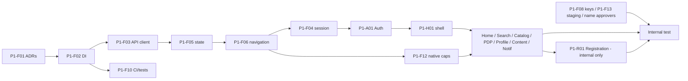

# Phase 1 Backlog — Foundation + Browse & Account (incl. Registration)

> **PLANNING DOCUMENT — NOT AN APPROVAL.** This backlog uses the 2026-10-13 user direction as **planning input**. That direction has **not** been recorded as a decision, and no approver identity has been established, so no item here is `APPROVED`. [PRD.md](../prd/PRD.md) v0.2 remains **DRAFT — NOT APPROVED FOR IMPLEMENTATION**. Implementation must not start until the PRD gates allow it; this document only prepares the plan.

**Prepared:** 2026-10-13 · **Inputs:** [PRD v0.2](../prd/PRD.md), [REQUIREMENT_TRACEABILITY](../prd/REQUIREMENT_TRACEABILITY.md), [DECISION_AND_GAP_INDEX](../prd/DECISION_AND_GAP_INDEX.md), [Prompt E recommendations](../audits/prompt-e/RECOMMENDED_ARCHITECTURE_CHANGES.md), [phase plan](PHASE_PLAN_AND_PHASE1_DECISIONS.md), and the 9 rule files in `gpos-b2b-mobile/mobile/.claude/rules/` (layer separation, component organization, form/validation with zod, naming, package boundaries, presentation structure, React Native, UI/business separation, UI components). The foundation tasks follow these rules.

## 1. Status vocabulary

| Status | Meaning |
|---|---|
| `PROVISIONAL-BASELINE` | Legacy behavior is used as a temporary implementation reference. This is **not** final approval. |
| `APPROVED` | An authorized approver explicitly approved it, and a decision record exists. **No item currently has this status.** |
| `PENDING-APPROVER` | A required approver or decision is missing. Work may proceed only where the "Proceed now?" column says so, and never as approval. |
| `BLOCKED` | Implementation or activation cannot proceed until the stated prerequisite is met. |
| `READY-FOR-INTERNAL-TEST` | A delivery status, allowed only when the §5 exit criteria are met. **No item currently has this status.** |

Direction used as provisional baseline: legacy behavior is the temporary reference, **except** unresolved security, regulatory/compliance and payment risks. For those, either a conservative interim default is used and labeled as such, or the item is blocked. Approval is never inferred from urgency, silence or legacy behavior.

## 2. Phase 1 scope (computed from the traceability matrix)

| Measure | Count |
|---|---|
| Requirements in Phase 1 modules and shared capabilities (AUTH, REG, HOME, SRCH, CAT, PDP, PROF, CONT, NOTIF + SHSESS, SHAPI, SHUI, SHOBS, SHVER, SHDEV, SHFILE) | 1064 |
| Implementable now (MIGRATION-CANDIDATE and not cart-deferred) | 960 |
| Excluded from Phase 1 (cart-deferred 41 + scope-pending or BLOCKED) | 104 |
| Acceptance criteria for these modules | 382 |
| — in scope for Phase 1 internal testing | 287 → **248** after the 2026-10-14 readiness correction (39 reclassified; §10.2) |
| — excluded (deferred/blocked requirement, or Prompt C Blocked/Conflicting) | 89 |
| — need owner rewording or a requirement link first | 6 |

Shared capabilities are built in Phase 1 but are also used by Phases 2–3. Only their Phase 1 behavior is in scope here.

**Cart-deferred requirements** (not activated in Phase 1; add-to-cart and transaction submission are off): BR-CAT-013, BR-CAT-017, BR-CAT-018, BR-CAT-022, BR-PDP-005, BR-PDP-008, BR-PDP-012, BR-PDP-013, BR-PDP-017, DATA-PDP-007, DATA-PDP-008, FR-CAT-017, FR-CAT-019, FR-HOME-009, FR-PDP-010, FR-PDP-013, FR-PDP-014, FR-PDP-015, FR-PDP-016, FR-PDP-018, FR-PROF-017, FR-SRCH-019, NAV-CAT-010, NAV-HOME-003, NAV-NOTIF-018, NAV-PDP-004, NAV-PDP-006, NAV-PROF-005, NAV-PROF-014, NAV-SRCH-005, UI-CAT-006, UI-PDP-009, UI-PDP-011, VAL-CAT-005, VAL-CAT-006, VAL-CAT-007, VAL-CAT-008, VAL-PDP-001, VAL-PDP-002, VAL-PDP-003, VAL-PDP-006.

## 3. Recommended task order

1. **Human prerequisites, started immediately in parallel:** P1-F08 (exposed keys), P1-F13 (staging, test accounts, distribution), and naming the approvers (§6).
2. **Foundation core:** P1-F01 → P1-F02 → P1-F03 → P1-F05 → P1-F06 → P1-F04 → P1-F10.
3. **Foundation support:** P1-F07, P1-F09, P1-F11, P1-F14, P1-F12.
4. **Features:** P1-A01 (auth) → P1-H01 (shell) → P1-H02, P1-S01, P1-C01, P1-D01 → P1-P01 → P1-N01, P1-N02 → P1-R01 (registration, internal test only).
5. **Internal test** against the §5 exit criteria.
6. **Not in Phase 1 internal test:** P1-H03 (blocked), P1-H04 (release only).

## 4. Backlog

| Task | Description | Source refs | Depends on | Acceptance criteria | Tests and evidence | Eligible once authorized? | Approval status | Responsible role (person: unset) | Blocker / resolution condition |
|---|---|---|---|---|---|---|---|---|---|
| P1-F01 | ADR baseline: record the target architecture decisions for Phase 1 (layering, service-object vs hook usecases, state/server-state approach, navigation, config), and reconcile the template rules with the README | Prompt E REC-01; ARCH-GAP-01; AE-DISC-02/03 | — | ADRs exist for each Phase 1 foundation choice and are accepted by the Tech lead | Document review | Yes | PENDING-APPROVER (Tech lead acceptance) | Tech lead | — |
| P1-F02 | Composition root and dependency injection; remove the `shared → packages/auth` import cycle | REC-02; ARCH-STR-001/002 | P1-F01 | No feature imports from `shared` back into packages; a single API client instance is injected; tsc and eslint pass | Unit tests with injected fakes; import-cycle check in CI | Yes | PENDING-APPROVER (Tech lead acceptance) | Tech lead | — |
| P1-F03 | API client: typed requests/responses, response headers captured (absent ≠ false), normalized error model (no swallowed errors), timeouts, cancellation; every contract tagged CLIENT-DERIVED | REC-03; ARCH-API-002/003/004; SHAPI (FR-SHAPI-001..010, BR-SHAPI-*); API-001..116 (Phase 1 subset); PRD-D10 | P1-F02 | Phase 1 endpoints typed; failed calls surface an error state instead of an empty list; header flags readable as unknown/true/false; contract tags present | Unit tests for error mapping and header capture; contract tests against staging (when available) | Yes (mechanism); contract content PENDING-APPROVER | PENDING-APPROVER (Backend/API owner: PRD-D10, SEG-A01) | Tech lead; Backend/API owner | Contract content stays CLIENT-DERIVED until Backend evidence (SEG-A01) is provided |
| P1-F04 | Session and token lifecycle: login, startup expiry check, refresh on 401 with single-flight replay, refresh failure → Login, logout; tokens in secure storage only (never plaintext AsyncStorage) | REC-04; ARCH-API-001, ARCH-SEC-001/002; SHSESS (FR-SHSESS-001..010, BR-SHSESS-*); MOD-01; PRD-D13, PRD-D26, DEC-027, DEC-037; SEG-A03 | P1-F02, P1-F03, P1-F05, P1-F06 | Session survives restart; 401 triggers exactly one refresh and replays; refresh failure clears session and returns to Login; no token value in AsyncStorage, logs or crash reports | Unit tests with mocked secure storage; integration tests on staging for refresh/expiry; log inspection | Yes, with an interim conservative default (secure storage, no token logging). This is not an approval of PRD-D26. | PENDING-APPROVER (Security owner: PRD-D26/DEC-027; Product + Security: PRD-D13; Backend: refresh contract SEG-A03) | Tech lead; Security owner; Backend/API owner | Refresh semantics need Backend confirmation (SEG-A03); final storage and clearing policy needs the Security owner |
| P1-F05 | App-scoped state conventions, server-state strategy (cache, refresh, pagination) and a session-end reset registry | REC-05; ARCH-STA-001/004; PRD-D13, DEC-036/037/089 | P1-F02 | Every app-scoped store registers a reset; logout and refresh failure clear all registered stores; list screens show loading, empty and error states | Unit tests for reset registry; component tests for list states | Yes (mechanism); clearing scope PENDING-APPROVER | PENDING-APPROVER (Product + Security: PRD-D13) | Tech lead | — |
| P1-F06 | Navigation foundation: navigation service/ref, typed route map, screen registry with scope flags (all 33 inactive screens, Stories, cart/transaction routes and Phase 2/3 routes flagged OFF), auth guard hook | REC-10; ARCH-NAV-001/002; PRD-D12, PRD-D16, DEC-004, DEC-009; PRD §9 | P1-F01 | Flagged-off routes cannot be reached from the UI, deep links or push; guard sends unauthenticated users to Login; dev/test routes absent | Unit tests for registry and guard; navigation tests | Yes | PENDING-APPROVER (Product owner: which screens are active, PRD-D12) | Tech lead; Product owner | — |
| P1-F07 | Configuration: flavors/variants (at least an internal-test variant separate from production), typed and validated env contract, no production endpoints in internal builds, no client secrets in the bundle | REC-07, REC-08 (structure only); ARCH-BLD-001/003, ARCH-SEC-004; DEC-098, DEC-099, PRD-D29; AE-GAP-03 | P1-F02 | Internal-test build points only at staging; env values validated at startup; production identity/signing values not used | Config unit tests; build inspection of bundled config | Yes (structure); production identity and signing values BLOCKED | BLOCKED for production values (Release/DevOps: DEC-098, DEC-099) | Tech lead; Release/DevOps owner | Production app id, signing key ownership and store continuity need Release/DevOps (SEG-E02, DEC-099) |
| P1-F08 | Exposed-key check: confirm whether the 32-character values in the tracked `gpos-b2b-mobile/mobile/.env.example` (lines 3 and 5) and the commented legacy key (`order_api_repository.dart` ≈432, SEC-06) are live; rotate if live; keep values out of tracked files | ARCH-SEC-005; SEC-06; SR-012/013; SEG-E03; PRD-D26 | — | Owner confirms liveness in writing; live keys rotated; tracked files contain placeholders only | Owner confirmation record; secret scan of repo and builds | No (human action required) | BLOCKED (Security owner + Backend/API owner) | Security owner; Backend/API owner | Must be resolved before any internal build is distributed outside the development team |
| P1-F09 | Observability port with redaction by default (no tokens, passwords, KTP/NIK or PII in logs); vendor wiring (Crashlytics, Analytics, OneSignal identity) behind the port | REC-09; SHOBS (FR-SHOBS-*, 45 events); SR-001..005; DEC-025, DEC-026, DEC-034; PRD-D26 | P1-F02, P1-F03 | Redaction tests pass; no remote logging of request headers or bodies; analytics events list matches the decision on DEC-025 | Unit tests for redaction; log inspection during internal test | Yes (port, redaction); vendors PENDING-APPROVER | PENDING-APPROVER (Security + Product: DEC-026, DEC-034; Product: DEC-025) | Tech lead; Security owner | Remote logging and tracking consent policy undecided |
| P1-F10 | CI pipeline and test harness: typecheck, lint, unit/component tests on every change; native-module mocks; test data conventions; staging-only integration test job | REC-06; ARCH-TST-001/002; PRD §17.4; PRD-D27 | P1-F02 | CI runs tsc, eslint and jest on every change and blocks merges on failure; native mocks available | CI run evidence | Yes (harness); CI host and secret store PENDING-APPROVER | PENDING-APPROVER (Release/DevOps: CI host; QA lead: AC→test strategy) | Tech lead; Release/DevOps owner; QA lead | — |
| P1-F11 | Design-system mapping and SHUI formatting: legacy theme tokens, Noto Sans weights, id_ID date/currency formatting, text-scale clamp, standard loading/empty/error components, testIDs | REC-16; ARCH-UIX-001; SHUI (FR-SHUI-*, BR-SHUI-*); DEC-100, DEC-030, PRD-D22 | P1-F02, P1-F05 | Phase 1 screens use the mapped tokens; currency and date output matches legacy examples; components carry testIDs | Component/snapshot tests for formatters and primitives | Yes (PROVISIONAL-BASELINE: legacy look as reference) | PROVISIONAL-BASELINE (final: Product/design DEC-100, DEC-030; Product/design + Finance PRD-D22) | Tech lead; Product owner (design) | — |
| P1-F12 | Native capabilities needed by Phase 1: deep/universal links, push (OneSignal) with central routing, in-app WebView, image/file picker and signed-URL upload, PDF viewer, file download/open, app version info | REC-14, REC-15; ARCH-BLD-006; SHDEV, SHFILE, MOD-17; PRD-D16, PRD-D17, PRD-D29; DEC-031/032/083/085/096/097 | P1-F06, P1-F07 | Each capability works on Android and iOS internal builds; push and link taps route via the navigation service; WebView limited per interim policy | Device tests (both platforms); unit tests for routing | Partly: links, picker/upload, PDF, download yes; push and associated domains need internal app registrations; WebView under interim allow-list | PENDING-APPROVER (Release/DevOps: registrations; Security + Product: PRD-D17 WebView policy; Tech lead + Product: PRD-D16) | Tech lead; Release/DevOps owner; Security owner | Interim WebView default: first-party hosts only (legacy hosts devb2b.gpos.id, b2b.gpos.id, order.gpos.id); arbitrary-URL loading not reproduced pending PRD-D17 |
| P1-F13 | Internal test environment: staging backend URL, test accounts (BUYER and PJ_RELASI, plus a newly registrable account), internal distribution channel and test devices | RISK B7; PRD-D27; SEG-B01..B04, SEG-B11, SEG-B13; D-GAP-03 | — | Staging reachable from internal builds; accounts documented in a secure store (not in the repo); testers can install builds | Access check record | No (human action required) | BLOCKED (Backend/API owner + QA lead + Release/DevOps) | Backend/API owner; QA lead; Release/DevOps owner | Without staging and test accounts no Phase 1 acceptance criterion can be executed |
| P1-F14 | Template pruning: remove or flag off the unrelated template packages (api-key, attribute, audit-log, permission-set, role, user, workflow, dashboard) from navigation and builds | REC-19; ARCH-MNT-* | P1-F06 | No template screens reachable in internal builds | Navigation tests | Yes | PROVISIONAL-BASELINE (engineering clean-up) | Tech lead | — |
| P1-A01 | Authentication UI: login, auto-login, user-type gate (BUYER / PJ_RELASI as in legacy), logout, forgot password, reset/change password via deep link, account activation via deep link | MOD-01 FR-AUTH-001..019 (BR-AUTH-001 and BR-AUTH-006 scope-pending); auth.md; SHSESS | P1-F03, P1-F04, P1-F06, P1-F12 | In-scope AC-AUTH criteria (24) pass on staging | Component tests; integration on staging; deep-link device tests | Yes | PROVISIONAL-BASELINE (user-type gate DEC/D-GAP-26 and vet channel DEC-001 PENDING-APPROVER) | Tech lead; Product owner | Vet channel: legacy forces `regular`; kept as baseline pending DEC-001 |
| P1-R01 | Registration: account registration, relation registration with document uploads, relation activation via deep link | MOD-02 FR-REG-001..017; registration.md; SHFILE (signed-URL upload); DEC-096, DEC-102; PRD-D24 | P1-F03, P1-F04, P1-F06, P1-F12 | In-scope AC-REG criteria (25) pass on staging with test data only | Component tests; upload tests; staging integration | Yes for internal testing only | BLOCKED for final approval and any non-internal use (Legal: PRD-D24 T&C; upload/size policy DEC-096; field rules DEC-102). Registration stays out of any release until Legal decides. | Tech lead; Legal; Product owner | T&C text contradicts the regulated workflow (PRD-D24, RMW-006); KTP/NIK is PII. Internal tests use test data only. |
| P1-H01 | App shell and bottom tabs (Home, Profile active; Pesanan and Pembayaran tabs flagged off until Phase 2) | MOD-03 FR-HOME-001..006; home-shell.md; PRD-D12 | P1-F06 | Shell renders; flagged tabs hidden; back behavior per legacy | Navigation and component tests | Yes | PROVISIONAL-BASELINE (tab visibility in Phase 1: Product owner, PENDING-APPROVER) | Tech lead; Product owner | — |
| P1-H02 | Home content: banner carousel, categories, wholesale, custom catalogs, principal catalog, "Semua Produk", best-selling, pop-up banner, gamification card (link to loyalty off until Phase 2). Product cards display-only: no add-to-cart, no floating cart. | MOD-03 FR-HOME-007..023 (excluding FR-HOME-009, FR-HOME-011, FR-HOME-020); UI-HOME-*; PRD-D06/D22/D25 (display only) | P1-F03, P1-F05, P1-F11 | In-scope AC-HOME criteria (27) pass on staging; no cart control present | Component tests; staging integration | Yes | PROVISIONAL-BASELINE (price display final: Finance/Commercial PRD-D06, D22, D25 PENDING-APPROVER) | Tech lead | — |
| P1-H03 | Home compliance pop-ups (Izin Operasional, APJ change, SIPA update, SIPA expiry) | FR-HOME-024..027, BR-HOME-006/007 (BLOCKED); PRD-D03, PRD-D14; PH-03 | — | — | — | No | BLOCKED (Compliance: may Phase 1 omit them? PH-03; policy PRD-D03/D14) | Compliance/pharmacy-domain owner | Regulated behavior: neither reproduced nor omitted without a Compliance answer to PH-03 |
| P1-H04 | Version check and update overlays (hard update, soft patch, restart) | FR-HOME-028/029 (scope-pending); SHVER FR-SHVER-005/006; PRD-D29 | P1-F07 | — | — | No (not needed for internal testing) | PENDING-APPROVER (Tech lead + Release/DevOps: PRD-D29, OTA replacement) | Tech lead; Release/DevOps owner | Needed only before a store release |
| P1-S01 | Search: landing (history, sponsored products), suggestions, results with filters; cart FAB hidden | MOD-04 FR-SRCH-001..018 (excluding FR-SRCH-019); search.md | P1-F03, P1-F05, P1-F06 | In-scope AC-SRCH criteria (23) pass on staging | Component tests; staging integration | Yes | PROVISIONAL-BASELINE | Tech lead | — |
| P1-C01 | Catalog: product lists by category, principal, banner, custom catalog and wholesale; filters and sort; banner content; display-only cards (no add-to-cart, no buy-plan sheet) | MOD-05 FR-CAT-* (excluding FR-CAT-017/019 and cart VAL/BR rows; BR-CAT-013 regulated BLOCKED); catalog.md | P1-F03, P1-F05, P1-F11 | In-scope AC-CAT criteria (35) pass on staging | Component tests; staging integration | Yes | PROVISIONAL-BASELINE | Tech lead | Regulated add-to-cart gating BR-CAT-013 stays BLOCKED (Phase 3) |
| P1-D01 | Product detail: detail display, prices and tiers (display only), wishlist toggle; no quantity entry, no add-to-cart, no package-group dialog | MOD-06 FR-PDP-001..009, 011, 012, 017, 019, 020 and display UI/BR rows (cart rows deferred; VAL-PDP-006/BR-PDP-005 BLOCKED); product-detail.md | P1-F03, P1-F05, P1-F11 | In-scope AC-PDP criteria (26) pass on staging | Component tests; staging integration | Yes | PROVISIONAL-BASELINE (tier-price display final: PRD-D06 PENDING-APPROVER) | Tech lead | Wishlist list screen belongs to MOD-07 (Phase 2); profile/notification links to it stay off |
| P1-P01 | Profile: account detail, phone and photo change, change password, user/relation list, feedback (list/detail/submit), FAQ, privacy policy, T&C, application guide (PDF), customer service, logout. APJ entry points hidden (Phase 3); cart icon and wishlist link hidden. | MOD-14 FR-PROF-* (excluding FR-PROF-017; BR-PROF-005/015 BLOCKED; NAV-PROF-008 scope-pending); profile.md; SHFILE | P1-F03, P1-F04, P1-F05, P1-F12 | In-scope AC-PROF criteria (57) pass on staging | Component tests; staging integration; upload/PDF device tests | Yes | PROVISIONAL-BASELINE (mock "data update" screens excluded pending DEC-002) | Tech lead; Product owner | — |
| P1-N01 | Content: news detail WebView and banner list; Stories excluded | MOD-16 FR-CONT-001..009 (Stories FR-CONT-010..021 scope-pending, DEC-004); content.md; PRD-D17 | P1-F06, P1-F12 | In-scope AC-CONT criteria (13) pass on staging | Component and device tests | Yes (WebView under interim first-party allow-list) | PROVISIONAL-BASELINE (WebView policy PRD-D17 PENDING-APPROVER; Stories DEC-004 PENDING-APPROVER) | Tech lead; Security owner; Product owner | — |
| P1-N02 | Notifications and deep links: push tap routing and deep links for Phase 1 targets via the navigation service; Phase 2/3 targets resolve to a "not available" result; local download notifications | MOD-17 FR-NOTIF-*, NAV-NOTIF-* (excluding NAV-NOTIF-018); notifications-deeplinks.md; PRD-D16; DEC-083, DEC-085 | P1-F06, P1-F12 | In-scope AC-NOTIF criteria (29) pass on devices with test pushes and links | Device tests on Android and iOS; routing unit tests | Partly (push needs internal registrations; universal links need association files) | PENDING-APPROVER (Product: DEC-083 login-gated links; Release/DevOps: DEC-085, SEG-B02) | Tech lead; Release/DevOps owner; Product owner | Universal/App Links require associated-domain files for the internal app id (SEG-B02) |

> **Column meaning (corrected 2026-10-14):** "Eligible once authorized?" was previously headed "Proceed now?". It says whether a task is *eligible* to start **after** a written implementation authorization (a limited authorization or PRD gate approval). It is **not** permission to start. No implementation authorization exists today (§10.1).

**Summary:** 26 tasks (14 foundation, 12 feature). Eligible under the provisional baseline or an interim default once authorized: 20. Partly: 2. Not eligible until a human action or decision: 4 (P1-F08, P1-F13, P1-H03, P1-H04).

### 4.1 Tasks eligible under the provisional baseline or interim defaults (once authorized; see §10.1)

P1-F01, F02, F03 (mechanism), F05, F06, F09 (port and redaction), F10 (harness), F11, F14; P1-A01, H01, H02, S01, C01, D01, P01, N01; F04 (interim secure storage); F07 (structure); F12 and N02 (partly); R01 (internal test only).

### 4.2 Tasks that need an explicit approval or human action

| Area | Items | Owner role |
|---|---|---|
| Security | P1-F04 storage and clearing policy (PRD-D26, DEC-027, PRD-D13), P1-F08 key liveness and rotation, P1-F09 remote logging and consent (DEC-026, DEC-034), P1-F12/N01 WebView policy (PRD-D17) | Security owner (role unassigned, SQ-001) |
| Legal | P1-R01 T&C text and consent before any non-internal use (PRD-D24) | Legal |
| Compliance | P1-H03 compliance pop-ups: omit in Phase 1 or include (PH-03, PRD-D03, PRD-D14) | Compliance/pharmacy-domain owner |
| Finance / Commercial | Price display rules on Home/Catalog/PDP (PRD-D06, D22, D25; display only) | Finance; Commercial/Pricing |
| Backend | Contract evidence (PRD-D10, SEG-A01), refresh contract (SEG-A03), staging (P1-F13) | Backend/API owner |
| Release / DevOps | Internal app registrations and distribution, CI host, production identity and signing (DEC-098, DEC-099, PRD-D29), associated domains (DEC-085) | Release/DevOps owner |
| Product | Phase boundaries PH-01..PH-06 (direction given but not recorded), active screens (PRD-D12), Stories (DEC-004), vet channel (DEC-001), tab visibility, login-gated links (DEC-083) | Product owner |

## 5. Phase 1 internal-testing exit criteria

All must be true before any item is marked `READY-FOR-INTERNAL-TEST`. **Meeting them does not mean production readiness**: store release also needs Phases 2–3 and PRD gates G1–G6.

| # | Criterion | Evidence |
|---|---|---|
| E1 | Staging backend and test accounts available; internal builds contain no production endpoints | P1-F13 record; build config inspection |
| E2 | Exposed-key question resolved: liveness confirmed by the owner, live keys rotated, tracked files hold placeholders only | P1-F08 owner record; secret scan |
| E3 | `tsc` 0 errors, `eslint` 0 errors and all test suites pass in CI on the release-candidate commit | CI run |
| E4 | Foundation tests pass: session (login, expiry, 401 refresh and replay, refresh failure, logout), error mapping, header capture (absent ≠ false), reset registry, navigation registry and guard, redaction | Test report |
| E5 | All **248** in-scope Phase 1 acceptance criteria (287 before the 2026-10-14 readiness correction, §10.2) executed on staging with recorded results, and every failure triaged. The list is in §8. | Test report mapped by AC ID |
| E6 | The 6 criteria needing owner rewording or linking are either fixed by the owner or explicitly excluded | Owner note |
| E7 | No token, password, KTP/NIK or other PII in device logs, AsyncStorage or crash/analytics payloads during the test | Log and storage inspection |
| E8 | Add-to-cart, cart, checkout and payment submission are absent; flagged-off routes (33 inactive screens, Stories, Phase 2/3 screens, dev/test routes) are unreachable from UI, deep links and push | Navigation tests; device checks |
| E9 | No `BLOCKED` item is enabled in the build (P1-H03, regulated gating, Registration outside internal test) | Build feature-flag inspection |
| E10 | Internal builds install and run on at least one Android and one iOS test device | Install record |
| E11 | Open blockers and pending approvals listed with owner roles at test start | This document updated |

## 6. Required human decisions (owner roles; persons not yet named)

| Decision / action | Owner role | Needed by |
|---|---|---|
| Name a person for each role (Product, Security, Legal, Compliance, Finance/Commercial, Backend/API, Release/DevOps, Tech lead, QA lead) | Project sponsor / Product owner | Before any approval |
| Record the phase direction (3 phases, Registration in Phase 1, store release after all phases) as decisions PH-05/PH-02/PH-04 | Product owner | Before Phase 1 approval |
| PH-01 (no add-to-cart in Phase 1), PH-06 (foundation work) | Product owner; Tech lead | Before Phase 1 approval |
| PH-03 compliance pop-ups in Phase 1 | Compliance/pharmacy-domain owner | Before Phase 1 approval |
| PRD-D10, SEG-A01, SEG-A03 contracts | Backend/API owner | Before Phase 1 exit |
| PRD-D13, PRD-D17, PRD-D26, DEC-026, DEC-027, DEC-034 | Security owner (+ Product) | Before Phase 1 exit |
| PRD-D24 T&C | Legal | Before Registration leaves internal testing |
| PRD-D12 (incl. DEC-001 vet, DEC-002 mock profile, DEC-004 Stories, DEC-009 dev routes) | Product owner | Before Phase 1 approval |
| DEC-098, DEC-099, PRD-D29, DEC-085 | Release/DevOps (+ Tech lead) | DEC-085: before link tests. Others: before store release |
| PRD-D06, PRD-D22, PRD-D25 (display) | Finance; Commercial/Pricing | Before Phase 1 approval |

## 7. Preserved risks (not resolved by this plan)

| Risk | Where tracked | Phase 1 handling |
|---|---|---|
| Potentially exposed API keys (RN `.env.example`; legacy commented key) | ARCH-SEC-005, SEC-06 | P1-F08 BLOCKED until owner action |
| Secure token storage | ARCH-SEC-001, PRD-D26 | Interim secure storage in P1-F04; policy PENDING-APPROVER |
| Session expiry and refresh | ARCH-API-001, SEG-A03, PRD-D13 | P1-F04; Backend confirmation pending |
| API error handling | ARCH-API-004 | P1-F03 normalized errors |
| Registration T&C | PRD-D24, RMW-006 | P1-R01 internal test only |
| Staging and test access | SEG-B*, PRD-D27 | P1-F13 BLOCKED until provided |
| Signing-key ownership | DEC-099, SEG-E02 | Production values BLOCKED (P1-F07); not needed for internal builds |
| Payment amount discrepancy (shown ≠ submitted) | DEF-NEW-PAY-02, PRD-D18 | Not in Phase 1 (Phase 2); must not **IN SCOPE (248, corrected 2026-10-14):** AC-AUTH-001, AC-AUTH-002, AC-AUTH-003, AC-AUTH-004, AC-AUTH-005, AC-AUTH-006, AC-AUTH-007, AC-AUTH-008, AC-AUTH-009, AC-AUTH-010, AC-AUTH-012, AC-AUTH-016, AC-AUTH-017, AC-AUTH-019, AC-AUTH-020, AC-AUTH-021, AC-AUTH-023, AC-AUTH-024, AC-AUTH-025, AC-AUTH-026, AC-AUTH-028, AC-AUTH-030, AC-CAT-001, AC-CAT-002, AC-CAT-003, AC-CAT-004, AC-CAT-005, AC-CAT-007, AC-CAT-008, AC-CAT-009, AC-CAT-010, AC-CAT-011, AC-CAT-012, AC-CAT-014, AC-CAT-015, AC-CAT-016, AC-CAT-017, AC-CAT-018, AC-CAT-019, AC-CAT-020, AC-CAT-023, AC-CAT-026, AC-CAT-030, AC-CAT-035, AC-CAT-036, AC-CAT-037, AC-CAT-038, AC-CAT-039, AC-CAT-040, AC-CAT-042, AC-CAT-044, AC-CAT-045, AC-CAT-046, AC-CONT-001, AC-CONT-002, AC-CONT-003, AC-CONT-004, AC-CONT-005, AC-CONT-006, AC-CONT-007, AC-CONT-008, AC-CONT-009, AC-CONT-010, AC-CONT-011, AC-CONT-012, AC-CONT-013, AC-HOME-004, AC-HOME-006, AC-HOME-007, AC-HOME-008, AC-HOME-010, AC-HOME-011, AC-HOME-012, AC-HOME-013, AC-HOME-015, AC-HOME-016, AC-HOME-017, AC-HOME-018, AC-HOME-019, AC-HOME-020, AC-HOME-029, AC-HOME-030, AC-HOME-033, AC-HOME-037, AC-HOME-038, AC-NOTIF-006, AC-NOTIF-007, AC-NOTIF-008, AC-NOTIF-009, AC-NOTIF-010, AC-NOTIF-011, AC-NOTIF-012, AC-NOTIF-013, AC-NOTIF-014, AC-NOTIF-015, AC-NOTIF-016, AC-NOTIF-019, AC-NOTIF-020, AC-NOTIF-021, AC-NOTIF-022, AC-NOTIF-023, AC-NOTIF-024, AC-NOTIF-025, AC-NOTIF-026, AC-NOTIF-027, AC-NOTIF-029, AC-NOTIF-030, AC-PDP-001, AC-PDP-002, AC-PDP-003, AC-PDP-004, AC-PDP-005, AC-PDP-006, AC-PDP-008, AC-PDP-009, AC-PDP-010, AC-PDP-011, AC-PDP-012, AC-PDP-013, AC-PDP-014, AC-PDP-015, AC-PDP-016, AC-PDP-023, AC-PDP-024, AC-PDP-025, AC-PDP-034, AC-PDP-036, AC-PDP-039, AC-PDP-042, AC-PROF-001, AC-PROF-002, AC-PROF-003, AC-PROF-004, AC-PROF-005, AC-PROF-006, AC-PROF-007, AC-PROF-013, AC-PROF-014, AC-PROF-015, AC-PROF-018, AC-PROF-019, AC-PROF-020, AC-PROF-021, AC-PROF-022, AC-PROF-023, AC-PROF-024, AC-PROF-025, AC-PROF-026, AC-PROF-027, AC-PROF-028, AC-PROF-029, AC-PROF-030, AC-PROF-031, AC-PROF-032, AC-PROF-033, AC-PROF-034, AC-PROF-035, AC-PROF-036, AC-PROF-038, AC-PROF-039, AC-PROF-040, AC-PROF-045, AC-PROF-046, AC-PROF-047, AC-PROF-048, AC-PROF-049, AC-PROF-050, AC-PROF-051, AC-PROF-052, AC-PROF-054, AC-PROF-055, AC-PROF-056, AC-PROF-057, AC-PROF-058, AC-PROF-059, AC-REG-001, AC-REG-002, AC-REG-003, AC-REG-004, AC-REG-005, AC-REG-006, AC-REG-008, AC-REG-010, AC-REG-011, AC-REG-012, AC-REG-013, AC-REG-014, AC-REG-015, AC-REG-016, AC-REG-017, AC-REG-019, AC-REG-020, AC-REG-021, AC-REG-022, AC-REG-023, AC-REG-025, AC-REG-026, AC-REG-027, AC-REG-029, AC-REG-030, AC-SHAPI-003, AC-SHAPI-004, AC-SHAPI-008, AC-SHDEV-001, AC-SHDEV-004, AC-SHFILE-001, AC-SHFILE-002, AC-SHFILE-005, AC-SHFILE-006, AC-SHFILE-007, AC-SHOBS-004, AC-SHSESS-001, AC-SHSESS-002, AC-SHSESS-003, AC-SHSESS-004, AC-SHSESS-005, AC-SHSESS-008, AC-SHUI-001, AC-SHUI-002, AC-SHUI-004, AC-SHUI-005, AC-SHUI-006, AC-SHUI-008, AC-SHVER-001, AC-SHVER-002, AC-SRCH-001, AC-SRCH-002, AC-SRCH-003, AC-SRCH-004, AC-SRCH-005, AC-SRCH-006, AC-SRCH-007, AC-SRCH-008, AC-SRCH-009, AC-SRCH-010, AC-SRCH-011, AC-SRCH-012, AC-SRCH-013, AC-SRCH-014, AC-SRCH-015, AC-SRCH-016, AC-SRCH-017, AC-SRCH-019, AC-SRCH-020, AC-SRCH-021, AC-SRCH-022, AC-SRCH-023, AC-SRCH-024

**NEEDS OWNER REWORD/LINK (6):** AC-HOME-039, AC-SHAPI-001, AC-SHAPI-002, AC-SHOBS-001, AC-SHVER-004, AC-SHVER-006

**EXCLUDED (Prompt C: Blocked by product/owner decision) (52):** AC-AUTH-011, AC-AUTH-015, AC-AUTH-018, AC-AUTH-022, AC-AUTH-027, AC-AUTH-029, AC-CAT-006, AC-CAT-013, AC-CAT-021, AC-CAT-022, AC-CAT-041, AC-CAT-043, AC-CONT-024, AC-CONT-025, AC-HOME-003, AC-HOME-009, AC-HOME-021, AC-NOTIF-005, AC-PDP-007, AC-PDP-017, AC-PDP-018, AC-PDP-035, AC-PDP-040, AC-PDP-041, AC-PROF-037, AC-PROF-053, AC-REG-007, AC-REG-009, AC-REG-018, AC-REG-024, AC-REG-028, AC-SHAPI-005, AC-SHAPI-006, AC-SHAPI-007, AC-SHDEV-002, AC-SHDEV-003, AC-SHDEV-007, AC-SHFILE-003, AC-SHFILE-004, AC-SHFILE-008, AC-SHFILE-009, AC-SHOBS-002, AC-SHOBS-003, AC-SHOBS-005, AC-SHOBS-006, AC-SHSESS-006, AC-SHSESS-007, AC-SHSESS-010, AC-SHUI-003, AC-SHUI-007, AC-SHVER-007, AC-SRCH-018

**EXCLUDED (Prompt C: Conflicting) (8):** AC-CAT-025, AC-HOME-022, AC-HOME-023, AC-HOME-024, AC-HOME-025, AC-HOME-027, AC-PDP-020, AC-SHDEV-006

**EXCLUDED (deferred/blocked/scope-pending requirement) (28):** AC-CAT-031, AC-CAT-032, AC-CAT-033, AC-CAT-034, AC-CONT-014, AC-CONT-015, AC-CONT-016, AC-CONT-017, AC-CONT-018, AC-CONT-019, AC-CONT-020, AC-CONT-021, AC-CONT-022, AC-CONT-023, AC-CONT-026, AC-CONT-027, AC-HOME-014, AC-HOME-031, AC-HOME-032, AC-PDP-019, AC-PDP-022, AC-PDP-026, AC-PDP-027, AC-PDP-028, AC-PDP-029, AC-PDP-030, AC-PDP-031, AC-PDP-032

**EXCLUDED (Prompt C: Blocked by external evidence) (1):** AC-SHDEV-005

## 9. Open questions and discrepancies

| # | Question / discrepancy | Owner role |
|---|---|---|
| Q1 | The target "Phase 1 ready for internal testing next week" depends on P1-F13 (staging/accounts) and P1-F08 (keys), which are human actions with no committed date. The timeline is not guaranteed. | Product owner; Backend; Security |
| Q2 | The user direction (3 phases, Registration in Phase 1, release after all phases, legacy baseline) is planning input only. It must be recorded as decisions by a named approver. | Product owner |
| Q3 | Should the Pesanan and Pembayaran tabs be hidden or shown as "coming soon" in Phase 1? | Product owner |
| Q4 | Is the internal-test app id separate from `com.dexagroup.gposb2b`? This needs the push and associated-domain registrations. | Release/DevOps |
| Q5 | The interim WebView allow-list (first-party hosts) changes legacy behavior for arbitrary `/banner` links. Is it acceptable for internal testing? | Security owner; Product owner |
| Q6 | The earlier proposal used Phases 0–3; this plan merges Phase 0 into Phase 1. The workbooks are still grouped as "Phase 1" and remain valid. | Product owner |
| Q7 | Auto-approval was suggested in conversation, but no approver is named. Nothing is marked `APPROVED`; statuses use PROVISIONAL-BASELINE / PENDING-APPROVER instead. | Product owner |
| Q8 | Six Phase 1 ACs need rewording or linking (Prompt C ambiguous/orphan). Owner action is needed before E6. | Requirements lead |

## 10. Readiness gate review (2026-10-14)

Read-only assessment of whether Phase 1 work can begin. Inputs: this backlog, [phase plan](PHASE_PLAN_AND_PHASE1_DECISIONS.md), [README](README.md), [PRD v0.2](../prd/PRD.md) §5, §9, §12A, §22, [Prompt E](../audits/prompt-e/README.md), and the 9 rule files in `gpos-b2b-mobile/mobile/.claude/rules/`. **Outcome: no implementation task may begin today.** No written implementation authorization exists, no approver is named, and the PRD is DRAFT — NOT APPROVED FOR IMPLEMENTATION.

### 10.1 Task classification

| Class | Tasks | Why |
|---|---|---|
| **A. Safe to prepare now (no application change)** | Draft ADRs for P1-F01 (stored outside the app repo, e.g. a planning area, until accepted); P1-F10 test strategy and AC→test mapping; P1-F07 env-contract and variant design (names only, no values); P1-F06 route/scope-flag registry spec (which routes are ON/OFF in Phase 1); P1-F11 legacy-token mapping table; owner requests for P1-F08, P1-F13, Q3, Q4 and the six ACs (§10.3) | Documentation and requests only. Nothing in the RN or legacy repos changes. |
| **B. Eligible only after a limited written authorization** | P1-F02, P1-F03 (mechanism only), P1-F05, P1-F06, P1-F10 (harness), P1-F14, then P1-F04 (interim secure storage), P1-F07 (structure, internal variant only), P1-F09 (port and redaction), P1-F11 | Engineering foundation with no business policy decided. The authorization must name these tasks and their exclusions (§10.5). It does not approve any PRD decision. |
| **C. Blocked (human action or evidence missing)** | P1-F08 (exposed keys: Security + Backend); P1-F13 (staging, test accounts, distribution: Backend + QA + Release/DevOps); internal app identity and internal signing for builds (Release/DevOps, Q4); P1-F12 push and associated domains (Release/DevOps registrations; Security + Product for the WebView policy PRD-D17); P1-H03 (Compliance, PH-03); P1-H04 (release only); every feature task P1-A01…P1-R01 (needs Phase 1 PRD approval or an explicit feature-level authorization, plus the foundation and staging for testing) | See §6 and §7 |

**First foundation tasks: dependency and AC check.**
- P1-F01 (none) → P1-F02 (F01) → P1-F03 (F02) → P1-F05 (F02) → P1-F06 (F01) → P1-F04 (F02, F03, F05, F06) → P1-F10 (F02).
- The dependency chain is acyclic and consistent with Prompt E REC-01..06/10.
- Each task's acceptance criterion is objective and testable (tests or CI evidence named).
- Gap: P1-F01's criterion ("accepted by the Tech lead") cannot be met until a Tech lead is named.

### 10.2 Correction: Phase 1 AC scope (287 → 248)

The original §8 rule placed an AC in scope when *any* linked requirement was in Phase 1. On review, 39 of those ACs expect behavior that Phase 1 must not have, or that is blocked or undecided. Keeping them would contradict exit criteria E8 and E9. They are reclassified below. None of them is deleted or rewritten; each is retained in the PRD.

| Reason | ACs |
|---|---|
| Cart / transaction behavior (add-to-cart off in Phase 1) | AC-CAT-027, AC-CAT-028, AC-CAT-029, AC-PDP-021, AC-PDP-033, AC-PDP-037, AC-PDP-038, AC-PROF-016, AC-PROF-017 |
| Destination is a Phase 2/3 screen (Orders, Invoices, Loyalty); a Phase 1 fallback would be new behavior, PENDING-APPROVER (Product owner, DEC-083) | AC-AUTH-013, AC-AUTH-014, AC-NOTIF-001, AC-NOTIF-002, AC-NOTIF-003, AC-NOTIF-004, AC-NOTIF-017, AC-NOTIF-018, AC-NOTIF-028, AC-SHSESS-009 |
| Regulated / APJ / SIPA behavior (Phase 3 or BLOCKED; APJ entry points hidden in Phase 1) | AC-CAT-024, AC-HOME-026, AC-HOME-028, AC-PROF-008, AC-PROF-009, AC-PROF-010, AC-PROF-011, AC-PROF-012, AC-PROF-041, AC-PROF-042, AC-PROF-043, AC-PROF-044 |
| Update overlays (P1-H04, not in Phase 1 internal test) | AC-HOME-034, AC-HOME-035, AC-HOME-036, AC-SHVER-003, AC-SHVER-005 |
| Tab visibility undecided (4 tabs incl. Pesanan and Pembayaran; backlog Q3) | AC-HOME-001, AC-HOME-002 |
| Home init loads the cart (FR-HOME-007 calls the cart API; conflicts with no-cart Phase 1) | AC-HOME-005 |

AC-HOME-001/002 and AC-HOME-005 return to scope (or get a Phase 1 variant) once the Product owner answers Q3 (tab visibility) and decides whether Home may read the cart in Phase 1 (§10.6 C3).

### 10.3 The six ACs needing owner action

| AC | Problem (Prompt C) | Exact owner action | Owner role |
|---|---|---|---|
| AC-HOME-039 | Ambiguous: the Then is an internal contract ("MOD-08 reads `DashboardBloc.isSipaExpired`"), and the trigger "cart opened" is a Phase 2 surface | Rewrite as an observable outcome, or move it to Phase 2/3 with the cart/regulated ACs | Requirements lead (+ Compliance for the SIPA meaning) |
| AC-SHAPI-001 | Ambiguous: "shows its configured error" is not defined per module | List the expected error text or presentation for each Phase 1 module, or reference each module's error AC | Requirements lead + Product owner |
| AC-SHAPI-002 | Ambiguous: "generic error (no crash)" is not defined | Specify the generic error message and the retry/back behavior | Requirements lead + Product owner |
| AC-SHOBS-001 | Ambiguous: covers every event in §7.1, including invalid names | Decide DEC-025 (which events to keep or fix), then split into per-event ACs for the Phase 1 events | Product owner (analytics) + Requirements lead |
| AC-SHVER-004 | Ambiguous: describes the legacy Shorebird double-restart mechanism | Not needed for Phase 1 internal test (P1-H04). Reword after PRD-D29 (OTA replacement). | Tech lead + Release/DevOps; Requirements lead |
| AC-SHVER-006 | Missing/invalid requirement link; effect is `PO-DECISION-REQUIRED` (DEF-03-19) | Link to a requirement and decide the effect of a `/client-versions` failure on Home state (P1-H04 scope) | Product owner; Requirements lead |

### 10.4 Cart, checkout and out-of-scope activation check

| Control in the plan | Status | Gap |
|---|---|---|
| Add-to-cart, buy-plan sheet, quantity entry, cart FAB and icon are deferred (41 requirements, §2) | Planned | Corrected AC scope (§10.2) now matches |
| Scope flags OFF for the 33 inactive screens, Stories, Phase 2/3 routes and dev/test routes; guard on UI, deep link and push (P1-F06, E8) | Planned | The registry spec (class A) must list every route with an ON/OFF value before P1-F06 starts |
| Checkout and transaction submission: no Phase 1 task implements API-047 (checkout), API-070 (payment), API-041 (redeem) or API-011/012/014 (cart writes) | Consistent | Add a CI check that these operation IDs are not referenced by Phase 1 code (proposed, not yet in E3/E4) |
| Home init cart read (FR-HOME-007 → API-010) | **Conflict** | §10.6 C3: Product owner decision |
| Deep links and push to Orders, Invoices, Loyalty, APJ | **Conflict** | The fallback ("not available") is new behavior: §10.6 C4 |

### 10.5 Internal vs production app identity

- **Production identity:** `com.dexagroup.gposb2b` on both platforms, with the legacy signing key (DEC-099; owner unknown, SEG-E02). Must **not** be used for internal builds. An internal build with the production id would overwrite or collide with the live app on testers' devices.
- **Current RN identity:** the template ids `com.hexenrn` / `org.reactjs.native.example.*` (ARCH-BLD-001). These are neither production nor an agreed internal identity.
- **Internal identity:** **not decided** (Q4). Release/DevOps must define a distinct internal id, internal signing, and an internal OneSignal/Firebase registration.
- **Deep links:** internal-id associations should go only on a non-production domain (e.g. `devb2b.gpos.id`). The production domain `b2b.gpos.id` association files must not change for internal testing.
- The backlog keeps these apart (P1-F07: "production identity/signing values not used"). No confusion was found, but the internal identity itself is a missing decision and blocks E10.

### 10.6 Conflicts between this backlog and the PRD (recorded, not resolved)

| # | Conflict | PRD reference | Resolution owner |
|---|---|---|---|
| C1 | Backlog tasks were marked "Proceed now: Yes" while the PRD says DRAFT — NOT APPROVED FOR IMPLEMENTATION and §22 gates are NOT PASSED | PRD §1, §22 | Corrected in §4 (column now "Eligible once authorized?"); authorization needed from Product owner + Tech lead |
| C2 | Phase 1 hides the Pesanan and Pembayaran tabs; the PRD migration-candidate shell has 4 tabs (FR-HOME-001..004, AC-HOME-001/002) | PRD §8 MOD-03 | Product owner (Q3) |
| C3 | FR-HOME-007 (Home init loads the cart) is a migration candidate, but Phase 1 has no cart | PRD §8 MOD-03; §18 D-03 | Product owner (extend PH-01) |
| C4 | Deep links and push for Orders, Invoices, Loyalty and APJ are migration candidates (MOD-17), but their destinations are Phase 2/3; a Phase 1 fallback is new behavior | PRD §9; DEC-083 | Product owner |
| C5 | APJ/SIPA badges and the APJ section on Profile (BR-PROF-003/016) are migration candidates, but APJ is Phase 3 and BR-PROF-005/015 are BLOCKED | PRD §14; MOD-14/15 | Product owner + Compliance |
| C6 | The PRD lists the version gate (SHVER) as a migration candidate; Phase 1 internal test excludes the update overlays (P1-H04) | PRD §5 SHVER | Tech lead + Release/DevOps (PRD-D29) before release |
| C7 | Registration is in Phase 1 by direction, but PRD-D24 (T&C) is open and RMW-006 says the T&C contradicts the app | PRD §14, §21 | Legal (P1-R01 stays internal-only) |

### 10.7 Proposed day-by-day sequence (ALL DATES UNCOMMITTED)

Today is Wed 2026-10-14. "Next week" is read as Mon 19 – Fri 23 Oct. Every day depends on the previous one and on the external items marked ⚠.

| Day | Date | Work (only if the precondition holds) | Precondition / external dependency |
|---|---|---|---|
| D0 | Wed 14 Oct | Class A preparation. Send owner requests: authorization, named approvers, keys, staging, internal identity, distribution, Q3/Q4, six ACs. | — |
| D1 | Thu 15 Oct | P1-F01 ADRs accepted; P1-F02 DI and cycle removal; P1-F14 template pruning | ⚠ Written limited authorization + named Tech lead |
| D2 | Fri 16 Oct | P1-F03 API client (mechanism); P1-F05 state and reset registry | D1 |
| D3 | Mon 19 Oct | P1-F06 navigation registry and guard; P1-F10 CI and test harness | ⚠ Route ON/OFF spec agreed; ⚠ CI host (Release/DevOps) |
| D4 | Tue 20 Oct | P1-F04 session (interim secure storage); P1-F07 config structure; P1-F09 redaction port | ⚠ Refresh contract or staging access (Backend, SEG-A03) |
| D5 | Wed 21 Oct | P1-F11 tokens and formatters; feature work may start **only** with a feature-level authorization: P1-A01 Auth | ⚠ Feature authorization; ⚠ staging + test accounts (P1-F13) |
| D6 | Thu 22 Oct | P1-H01 shell, P1-H02 Home, P1-S01 Search | ⚠ Q3 tabs; C3 Home cart read |
| D7 | Fri 23 Oct | P1-C01 Catalog, P1-D01 PDP; first internal build **candidate** | ⚠ Internal identity + signing + distribution (Q4); ⚠ keys resolved (P1-F08) |
| After | 26 Oct → | P1-P01 Profile, P1-N01 Content, P1-N02 Notifications, P1-R01 Registration (internal only); run the 248 in-scope ACs; E1–E11 | ⚠ Push/link registrations; ⚠ Legal for Registration beyond internal |

**Schedule realism:** full Phase 1 internal-test readiness (all E1–E11, 248 ACs) by Fri 23 Oct is unlikely. A realistic "next week" milestone is: foundation complete, Auth plus read-only Home/Search/Catalog/PDP on an internal build, provided every ⚠ dependency is met by its day. A slip in any ⚠ item moves every later day.

### 10.8 Evidence required

**Before the first implementation task (P1-F02):**
1. A written limited implementation authorization stored as `decisions/AUTH-P1-FOUNDATION.md`. It must be written by the authorizer, not by Claude. It must state:
   - the authorizer's name and role, and the date;
   - the tasks authorized (class B list) and the repo/branch;
   - exclusions: no business features, no production identity/signing/config, no secrets in the repo, no cart/transaction/regulated code;
   - that it does not approve any PRD decision.
2. A named Tech lead, who accepts the P1-F01 ADRs.
3. A branch plan that preserves the user's uncommitted edits in `gpos-b2b-mobile/mobile` (`.vscode/settings.json`, `package-lock.json`). The user commits or stashes them; Claude does not.
4. The 9 `.claude/rules/` files acknowledged as the coding rules (layer separation, naming, zod forms, atomic components).

**Before the first internal test build:**
1. E2: exposed-key liveness resolved by the owner (P1-F08).
2. Internal app identity, internal signing and a distribution channel defined by Release/DevOps (Q4). The production identity is not used.
3. E1: staging URL and test accounts available (P1-F13); the build contains no production endpoints.
4. E3/E4: CI green; foundation tests pass.
5. E7: redaction verified.
6. E8/E9: scope flags verified against the route ON/OFF spec; no BLOCKED item enabled.
7. A feature-level authorization for whichever feature tasks the build contains.
8. If the build is meant to test push or deep links: internal OneSignal/Firebase registrations and non-production domain association files.

